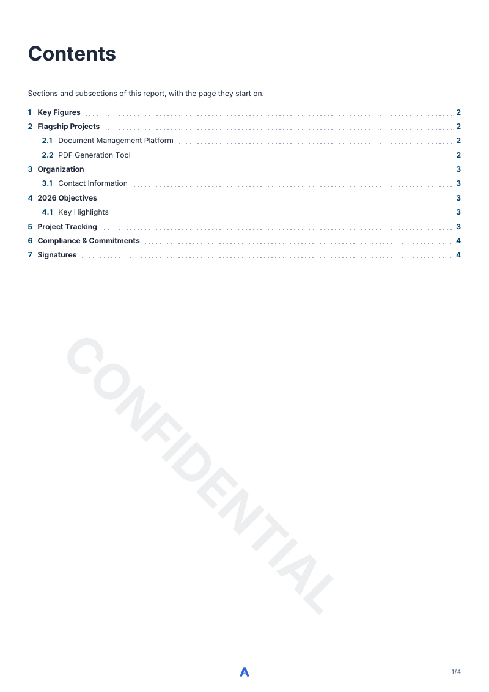
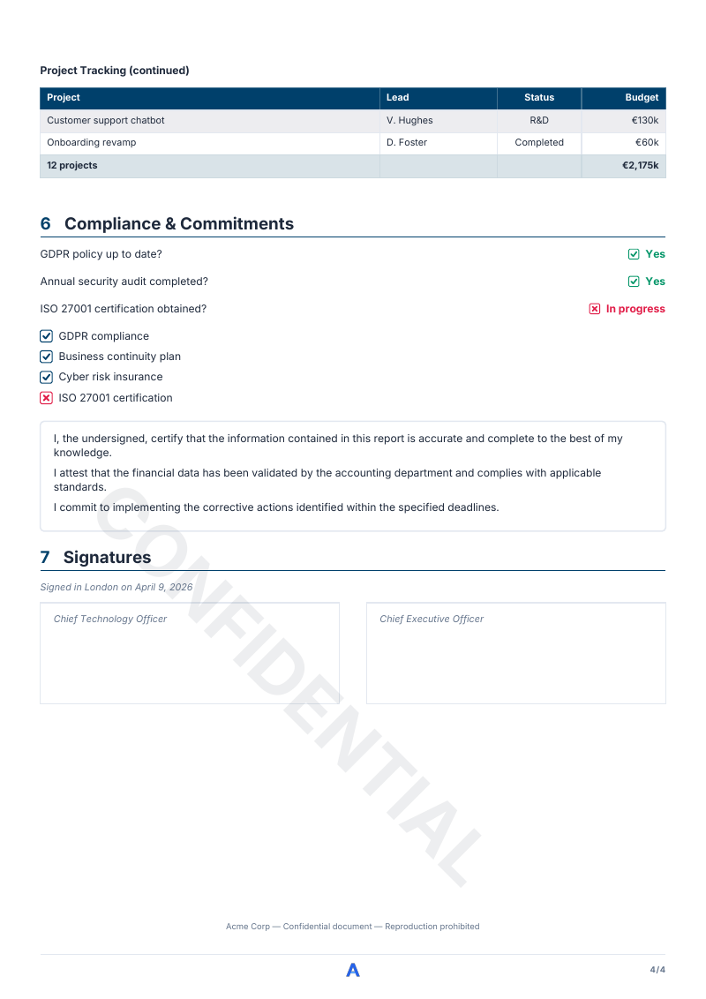
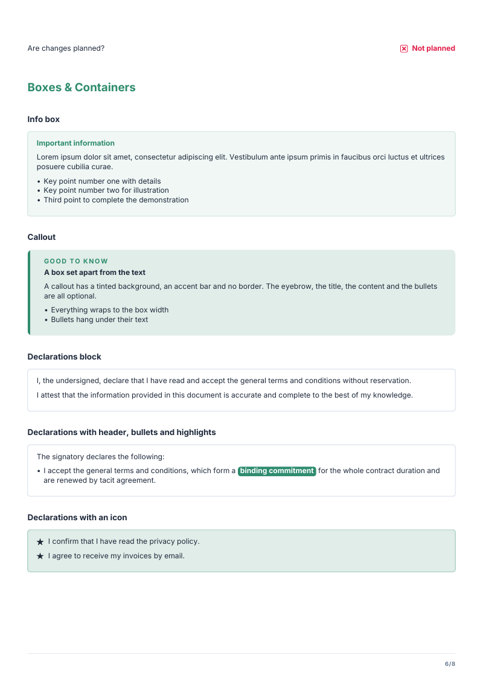
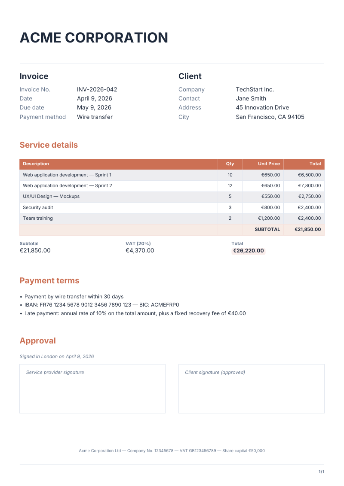
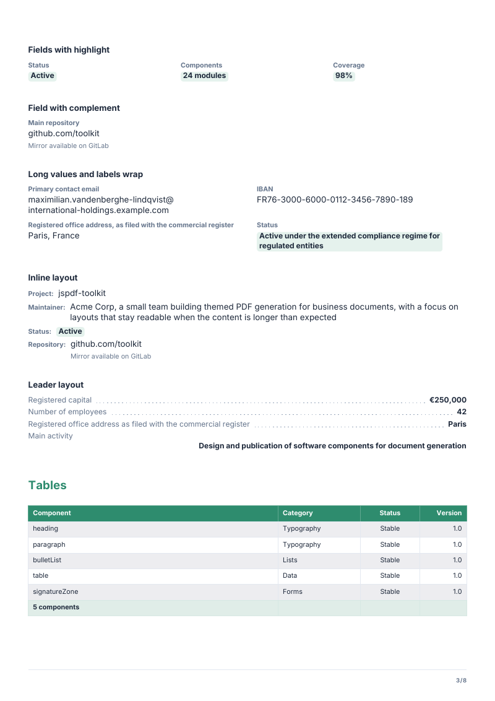
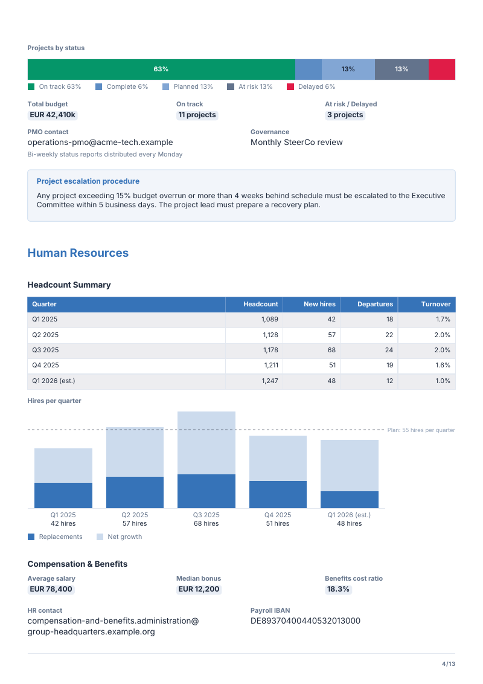
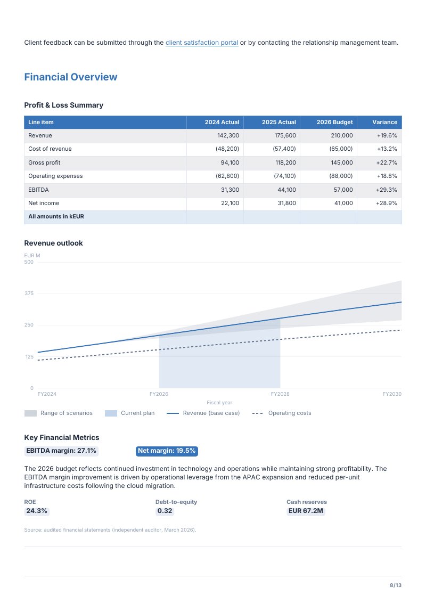

# @mlt-a/jspdf-toolkit

[](https://www.npmjs.com/package/@mlt-a/jspdf-toolkit)
[](https://github.com/mlt-a/jspdf-toolkit/actions/workflows/ci.yml)
[](LICENSE)
[](#install)
[](https://mlt-a.github.io/jspdf-toolkit/)

Themed PDF generation on top of [jsPDF](https://github.com/parallax/jsPDF). A fluent, typed API draws headings,
paragraphs, tables, forms, boxes and cover pages from one design system: pick a color, get a coherent document.

<p align="center">
  
  
  
  
</p>

**[Component pages](docs/components/README.md)**: one page per component, with an example, its rendering, every option
and the rules to know.

## Features

- One primary color derives a 15-token palette (WCAG contrast aware); 10 presets included.
- Automatic pagination: page breaks, headings kept with the block that follows, table continuation.
- Table of contents, running header and footer, page numbers, watermark, cover and back cover.
- Forms and legal blocks: fields, checkboxes, declarations, address blocks, signature zones.
- Charts drawn with plain PDF paths: donut, stacked bar, columns and lines, in the theme colors.
- Runs in Node and in the browser. Helvetica by default, Inter opt-in, any TTF on request.
- Typed end to end; invalid configuration throws a typed error, asset problems become warnings.

## Install

```bash
pnpm add @mlt-a/jspdf-toolkit jspdf   # or: npm install … / yarn add …
```

- `jspdf` (^4.2.1) is the only peer dependency; the package has no runtime dependency of its own.
- ESM only. Node >= 20, or any bundler.
- Entry points:

| Import                             | Content                                                           |
| ---------------------------------- | ----------------------------------------------------------------- |
| `@mlt-a/jspdf-toolkit`             | Document, themes, drawing primitives, loaders. Browser-safe.      |
| `@mlt-a/jspdf-toolkit/node`        | `loadImageFromPath`, `loadFontFromPath`. The only `node:fs` user. |
| `@mlt-a/jspdf-toolkit/fonts/inter` | `interFonts`: Inter (regular, bold, italic) as `FontSource[]`.    |

## Quick start

```ts
import { writeFileSync } from 'node:fs';
import { PDFDocument, presetTheme } from '@mlt-a/jspdf-toolkit';

const doc = new PDFDocument({ theme: presetTheme('ocean'), title: 'Invoice INV-042' });

doc
  .heading('Invoice INV-042')
  .paragraph('Thank you for your business. Payment is due within 30 days.')
  .fields([
    { label: 'Client', value: 'TechStart Inc.' },
    { label: 'Date', value: 'April 9, 2026' },
    { label: 'Status', value: 'Paid', highlight: true },
  ])
  .heading('Services', { level: 'h2' })
  .table(
    [
      { description: 'Design', qty: 5, total: '$2,750.00' },
      { description: 'Audit', qty: 3, total: '$2,400.00' },
    ],
    {
      columns: [
        { header: 'Description', key: 'description' },
        { header: 'Qty', key: 'qty', width: 15, align: 'center' },
        { header: 'Total', key: 'total', width: 30, align: 'right' },
      ],
      footRow: ['', 'Total', '$5,150.00'],
    },
  )
  .infoBox('Bank transfer, 30 days net.', { title: 'Payment' });

writeFileSync('invoice.pdf', doc.toBuffer());
```

The [invoice example](src/examples/invoice.ts) takes the same calls further:

<p align="center">
  
</p>

Every fluent method returns the document, so calls chain. Most take their content first and an optional options
object last; a method without content, such as `separator`, `addPage` or `tableOfContents`, takes only the options.

## Node and browser

The main entry point never touches the file system, so it bundles for the browser as is. Images are data URIs; fonts are
`FontSource` objects. Load them from wherever your runtime allows:

| Where | Images                                                                      | Fonts                                                                         |
| ----- | --------------------------------------------------------------------------- | ----------------------------------------------------------------------------- |
| Node  | `loadImageFromPath(path, options?)` from `/node`                            | `loadFontFromPath(path, { family, style })` (`/node`)                         |
| Any   | `loadImageFromBase64(data, { mimeType? })`, `loadImageFromBinary(bytes, …)` | `loadFontFromBase64(data, { family, style })`, `loadFontFromBinary(bytes, …)` |

`mimeType` is sniffed from the data when omitted (PNG, JPEG, GIF, WebP, BMP). The five formats are drawn; only PNG keeps
its transparency, a transparent GIF, WebP or BMP is drawn on a solid background. The image loaders throw
`AssetLoadError` for data that is empty or not base64, or of a type they do not recognize: pass `mimeType` for another
format. Register an image once with `registerImage`, then name it in every image option (`icon`, `logo`, `image`,
`background`); a data URI works there too.

```ts
import { writeFileSync } from 'node:fs';
import { PDFDocument, presetTheme } from '@mlt-a/jspdf-toolkit';
import { loadFontFromPath, loadImageFromPath } from '@mlt-a/jspdf-toolkit/node';

const doc = new PDFDocument({
  theme: presetTheme('slate', { typography: { fontFamily: 'Brand' } }),
  fonts: [
    loadFontFromPath('./Brand-Regular.ttf', { family: 'Brand' }),
    loadFontFromPath('./Brand-Bold.ttf', { family: 'Brand', style: 'bold' }),
  ],
});

doc.registerImage('logo', loadImageFromPath('./logo.png'));
doc.logo('logo', { height: 12 }).heading('Brand report');

writeFileSync('brand.pdf', doc.toBuffer());
```

In the browser, `toBlob()` and `toDataUri()` replace the Node buffer. This one downloads a PDF with a logo fetched from
your server:

```ts
// browser only
import { PDFDocument, createTheme, loadImageFromBinary } from '@mlt-a/jspdf-toolkit';

export async function downloadReport(): Promise<void> {
  const response = await fetch('/logo.png');
  const logo = loadImageFromBinary(new Uint8Array(await response.arrayBuffer()));

  const doc = new PDFDocument({ theme: createTheme({ colors: { primary: '#0F766E' } }) });
  doc.logo(logo, { height: 12 }).heading('Hello from the browser').paragraph('Generated client side.');

  const url = URL.createObjectURL(doc.toBlob());
  const link = document.createElement('a');
  link.href = url;
  link.download = 'report.pdf';
  link.click();
  URL.revokeObjectURL(url);
}
```

## Fonts

- **Default: Helvetica**, built into jsPDF. Nothing is embedded, which keeps files small, but it covers WinAnsi
  characters only (Western European languages). Anything else needs an embedded font.
- **Inter** is opt-in through its own entry point, so its ~660 KB of base64 only enters your bundle when you import it.
  The first family in `fonts` becomes the default family, so passing `interFonts` is enough (`INTER_FAMILY` is its name,
  `'Inter'`):

```ts
import { PDFDocument } from '@mlt-a/jspdf-toolkit';
import { interFonts } from '@mlt-a/jspdf-toolkit/fonts/inter';

const doc = new PDFDocument({ fonts: interFonts });
```

- **Custom fonts**: pass TTF files, one `FontSource` per face, built with the `loadFontFrom*` functions. `style` is
  `'normal' | 'bold' | 'italic' | 'bolditalic'` and defaults to `'normal'`.
- The theme only names families: `typography.fontFamily` (default family), `titleFontFamily` (h1, h2 and cover titles)
  and `labelFontFamily` (labels and field names). A family that is neither built in nor registered throws an
  `InvalidOptionError` at construction. Registered fonts that the theme never uses, and missing faces, are reported in
  `doc.warnings`.

## Theming and presets

`createTheme(overrides?)` builds a `Theme`; every color of the document comes from it.

```ts
import { createTheme } from '@mlt-a/jspdf-toolkit';

const theme = createTheme({
  name: 'corporate',
  colors: { primary: '#1E40AF', text: '#0F172A' }, // the other tokens are derived
  typography: { sizes: { h2: 16 }, lineHeightFactor: 1.35, levels: { h2: { color: 'text' } } },
  spacing: { block: 5, heading: { h2: { before: 16 } } }, // mm
  chrome: { uppercase: false }, // running header and footer look
});
```

| Override     | Content                                                                                                |
| ------------ | ------------------------------------------------------------------------------------------------------ |
| `name`       | Free label. Default `'custom'`.                                                                        |
| `colors`     | Any `ColorPalette` token. `primary` defaults to `#2563EB`; tokens left out are derived from it.        |
| `typography` | `fontFamily`, `titleFontFamily`, `labelFontFamily`, `sizes`, `weights`, `lineHeightFactor`, `levels`.  |
| `spacing`    | `block` (space under a block, default 4 mm) and `heading` (`before` and `after` of each level), in mm. |
| `assets`     | `footerLogo` (default logo of `pageFooter`), `backgroundOffsetY`, `covers` (layouts of image covers).  |
| `chrome`     | `uppercase` (default `true`) and `tracking` (mm) of the running header and footer.                     |

Colors are `#RGB` or `#RRGGBB`. An invalid one throws an `InvalidColorError` carrying the value (and the token, for a
theme color). A value you leave `undefined` keeps its default, at every depth of the overrides.

### Text levels

`typography.sizes` sets the size (pt) of the text levels: `bodyBold` takes the size of `body`, `smallMuted` and
`italic` that of `small`. `typography.levels` restyles the level itself: `color` (a palette token or a hex color),
`bold`, `italic` and `font` (`'body'`, `'title'` or `'label'`, the family it is set in).
What a level leaves out keeps its built-in style. Every block set in that level follows: paragraphs, headings, table
cells, fields, boxes, and `measureTextLevel`.

```ts
import { PDFDocument, createTheme } from '@mlt-a/jspdf-toolkit';

const doc = new PDFDocument({
  theme: createTheme({
    typography: {
      sizes: { small: 9 }, // table cells and notes
      levels: {
        h2: { color: 'text' }, // section headings in the text color rather than the primary one
        small: { italic: true },
      },
    },
  }),
});
doc.heading('Terms', { level: 'h2' }).paragraph('Set in `small`, italic.', { level: 'small' });
```

A size that is not finite or not above 0, a color that is not a token or a hex color, a `bold` or `italic` that is not
a boolean, an unknown `font` or level, and a weight face other than `'normal'` or `'bold'` throw when the theme is
created (an `InvalidOptionError`, an `InvalidColorError` for a color, which names the setting it was written in). A
spacing of 0 is valid, a font size of 0 is not.

An emphasis that a block asks for wins over the level: `bold: false` or `italic: false` in a table `cellStyle` removes
the weight or the slant a level gives, `true` adds it, and leaving it out lets the level decide. The unmarked words of
a rich text keep the weight of their level, and `**…**` makes them bold.

A block that sets a level in a color of its own keeps it unless the theme chose a color for that level: the title of a
numbered or ruled heading stays in the text color, the labels of fields and of `headerColumns` take the color of
`fieldLabel` (not that of the value), the callout eyebrow keeps its accent, `closingNote` stays `secondary`. A `color`
option given to the block overrides both.

Every `color` option of the blocks is a `ColorInput`: a palette token (`'primary'`, `'secondary'`…) or a hex string with
its `#`.

### Palette

`colors` has 15 tokens: `primary`, `onPrimary` (text on primary: white from a 3:1 contrast, else white or dark by contrast), `background`, `border`,
`surface`, `surfaceBorder`, `zebraFill` (alternate table rows), `text`, `secondary`, `subtle`, `tint`, `tintBorder`,
`tintLight`, `success`, `error`. Dark themes work: set `background` and `text`, and `zebraFill` follows.

Helpers, all exported: `generatePalette(primary, overrides?)`, `tint(hex, factor)` (mix with white),
`contrastRatio(a, b)` (WCAG, 1 to 21), `ensureReadableOn(color, background, minRatio = 4.5)`,
`resolveColor(theme, input)`, `hexToRgb`, `rgbToHex`. `DEFAULT_COLORS`, `DEFAULT_TYPOGRAPHY` and `DEFAULT_SPACING` hold
the defaults.

### Presets

`presetTheme(name, overrides?)` returns a ready `Theme`, `overrides` applied as `createTheme` applies them.
`PRESET_THEME_NAMES` lists the names.

```ts
import { PDFDocument, presetTheme, PRESET_THEME_NAMES } from '@mlt-a/jspdf-toolkit';
import { interFonts } from '@mlt-a/jspdf-toolkit/fonts/inter';

const ocean = new PDFDocument({ theme: presetTheme('ocean') });
// A theme that names a family needs its fonts registered.
const branded = presetTheme('ocean', { name: 'brand', typography: { fontFamily: 'Inter' } });
const doc = new PDFDocument({ theme: branded, fonts: interFonts });
console.log(PRESET_THEME_NAMES); // ['ocean', 'emerald', ...]
```

| Preset  | Primary   | Preset   | Primary   |
| ------- | --------- | -------- | --------- |
| ocean   | `#3572B8` | violet   | `#7B68AE` |
| emerald | `#2E8B6E` | teal     | `#3A8F87` |
| slate   | `#5A6578` | indigo   | `#5B68A8` |
| rose    | `#C4536A` | coral    | `#CB7054` |
| amber   | `#C08B40` | graphite | `#4A5262` |

## Document options

```ts
import { PDFDocument } from '@mlt-a/jspdf-toolkit';

const doc = new PDFDocument({
  format: 'letter',
  orientation: 'landscape',
  margins: { left: 15, top: 25 },
  title: 'Quarterly review',
});
```

All options are optional, including `theme` (default `createTheme()`).

| Option                                              | Default              | Meaning                                                                                                                                                                                                            |
| --------------------------------------------------- | -------------------- | ------------------------------------------------------------------------------------------------------------------------------------------------------------------------------------------------------------------ |
| `theme`                                             | `createTheme()`      | Colors, typography, assets.                                                                                                                                                                                        |
| `format`, `orientation`                             | `'A4'`, `'portrait'` | `'A3'`, `'A4'`, `'A5'`, `'letter'`, `'legal'` or `[width, height]` in mm; `'portrait' \| 'landscape'`.                                                                                                             |
| `margins`                                           | see below            | `{ top, right, bottom, left }` in mm; omit a side to keep its default.                                                                                                                                             |
| `fonts`                                             | none                 | Fonts to embed. See [Fonts](#fonts).                                                                                                                                                                               |
| `firstPageTop`                                      | `margins.top`        | Top of the content on the first page only (room for a letterhead, or a first page that starts higher).                                                                                                             |
| `measure`                                           | content width        | Width of the reading column: the default width of text blocks. Tables, charts, columns, separators, the running header and footer and the covers span the content width. Inside a column, the narrower of the two. |
| `compress`                                          | `true`               | Compress the PDF streams.                                                                                                                                                                                          |
| `title`, `author`, `subject`, `keywords`, `creator` | none                 | PDF metadata.                                                                                                                                                                                                      |
| `debug`                                             | `false`              | Print warnings to the console as they are raised.                                                                                                                                                                  |

```ts
import { PDFDocument } from '@mlt-a/jspdf-toolkit';

const a5 = new PDFDocument({ format: 'A5' });
const label = new PDFDocument({ format: [100, 60] }); // width, height in mm
const wide = new PDFDocument({ format: 'A4', orientation: 'landscape' });
```

A custom `format` is taken as given: `[297, 210]` is a landscape page, and an `orientation` turns the page to match.
Margins, the content width, covers, watermarks, backgrounds, the running header and footer follow the format. A name
that is not a standard size as written above (`'a4'` throws), or a size that is not two finite numbers above 0, throws
an `InvalidOptionError`.

Margin defaults: `top` 20, `left` 12, `right` = `left`, `bottom` 15 (the footer zone, at least 11 mm to fit a footer). A
`pageHeader` needs a top margin of 16 mm: it raises a lower one to 16, and leaves the default 20 as it is. Invalid
values (negative margins, margins that leave no width or no height, a `measure` wider than the content width) throw an
`InvalidOptionError` at construction. The check on the height counts `margins.top` and `margins.bottom`: the room a
`pageHeader` takes is declared later and is not part of it.

Read-only state: `doc.doc` (the jsPDF instance), `doc.theme` (font families resolved), `doc.contentWidth`,
`doc.measure`, `doc.pageWidth`, `doc.pageHeight`, `doc.margins`, `doc.firstPageTop`, `doc.warnings`, `doc.coverPage`,
`doc.backCoverPage`, `doc.pageLabels`. `doc.margins` is one frozen object per page or column, the same on every read:
its `top` follows a `pageHeader` declared after you read it; spread it (`{ ...doc.margins }`) for a copy that stays.

## Blocks

All lengths are millimeters, font sizes points. Blocks break the page when they do not fit. The tables below list the
main options of each block; the [component pages](docs/components/README.md) show each block rendered, with every option
and the rules that apply to it, and the [API reference](#api-reference) has the complete option types and an example for
every method.

Snippets from here on start with `// assumes doc` when they use the `doc` of the [Quick start](#quick-start), a
document that already has content; the others build their own.

### Every method at a glance

Each method returns the document, so calls chain. `o?` is the optional options object.

| Method                                                              | Draws                                                         | Section                                                          |
| ------------------------------------------------------------------- | ------------------------------------------------------------- | ---------------------------------------------------------------- |
| `heading(text, o?)`                                                 | A heading, `h1` to `h4`, kept with the block that follows.    | [Headings](#headings)                                            |
| `paragraph(text, o?)`, `paragraphs(texts, o?)`                      | Plain text wrapped to the reading column.                     | [Text](#text)                                                    |
| `richText(markup, o?)`, `richBlocks(blocks, o?)`                    | Text with bold, italic and links.                             | [Text](#text)                                                    |
| `bulletList(items, o?)`, `numberedList(items, o?)`                  | Lists with sub-items and detail lines.                        | [Lists and separators](#lists-and-separators)                    |
| `iconList(items, o)`                                                | A list whose bullets are an image.                            | [Lists and separators](#lists-and-separators)                    |
| `separator(o?)`                                                     | A horizontal rule.                                            | [Lists and separators](#lists-and-separators)                    |
| `fields(list, o?)`, `fieldRows(rows, o?)`                           | Label / value pairs: stacked, inline or with a dotted leader. | [Fields and forms](#fields-and-forms)                            |
| `checkbox(label, o?)`, `inlineQuestion(question, o?)`               | Checkboxes and question / answer lines.                       | [Fields and forms](#fields-and-forms)                            |
| `infoBox(content, o)`                                               | A titled box or a callout.                                    | [Boxes](#boxes)                                                  |
| `declarationsBox(items, o?)`, `addressBlock(lines, o?)`             | A box of statements; a boxed address.                         | [Boxes](#boxes)                                                  |
| `signatureZone(boxes, o?)`                                          | One or two signature boxes.                                   | [Signatures](#signatures)                                        |
| `donutChart(slices, o?)`, `stackedBar(slices, o?)`                  | Parts of a whole: a ring or pie, a horizontal bar.            | [Charts](#charts)                                                |
| `columnChart(columns, o?)`, `lineChart(data, o?)`                   | Stacked columns against a target; lines, a range, an area.    | [Charts](#charts)                                                |
| `table(data, o)`                                                    | A themed table that continues across pages.                   | [Tables](#tables)                                                |
| `columns(callbacks, o?)`, `headerColumns(columns, o?)`              | Side-by-side columns of blocks; titled columns of fields.     | [Columns and flow control](#columns-and-flow-control)            |
| `logo(image, o?)`, `badge(text, o?)`                                | A logo; a pill-shaped label.                                  | [Columns and flow control](#columns-and-flow-control)            |
| `keepTogether(draw)`, `addPage(o?)`, `addSpace(mm)`, `onNewPage(f)` | Flow control.                                                 | [Columns and flow control](#columns-and-flow-control)            |
| `inset(o, draw)`                                                    | A narrower frame for the blocks `draw` adds.                  | [Columns and flow control](#columns-and-flow-control)            |
| `getYPos()`, `setYPos(y)`, `ensureSpace(h, o?)`                     | The position, for custom blocks.                              | [Columns and flow control](#columns-and-flow-control)            |
| `beginBlock(spaceBefore)`, `endBlock(y, spaceAfter?)`               | Open and close a custom block at the position.                | [Custom components](#low-level-primitives-and-custom-components) |
| `resolveSpaceAfter(spaceAfter?, fallback?)`                         | The space a custom block leaves under it.                     | [Custom components](#low-level-primitives-and-custom-components) |
| `tableOfContents(o?)`                                               | A table of contents filled from the headings.                 | [Table of contents](#table-of-contents)                          |
| `cover(title, o)`, `backCover(o?)`                                  | Cover pages: built-in layouts or your own drawing.            | [Cover pages](#cover-pages)                                      |
| `pageHeader(o)`, `pageFooter(o)`, `watermark(text, o?)`             | Running header and footer, watermark.                         | [Page decorations](#page-decorations)                            |
| `background(image, o?)`, `closingNote(text, o?)`                    | A page background image; a note at the bottom of the page.    | [Page decorations](#page-decorations)                            |
| `registerImage(name, data)`, `registerImages(map)`                  | Names an image for every image option.                        | [Node and browser](#node-and-browser)                            |
| `finalize()`, `toBuffer()`, `toDataUri()`, `toBlob()`               | Page numbers, footers and export.                             | [Finalize, export…](#finalize-export-warnings-and-errors)        |
| `margins`, `contentWidth`, `measure`, `firstPageTop`                | Read-only margins and widths of the page or column.           | [Document options](#document-options)                            |
| `warnings`, `coverPage`, `backCoverPage`, `pageLabels`              | Read-only state: problems met, cover pages, page numbers.     | [Finalize, export…](#finalize-export-warnings-and-errors)        |

### Spacing

Vertical spacing follows three rules, so a document keeps one rhythm without any number in your code:

1. **One scale.** `SPACING` holds the steps (mm): `none` 0, `xxsmall` 0.5, `xsmall` 1, `small` 2, `medium` 4, `large` 6,
   `xlarge` 8, `xxlarge` 12, `xxxlarge` 16. Every gap the library leaves is one of them; pick from it for a `spaceAfter`
   or an `addSpace`.
2. **The theme sets the rhythm.** `theme.spacing.block` (default `SPACING.medium`) is the space under every block:
   paragraph, list, table, box, fields, signatures, columns. `theme.spacing.heading` gives each heading level its space
   `before` and `after` (h1 16 / 8, h2 12 / 4, h3 8 / 2, h4 4 / 2). The few blocks with a default of their own say so
   in their options (`separator`, `logo`, `headerColumns`).
3. **Spaces collapse.** Two blocks are separated by the larger of the space the first leaves under it and the space the
   second asks above it, never by their sum: an h2 sits 12 mm under a paragraph and 12 mm under a table. There is no
   space before the first block of a page, and a block with nothing to draw (empty text, no item) leaves none.
   `addSpace(mm)` and `setYPos` are explicit: they never collapse.

```ts
import { PDFDocument, SPACING, createTheme } from '@mlt-a/jspdf-toolkit';

// A denser document: less air under the blocks and above the sections.
const compact = createTheme({ spacing: { block: SPACING.small, heading: { h2: { before: SPACING.xlarge } } } });
const doc = new PDFDocument({ theme: compact });

doc
  .heading('Terms', { level: 'h2' })
  .paragraph('Uses the rhythm of the theme.')
  .paragraph('One-off override, from the scale.', { spaceAfter: SPACING.xlarge });
```

- `spaceAfter` (mm) is available on nearly every block and always means the space under the block. A heading and a
  separator also take `spaceBefore`; a heading takes both from `theme.spacing.heading[level]`.
- A `spaceAfter` or `spaceBefore` is any finite number (a negative one pulls the next block up). A gap inside a block
  (`itemSpacing`, `rowGap`, `gap`) is 0 or more.
- `DEFAULT_SPACING` holds the defaults. A theme is always complete: a value left out of `spacing` keeps its default,
  level by level and side by side.
- A badge called right after a heading attaches to it: `SPACING.small` under the heading, and the space the heading
  would have left under the badge. A heading given a `spaceAfter` keeps it: nothing attaches.

### Headings

```ts
// assumes `doc` from Quick start
doc.heading('Scope', { level: 'h2', number: '2.1', rule: true });
```

`heading(text, options?)`. `level` is `'h1'` (default), `'h2'`, `'h3'` or `'h4'`.

| Option                      | Meaning                                                                                                                                           |
| --------------------------- | ------------------------------------------------------------------------------------------------------------------------------------------------- |
| `number`                    | Section number drawn before the title, in the primary color. Shown in the contents.                                                               |
| `rule`                      | Rule under the heading.                                                                                                                           |
| `spaceBefore`, `spaceAfter` | Override the spacing of the level, `theme.spacing.heading[level]`.                                                                                |
| `keepWithNext`              | Default `true`: the heading waits for the next block and moves to the next page with it, so it never ends a page alone. `false` draws it at once. |
| `toc`                       | Include in (`true`) or leave out of (`false`) the table of contents. Default: by `depth`.                                                         |

### Text

```ts
// assumes `doc` from Quick start
import { SPACING } from '@mlt-a/jspdf-toolkit';

doc
  .paragraph('Plain text.\nA new line starts a new line.', { align: 'justify' })
  .paragraphs(['First.', 'Second.'], { itemSpacing: SPACING.small })
  .richText('Prose with **bold**, *italic* and **nested *emphasis***. Escape a star with \\*.');
```

| Method                   | Options                                                                                                                           |
| ------------------------ | --------------------------------------------------------------------------------------------------------------------------------- |
| `paragraph(text, o?)`    | `level` (a `TextLevel`, default `'body'`), `indent`, `maxWidth`, `align` (`'left' \| 'justify'`), `lineHeightScale`, `spaceAfter` |
| `paragraphs(texts, o?)`  | Same as `paragraph`, plus `itemSpacing` between paragraphs. `spaceAfter` is the space under the last one.                         |
| `richText(markup, o?)`   | `level`, `indent`, `maxWidth`, `align`, `spaceAfter`. A line break is a space; a blank line separates paragraphs.                 |
| `richBlocks(blocks, o?)` | Same options as `richText`, from data (below).                                                                                    |

`TextLevel` is one of `h1`, `h2`, `h3`, `h4`, `body`, `bodyBold`, `small`, `smallMuted`, `caption`, `label`,
`fieldLabel`, `fieldValue`, `footer`, `italic`. Each maps to a typography size and a palette color, which
[`typography.levels`](#text-levels) can change. `maxWidth` defaults to the reading column (the document `measure`) minus
`indent`; wider than the available width (the content width less `indent`), it is brought down to it, with a warning. A
heading wraps to the reading column like a paragraph: its number stays on the first line, its rule under the last one,
and the table of contents lists its whole text.

`richBlocks` takes data instead of markup, which is how you add links. A run is `{ text, bold?, italic?, link? }`:

```ts
// assumes `doc` from Quick start
doc.richBlocks([
  { type: 'paragraph', runs: [{ text: 'Terms: ' }, { text: 'net 30', bold: true }] },
  {
    type: 'bulletList',
    items: [
      [{ text: 'First' }],
      [
        { text: 'Second ', italic: true },
        { text: 'link', link: 'https://example.com' },
      ],
    ],
  },
  { type: 'numberedList', items: [[{ text: 'Step one' }]] },
]);
```

`parseRichText(markup)` and `parseRichInline(markup)` turn markup into these structures, for example to feed the
`detail` of a list item.

### Lists and separators

```ts
// assumes `doc` from Quick start
import { SPACING } from '@mlt-a/jspdf-toolkit';
import { loadImageFromPath } from '@mlt-a/jspdf-toolkit/node';

doc.registerImage('star', loadImageFromPath('./star.png'));
doc
  .bulletList([
    'Plain item',
    { text: 'With sub-items', subItems: ['One', 'Two'] },
    { text: 'With detail', detail: 'Muted line under the item' },
  ])
  .numberedList(['First', 'Second'])
  .iconList(['Verified', 'Insured'], { icon: 'star' })
  .separator({ spaceBefore: SPACING.medium });
```

- `bulletList(items, o?)`, `numberedList(items, o?)`: an item is a string or `{ text, subItems?, detail? }`. `detail` is
  plain text or `RichBlock[]`. Options: `level` (`'body'`), `indent`, `maxWidth` (as a paragraph's), `itemSpacing`,
  `bulletChar` (checked by `numberedList`, which draws numbers), `lineHeightScale`, `spaceAfter`.
- `iconList(items, { icon, … })`: same options without `bulletChar` (setting it throws an `InvalidOptionError`); `icon`
  is a registered image name or image data.
- `separator(o?)`: `color` (`'border'`), `lineWidth` (0.3, `LINE_WIDTH.normal`), `spaceBefore` and `spaceAfter` (6 each,
  `SPACING.large`).
- `registerImages({ name: data, … })` registers several images at once.

### Fields and forms

<p align="center">
  
</p>

```ts
// assumes `doc` from Quick start
doc.fields(
  [
    { label: 'Client', value: 'TechStart Inc.' },
    { label: 'Status', value: 'Paid', highlight: true },
  ],
  { layout: 'stacked' },
);
```

A `Field` is `{ label, value, highlight?, complement? }`; `highlight` draws the value in a pill, `complement` adds a
muted note under it. `fields(list, o?)` draws one row, `fieldRows(rows, o?)` several (`Field[][]`). `spaceAfter` is the
space under the block; `rowGap` is the space between two rows (default 2 mm, 4 mm for `'inline'` and `'leader'`). A
highlighted value sits on the baseline of a plain one. Fields too many for the width of a row throw an
`InvalidOptionError` before the first row is drawn. `'stacked'` and `'inline'` set the label in the `fieldLabel` level
and the value in `fieldValue`; `'leader'` sets them in `body` and `bodyBold`, so a theme restyles a leader row through
those.

| `layout`              | Result                                                                                                               |
| --------------------- | -------------------------------------------------------------------------------------------------------------------- |
| `'stacked'` (default) | Label above value; the fields of a row sit side by side in columns.                                                  |
| `'inline'`            | One field per line, `Label: value`. A long value wraps under itself.                                                 |
| `'leader'`            | One field per line, label left, value right, dotted leader between. A long value goes right-aligned under the label. |

Checkboxes and questions:

```ts
// assumes `doc` from Quick start
doc
  .checkbox('Terms accepted', { variant: 'checked' })
  .checkbox('Newsletter')
  .checkbox('Rejected', { variant: 'cross' })
  .inlineQuestion('Is the component stable?', { variant: 'checked', answer: 'Yes' });
```

- `checkbox(label, { variant?, level?, color?, spaceAfter? })`: `variant` is `'empty'` (default), `'checked'` or
  `'cross'`; `level` (`'body'`); `color` replaces the variant's color; `spaceAfter` (`theme.spacing.block`; consecutive
  checkboxes sit 2 mm apart). A long label wraps to the reading column (the narrower of the column and `measure` in
  `columns`), the box staying on its first line; a width too narrow for the box and some text throws an
  `InvalidOptionError`, as it does for a paragraph.
- `inlineQuestion(question, { variant?, answer?, color?, spaceAfter? })`: the answer box and text are right-aligned on the line;
  `color` replaces the variant's color. An answer that leaves the question no width throws an `InvalidOptionError`.

### Boxes

`infoBox(content, options)` has two variants, discriminated by `variant`. The compiler rejects the options of the other
variant, and so does a JavaScript caller: an option of the other variant (an `icon` on a callout, an `eyebrow` or an
`accentBar` on a surface box) throws an `InvalidOptionError` before anything is drawn.

```ts
// assumes `doc` from Quick start
doc.infoBox('A bordered surface box with a title, text and bullets.', {
  title: 'Important',
  bulletPoints: ['Net 30: due on receipt', 'Late fee: 1.5%'],
  boldPrefixes: ['Net 30:', 'Late fee:'],
});

doc.infoBox('Tinted background, accent bar, no border.', {
  variant: 'callout',
  eyebrow: 'Good to know',
  title: 'Set apart from the text',
});
```

| Option         | `'surface'` (default)      | `'callout'`                                 |
| -------------- | -------------------------- | ------------------------------------------- |
| `title`        | required (\*)              | optional                                    |
| `eyebrow`      | no                         | optional, small capitals above the title    |
| `accentBar`    | no                         | accent bar on the left edge, default `true` |
| `icon`         | optional, before the title | no                                          |
| `bulletPoints` | optional                   | optional                                    |
| `boldPrefixes` | optional                   | optional                                    |
| `spaceAfter`   | optional                   | optional                                    |

(\*) Required by the types; at run time, only a surface box with an `icon` must have one (the icon sits on the title
line).

`boldPrefixes` bolds the leading part of each bullet that starts with one of the listed strings, and its bullet.

Other boxes:

```ts
// assumes `doc` from Quick start
import { parseAddressLines } from '@mlt-a/jspdf-toolkit';

doc
  .declarationsBox([{ text: 'I accept the terms.', highlights: [{ text: 'accept', strong: true }] }], {
    intro: 'The signatory declares that:',
    bullet: true,
  })
  .inset({ width: 80 }, () => {
    doc.addressBlock(parseAddressLines('Acme Corp\nSupplier\n1 Main Street\nSpringfield', { hasSubtitle: true }));
  });
```

- `declarationsBox(items, { intro?, bullet?, icon?, boxStyle?, level?, spaceAfter? })`: a box of
  statements, as wide as the measure of its frame (narrow it with `inset`). An item is
  `{ text, highlights? }`; each highlight (`{ text, strong? }`) becomes a pill at its first match. `icon` is placed
  before each item and replaces the bullet. `boxStyle` is a `BoxStylePreset`: `'tint' | 'tintSolid' | 'border' |
'background' | 'surface' | 'surfaceBorder'`.
- `addressBlock(lines, { boxStyle?, spaceAfter? })`: `lines` are `{ text, role }` with `role` one of
  `'title' | 'subtitle' | 'address'`. `parseAddressLines` builds them from a multi-line string (first line title,
  optional second line subtitle, the rest address). The block is as wide as the measure of its frame.

### Signatures

```ts
// assumes `doc` from Quick start
doc.signatureZone(
  [
    { label: 'Client', sublabel: 'Jane Smith, CEO' },
    { label: 'Supplier', sublabel: 'John Doe', anchorKey: 'supplier' },
  ],
  {
    caption: 'Signed in London on May 22, 2026',
    renderAnchor: (ctx, box, key) => {
      // place an e-signature anchor in the box
      ctx.doc.text(`{{${key}}}`, box.x + 2, box.y + 5);
    },
  },
);
```

- Items: one or two `SignatureItem`: `{ label, sublabel?, image?, imageOffsetX?, imageOffsetY?, anchorKey? }`. `image`
  is a registered image name or image data, drawn as large as it fits under the text, its ratio kept, on the left.
  `imageOffsetX` and `imageOffsetY` (mm, default: left padding and just under the text) may be negative to move the
  image left or up. A third box throws an `InvalidOptionError`.
- Options: `height` (30, growing to hold the label, sublabel and image), `gap` (8, `SPACING.xlarge`), `caption` (line
  above, in italics), `spaceAfter`.
- `renderAnchor(ctx, bounds, anchorKey)` is called on every box with an `anchorKey` and no `image`, after it is drawn.

### Charts

<p align="center">
  
  
</p>

Four charts, drawn with plain PDF paths (no canvas, no extra dependency) and styled from the theme: series without a
color take shades of the primary color (the first is the primary itself, the last a light mix with the page; the band
and the highlight of a line chart have a default of their own), and the text follows the `smallMuted`, `caption`, `small` and `bodyBold` [text levels](#text-levels). A chart spans the content
width (the column's, inside `columns`), takes its height from its content and breaks the page whole when it does not
fit.

```ts
// assumes `doc` from Quick start
doc.heading('Revenue', { level: 'h2' }).donutChart(
  [
    { label: 'Licenses', value: 60 },
    { label: 'Services', value: 30 },
    { label: 'Support', value: 10, color: 'secondary' },
  ],
  { centerLabel: '$1.2M' },
);

doc.stackedBar([
  { label: 'Done', value: 14, color: 'success' },
  { label: 'In progress', value: 5 },
  { label: 'Blocked', value: 2, color: 'error' },
]);

doc.columnChart(
  [
    { label: 'Q1', valueLabel: '$120k', values: [80, 40] },
    { label: 'Q2', valueLabel: '$150k', values: [95, 55] },
  ],
  { series: [{ label: 'Licenses' }, { label: 'Services' }], reference: { value: 180, label: 'Target $180k' } },
);

doc.lineChart(
  {
    xs: [2026, 2027, 2028, 2029, 2030],
    lines: [{ label: 'Forecast', values: [100, 110, 121, 133, 146], emphasis: true }],
    band: { label: 'Range', lower: [100, 104, 108, 112, 116], upper: [100, 116, 134, 154, 176] },
  },
  { yTitle: 'Revenue ($k)', xTitle: 'Year', highlight: { from: 2027, to: 2029, label: 'Plan period' } },
);
```

- `donutChart(slices, options?)`: parts of a whole as a ring with a legend on its right. A slice is `{ label, value,
color?, legendValue? }`; the legend shows its percentage, or `legendValue` (`'$1,200'`). Options: `diameter` (46,
  shrinking to leave the legend 36 mm, down to 20, and to the available width), `innerRatio` (0.62; 0 draws a pie),
  `centerLabel`, `legend` (`true`), `emptyText`, `spaceAfter`.
- `stackedBar(slices, options?)`: the same slices as one bar, with the percentages inside the slices wide enough for
  them and the legend under it. Options: `width` (the content width), `height` (9), `legend`, `percentages` (`true`),
  `emptyText`, `spaceAfter`.
- `columnChart(columns, options?)`: vertical columns on one scale. A column is `{ label, valueLabel?, values }`, with
  one value per series stacked from the bottom up (an array even for a plain column: `[90]`); the label takes two lines
  at most. Options: `series` (`{ label, color? }[]`, names the legend), `max` (the top of the scale as long as no column
  and not the reference is higher: the scale then extends to show them), `reference` (`{ value, label }`, a dashed line
  across the plot, its label in a room of its own on the right that no column runs under), `legend`, `height` (42),
  `emptyText`, `spaceAfter`. With `series` given, a column with more values than named series throws.
- `lineChart(data, options?)`: lines over a shared X axis, from zero to a round maximum. `data` is
  `{ xs, lines, band? }`: `xs` increases, a line is `{ label, values, color?, lineWidth?, dash?, emphasis? }` with one
  value per point of `xs`, `band` is `{ label, lower, upper, color? }`, each `lower` value at most the `upper` one. Each
  `xs` value is equal to or greater than the one before it. Options: `highlight` (`{ from, to, color?, label? }`, the
  area under the emphasized line). Lines left without a color take the shades of the primary color, whether or not
  there is a band or a highlight; a band without a color is `'secondary'`, a highlight `'primary'`, both translucent,
  so their legend swatches differ. Other options: `xTitle`, `yTitle`, `formatValue`, `formatX`, `height`
  (62), `width`, `yTicks` (4), `xTicks` (6), `emptyText`, `spaceAfter`. A plot narrower than 10 mm (a small `width`,
  wide Y labels) is not drawn: the chart takes no room and adds a `Failed to draw lineChart: …` warning.
- A value of zero or less, or that is not a finite number, leaves a slice or a layer out. A line or band value must be a
  finite number of 0 or more. A chart with no value above 0 draws nothing, and leaves the position as it was;
  `emptyText` draws that muted line instead.
- A `width` or `diameter` wider than the available width (the content width, or the column's in `columns`) is brought
  down to it, with a warning; a `diameter` within it that leaves the legend no room is brought down to what is left,
  with a warning of its own. A label cut short ends with an ellipsis; a label left with no room at all is left out,
  with one warning for the chart.
- Invalid options throw an `InvalidOptionError` before anything is drawn: a size that is not a finite number above 0, a
  label that is not a string (even on a part left out), data that is not an array, a line series that is not one value
  per point of `xs`, an `xs` that does not increase, a band whose `lower` value is above its `upper` one. An invalid
  color throws an `InvalidColorError`.
- `computeDonutChartHeight`, `computeStackedBarHeight`, `computeColumnChartHeight` and `computeLineChartHeight` take the
  arguments of the method and return its height without `spaceAfter`.

### Tables

```ts
// assumes `doc` from Quick start
doc.table(
  [
    { description: 'Design', qty: 5, total: '$2,750.00' },
    { description: 'Refund', qty: 1, total: '-$120.00' },
  ],
  {
    columns: [
      { header: 'Description', key: 'description' },
      { header: 'Qty', key: 'qty', width: 15, align: 'center' },
      { header: 'Total', key: 'total', width: 25, align: 'right' },
    ],
    footRow: ['', 'Total', '$2,630.00'],
    cellStyle: ({ section, text }) => (section === 'body' && text.startsWith('-') ? { color: 'error' } : undefined),
  },
);
```

`table(data, options)`: `data` holds one record per row, read by each column `key`. A value is a string or a number;
`null` and `undefined` leave the cell empty. The table is drawn by the toolkit itself: it spans the content width,
unless every column has a fixed `width`, in which case it is as wide as their sum. Rows never split across pages, the
head row is repeated, the foot row stays with the last body row.

| Option              | Meaning                                                                                                                                                                                                                                          |
| ------------------- | ------------------------------------------------------------------------------------------------------------------------------------------------------------------------------------------------------------------------------------------------ |
| `columns`           | At least one. `{ header, key, width?, align? }`. `width` is mm (a finite number above 0) or `'auto'`; without one the column is sized from its content. `align` is `'left' \| 'center' \| 'right'`.                                              |
| `footRow`           | One cell per column, drawn as the foot.                                                                                                                                                                                                          |
| `showHead`          | `'everyPage'` (default), `'firstPage'`, `'never'`.                                                                                                                                                                                               |
| `alternateRowFill`  | Zebra stripes from `zebraFill`. Default `true`.                                                                                                                                                                                                  |
| `continuationTitle` | Text drawn above the table on each page it continues on.                                                                                                                                                                                         |
| `cellStyle`         | `(cell) => style`: styles one cell. `cell` is `{ section, rowIndex, columnIndex, column, text, row? }`; return `{ color?, fill?, bold?, italic?, align? }`. It may run more than once per cell (`keepTogether` measures first): no side effects. |
| `spaceAfter`        | Default: `theme.spacing.block`.                                                                                                                                                                                                                  |

### Columns and flow control

Columns and `keepTogether` take callbacks that receive the same `DrawingContext` as custom components:

```ts
// assumes `doc` from Quick start
import { SPACING } from '@mlt-a/jspdf-toolkit';

doc.columns(
  [
    (column) => column.heading('Sales', { level: 'h3' }).bulletList(['12 people', '3 offices']),
    (column, x, width) => {
      column.heading('Support', { level: 'h3' }).paragraph('Open 24/5, in four languages.');
      // Raw jsPDF drawing takes the column X and width.
      column.doc.line(x, column.getYPos(), x + width, column.getYPos());
    },
  ],
  { gap: SPACING.xlarge },
);

doc.keepTogether(() => {
  doc.heading('Terms', { level: 'h3' }).paragraph('Kept on one page when it fits on one.');
});
```

- `columns(callbacks, { gap?, spaceAfter? })`: equal columns across the content width, `gap` (8, `SPACING.xlarge`)
  between them. A callback receives `(column, columnX, columnWidth)`: `column` is the document laid out in the column
  (its `margins` and `contentWidth` are the column's, its `measure` the narrower of the column and the reading column),
  so every block, a table or nested `columns` included, wraps to the column; the two numbers are for drawing with jsPDF
  yourself. Every column starts from the same top, with the font, colors and line width the call found, and the
  position ends under the tallest one. The page methods (`pageHeader`, `pageFooter`, `watermark`, `background`,
  `tableOfContents`, the covers, a logo placed from a page corner, `finalize`) act on the whole page, even from a
  column. Columns do not continue on the next page: a
  column that runs onto a new page raises a warning, and the columns after it start at the top of that page. Wrap the
  call in `keepTogether` when the columns may reach the bottom.
- `keepTogether(draw)`: breaks the page first when the block does not fit under the current position but fits on a page
  of its own; a block taller than a page breaks across pages as it would without it. The callback runs up to three times
  (two measuring passes, then the real one): keep it free of side effects.
- `inset({ left?, right?, width? }, draw)`: lays out the blocks `draw` adds in a frame narrowed inside the current one
  (the page, a column or another inset), in mm from its edges; two of the three options fix the third. `margins`,
  `contentWidth` and `measure` read the inset meanwhile, and a heading called just before it spans the frame around it.
  A page break inside goes on in the inset, without a warning. A `width` given is also the `measure` of the inset, even
  wider than the `measure` of the document.
- `headerColumns(columns, { gap?, spaceAfter? })`: titled columns of `label` / `value` lines, for invoice and letter
  headers, `gap` (8, `SPACING.xlarge`) between them and `spaceAfter` (12, `SPACING.xxlarge`) under them. A column is `{
title, fields: { label, value }[], labelWidth? }`. The block reserves its height: one that does not fit under the
  position starts on the next page. It is never split between two pages.
- `logo(image, { height?, x?, y?, anchor?, spaceAfter? })` draws a logo at the position, or from a page corner when `y`
  or a bottom `anchor` is given: `height` (15), `x` (the margin), `anchor` (`'top-left'`), `spaceAfter` (8,
  `SPACING.xlarge`). A logo wider or taller than the page leaves from its position raises a warning.
  `badge(text, { level?, spaceAfter? })` draws a pill: `level` (`'bodyBold'`), `spaceAfter` (`theme.spacing.block`, or
  the space of the heading it attaches to, see [Spacing](#spacing)). A
  label wider than the reading column wraps to it, the pill around its lines; a column too narrow for the padding
  throws an `InvalidOptionError`.
- `addPage({ blank? })`, `addSpace(mm)`, `getYPos()`, `setYPos(y)`, `ensureSpace(height, { lead? })`: manual control of
  the position and the pages. `blank: true` adds a page that paints itself (see [Page decorations](#page-decorations)).
  `addSpace` adds to the space the previous block left, and the block after `setYPos` starts there: neither collapses.
- `beginBlock(spaceBefore)` and `endBlock(bottom, spaceAfter?)` open and close a custom block at the position, so its
  spaces collapse with those of the blocks around it (see
  [custom components](#low-level-primitives-and-custom-components)). `endBlock` leaves `theme.spacing.block` when
  `spaceAfter` is left out; `resolveSpaceAfter(spaceAfter?, fallback?)` gives that space to reserve it first, and
  throws for a `spaceAfter` that is not a finite number.
- `onNewPage(callback)`: runs on every page created, including table continuation pages. One callback is kept: a new
  call replaces the previous one. The callback starts from the `body` text style; the fill and draw colors, line width,
  cap and join it finds are the ones jsPDF reports, in force on the page (on a theme with a background color, the fill
  is that color). What it changes is undone after it.

### Table of contents

```ts
import { PDFDocument } from '@mlt-a/jspdf-toolkit';

const doc = new PDFDocument();
doc.tableOfContents({ title: 'Contents', depth: 2 });
doc.heading('Introduction').paragraph('...');
```

Declared once, at the place it appears: it lists the headings of the whole document, those above it and those below it.
`finalize()` fills it from the headings and their page numbers; entries link to their heading, and an overflowing list
gets continuation pages. Options: `title` (default `'Contents'`),
`intro`, `depth` (`1` to `4`, default `2`). The content that follows starts on a new page. A heading opts in or out with
its own `toc` option.

### Cover pages

<p align="center">
  
</p>

```ts
import { PDFDocument } from '@mlt-a/jspdf-toolkit';

const doc = new PDFDocument();
doc.cover('Annual report', { variant: 'wave', subtitle: '2026' });
doc.heading('Introduction').paragraph('The content starts on the page after the cover.');
doc.backCover({
  contact: { lines: ['hello@example.com', '+1 555 0100'] },
  legalText: 'Acme Corp, all rights reserved.',
});
```

`cover(title, options)` draws on the current page, then starts a new one for the content. Call it before the content
of its page: on a page that already has some, the cover is drawn over it, with a warning. The cover has no page number
and no running header or footer. `variant` picks the layout:

| `variant`  | Options                                                                                                                                                                                     |
| ---------- | ------------------------------------------------------------------------------------------------------------------------------------------------------------------------------------------- |
| `'wave'`   | `subtitle?`, `image?` (fills the wave zone), `logo?`, `titleColor?`, `subtitleColor?`, `accentBar?` (default `true`), `waveColor?` (zone fill without an `image`, default: the theme tint). |
| `'image'`  | `layout` (key of `theme.assets.covers`; throws if missing), `subtitle?`, `image?` (page wide, bottom anchored), `logo?`.                                                                    |
| `'custom'` | `draw(ctx, title)`: you draw the page.                                                                                                                                                      |

The wave cover starts from the top of the page it is drawn on. A cover takes the options of its own variant only: an
option of another variant (`layout` on a wave cover, `subtitle` on a custom one…) throws an `InvalidOptionError`.

`logo` is `{ image, height?, x?, y?, anchor? }` everywhere: `anchor` is the page corner `x` and `y` measure from
(`'top-left'` by default). An image cover takes its title position from the theme:

```ts
import { PDFDocument, createTheme } from '@mlt-a/jspdf-toolkit';
import { loadImageFromPath } from '@mlt-a/jspdf-toolkit/node';

const theme = createTheme({
  assets: {
    covers: {
      dark: { color: '#FFFFFF', titleX: 20, titleY: 120, logo: { height: 14, x: 20, y: 20 } },
    },
  },
});
const doc = new PDFDocument({ theme });

doc.registerImage('cover', loadImageFromPath('./cover.png')).registerImage('logo', loadImageFromPath('./logo.png'));
doc.cover('Annual report', {
  variant: 'image',
  layout: 'dark',
  subtitle: '2026',
  image: 'cover',
  logo: { image: 'logo' },
});
```

A `CoverConfig` takes `color`, `titleX`, `titleY` (required), then `logo`, `titleMaxWidth`, `titleSize`, `titleAlign`,
`titleGap`, `subtitleSize` and `subtitleColor`.

`backCover(options?)` adds a page without number, header or footer. Options (all optional): `image`, `logo`, `contact`
(`{ lines, x?, y?, color? }`, `lines` required) and `legalText`. Positions are in mm. A contact line wraps to the page
right of `x`, less a 20 mm inset; the legal text wraps to the page less 20 mm on each side and grows upward from the
bottom. `{ variant: 'custom', draw(ctx) }` draws the page yourself; the options of the plain variant then throw an
`InvalidOptionError`, and the other way round. Call `backCover` last: it closes its page, so a block added after it
starts a new, numbered page, with a warning that the back cover is no longer the last page.

A custom cover or back cover is drawn like any other:

```ts
import { PDFDocument } from '@mlt-a/jspdf-toolkit';

const doc = new PDFDocument();
doc.cover('Annual report', {
  variant: 'custom',
  draw: (ctx, title) => {
    // `ctx` is the document, on the cover page: use the blocks, or jsPDF through `ctx.doc`.
    ctx.doc.setFontSize(40);
    ctx.doc.text(title, ctx.margins.left, 120);
  },
});
doc.backCover({ variant: 'custom', draw: (ctx) => ctx.paragraph('Thank you.') });
```

- `draw` receives the document, laid out on the geometry of the page (`margins`, `contentWidth`), also when `cover` or
  `backCover` is called from a `columns` callback. The theme background color is already painted.
- The font, size, colors and line width `draw` sets do not reach the pages that follow.
- A callback that draws past its page gives a warning: only the first page is the cover, the rest is content.
- When a callback throws, the pages it added are deleted, no cover is recorded, and the error propagates. What it
  already drew on the current page stays, and so does what it registered (`onNewPage`, `background`).

### Page decorations

```ts
import { PDFDocument } from '@mlt-a/jspdf-toolkit';
import { loadImageFromPath } from '@mlt-a/jspdf-toolkit/node';

const doc = new PDFDocument();
doc
  .registerImage('letterhead', loadImageFromPath('./letterhead.png'))
  .background('letterhead', { allPages: true })
  .pageHeader({ title: 'Annual report 2026', folio: true })
  .pageFooter({ left: 'Acme Corp', right: 'Page {page} of {pages}' })
  .watermark('DRAFT', { allPages: true, opacity: 0.1 })
  .heading('Annual report')
  .paragraph('Drawn over the background, under the watermark.')
  .closingNote('Acme Corp, registered in England and Wales.');
```

A new page is painted in layers, in this order: the theme `background` color, the `background` image, then the
`onNewPage` callback; the content comes on top. A page added with `addPage({ blank: true })`, such as the back cover,
gets the theme color, but no `background` image and no `onNewPage` callback. `finalize()` then draws the running header
and footer on the numbered pages, and the watermarks last, over everything, blank pages and covers included.

- `pageHeader({ title?, folio? })`: running header drawn by `finalize()` on every numbered page; `folio: true` prints
  the page number on the right, on two digits at least (`01`); the texts of the header and footer are set in capitals
  (see `chrome` in the theme). Declare it before the content: the header needs a top margin of 16 mm, so the document
  raises a lower one to 16, and warns if content already sits above it; the default 20 mm leaves room.
- `pageFooter({ left?, right?, logo?, rule? } | false)`: replaces the default footer (`{ right: '{page}/{pages}' }`).
  `{page}` and `{pages}` stand for the page number and the page count, written as they are (`3`, `12`). `logo` is a
  registered image name or image data, and defaults to `theme.assets.footerLogo`; `rule: false` drops the rule; `false`
  removes the footer altogether.
- Page numbers count from 1 in page order, skipping the cover and the back cover, which are not counted
  (`doc.pageLabels` maps physical pages to numbers).
- `watermark(text, { allPages?, opacity?, angle?, fontSize?, color? })` marks the current page, or every page, covers
  included, with `allPages: true` (defaults: opacity 0.08, angle -45, 60 pt, `'text'` color). `finalize()` draws it
  over everything on the page, translucent; called before or after the content, it gives the same page.
- `background(image, { allPages? })` paints a full-width image, anchored to the bottom, on the current page, or on it
  and every later page except blank ones with `allPages: true`. Call it before the page content: on a page that already
  has some, the image is drawn over it, with a warning.
- `closingNote(text, { level?, color?, bottomGap? })`: small muted text at the bottom of the content area, e.g. legal
  notices, `bottomGap` (default `theme.spacing.block`) above the bottom edge. It closes the page: what follows starts
  on a new one. An empty text draws nothing and closes nothing.

## Finalize, export, warnings and errors

```ts
// assumes `doc` from Quick start
const bytes = doc.toBuffer(); // Uint8Array
const uri = doc.toDataUri(); // 'data:application/pdf;...'
const blob = doc.toBlob(); // Blob
```

- `finalize()` renders the table of contents, footers and headers. The export methods call it for you; call it yourself
  only to inspect the document before export. It runs once.
- Drawing after `finalize()` works but misses page numbers and footers, and raises a warning.
- `doc.warnings` lists the problems the library handled instead of throwing: an image that failed to load, a block
  taller than a page, registered fonts the theme does not use, a footer that does not fit. A drawing that fails reads
  `Failed to draw <what>: <reason>`; an image that cannot be registered reads
  `Failed to register image "<name>": <reason>`; the others are plain sentences. No message ends with a period. Messages
  are deduplicated. Set `debug: true` to print them as they happen.

```ts
// assumes `doc` from Quick start
for (const warning of doc.warnings) console.warn(warning);
```

The rule: **invalid configuration throws, a problem with an asset warns.** A wrong option is a bug in the calling code,
so it fails at once; an unreadable image should not lose a whole document, so it is skipped and reported. Every error
extends `PdfToolkitError`:

| Class                | Thrown for                                                                                                                                                                                                                                                                                                                                |
| -------------------- | ----------------------------------------------------------------------------------------------------------------------------------------------------------------------------------------------------------------------------------------------------------------------------------------------------------------------------------------- |
| `InvalidColorError`  | A color that is not `#RGB` or `#RRGGBB`. Carries `value` and, for a theme color, `token`.                                                                                                                                                                                                                                                 |
| `InvalidOptionError` | An invalid document option, a position, size or space that is not a finite number (`x`, `width`, `height`, `spaceAfter`, `gap`…), a width that leaves no room for text, an unknown cover layout, a content item that is not an object or lacks a required field, an option of another variant, a theme font family that is not available. |
| `AssetLoadError`     | A file that `loadImageFromPath` or `loadFontFromPath` cannot read; image data a `loadImageFrom*` loader cannot decode, or whose type it does not recognize without `mimeType`.                                                                                                                                                            |

What a block checks, before it draws anything and from `compute*Height` too:

- Its options come first: an invalid one throws even when there is nothing to draw (empty text, no item).
- Its content: an item, field, column, row or part that is not an object, or that lacks a field its type requires (the
  `text` of a list item, the `label` and `value` of a field, the `role` of an address line, the `lines` of a back cover
  `contact`…), throws an `InvalidOptionError` instead of a `TypeError`.
- An optional field set with the wrong type (a flag that is no boolean, a `level` or `variant` that is none of the
  choices, a text that is no string; left out, it keeps its default), and a text argument (`paragraph(5)`) that is no
  string.
- A list is checked whole before its first item is drawn.

```ts
import { InvalidOptionError, PDFDocument, PdfToolkitError } from '@mlt-a/jspdf-toolkit';

try {
  new PDFDocument({ margins: { left: -5 } });
} catch (error) {
  if (error instanceof InvalidOptionError) console.error('Fix the options:', error.message);
  else if (error instanceof PdfToolkitError) console.error('Toolkit error:', error.message);
  else throw error;
}
```

## Low-level primitives and custom components

Every block is a function that takes the document as a `DrawingContext` (the `PDFDocument` itself), then the content,
then options: `drawX(ctx, content, options)`. A custom component follows the same contract as the built-in ones:

- **Flow primitives** draw at the current position, call `ensureSpace(height)` before reading the position (it breaks
  the page and places headings that wait for a block), and close with `endBlock(bottom, spaceAfter)`, whose result they
  return; `endBlock` defaults `spaceAfter` to `theme.spacing.block`. A block that asks for space above it calls
  `beginBlock(spaceBefore)` after `ensureSpace`. `endBlock` does not place a waiting heading: call `ensureSpace` (or
  read `getYPos`) before drawing. A block that repeats something at the top of a new page (a title, a head row) passes
  its height as `ensureSpace(height, { lead })`, so a block too tall for a page with it is reported.
- **Primitives placed by coordinates** take `{ x, y, … }` in their options, `y` being the top of what they draw, and
  return the Y under it.
- **Page decorations** (watermark, running header and footer) return nothing.
- `computeXHeight(ctx, content, options)` returns the height a block will take, without `spaceAfter`, to decide a layout
  before drawing. `measureX` returns metrics (`measureTextLevel`, `measureHighlightedText`).

Raw jsPDF drawing after a block finds the font, colors, line width, cap and join set before it, in force on the page: a
`doc.doc.rect(…, 'F')` without `doc.doc.setFillColor` takes the fill set before the block, even though the block wrote
text (in PDF the text color is also the fill color) or broke the page.

```ts
import {
  PDFDocument,
  measureTextLevel,
  resolveColor,
  setTextStyle,
  type ColorInput,
  type DrawingContext,
} from '@mlt-a/jspdf-toolkit';

export interface NoteOptions {
  /** Default: `'primary'`. */
  color?: ColorInput;
  spaceAfter?: number;
}

export function computeNoteHeight(ctx: DrawingContext): number {
  return measureTextLevel(ctx, 'label').lineHeight;
}

export function drawNote(ctx: DrawingContext, text: string, options: NoteOptions = {}): number {
  const { color = 'primary' } = options;
  // Reserved with the note, so it reads the space `endBlock` will leave.
  const spaceAfter = ctx.resolveSpaceAfter(options.spaceAfter);
  const { ascent } = measureTextLevel(ctx, 'label');
  ctx.ensureSpace(computeNoteHeight(ctx) + spaceAfter);

  const y = ctx.getYPos();
  setTextStyle(ctx, 'label');
  ctx.doc.setTextColor(resolveColor(ctx.theme, color));
  ctx.doc.text(text, ctx.margins.left, y + ascent);

  return ctx.endBlock(y + computeNoteHeight(ctx), spaceAfter);
}

const doc = new PDFDocument();
doc.heading('Section', { level: 'h2' });
drawNote(doc, 'Custom label');
doc.paragraph('Back to the fluent API.');
```

Exported building blocks for custom code:

- Text: `setTextStyle(ctx, level)`, `setFont(ctx, role, weight, size, italic?)` (a `'body'`, `'title'` or `'label'`
  family at `'regular'` or `'bold'`, with face fallback), `measureTextLevel(ctx, level, options?)`
  (`{ lineHeight, ascent }`), `computeParagraphHeight`, `computeRichTextHeight`, `computeRichBlocksHeight`.
- Boxes: `drawBox(ctx, { x, y, width, height, boxStyle, radius? })`, `computeInfoBoxHeight`,
  `computeDeclarationsBoxHeight`, `computeSignatureZoneHeight`.
- Charts: `computeDonutChartHeight`, `computeStackedBarHeight`, `computeColumnChartHeight`, `computeLineChartHeight`.
- Pills, icons and images: `drawHighlightedText(ctx, text, { x, y, … })`, `measureHighlightedText`,
  `drawIconWithText(ctx, text, { icon, x, y, … })`, `drawImage(ctx, image, { x, y, width?, height? })`. A pill wraps
  its glyphs, `padding` around them: with `y` at `padding` above the top of a text line, its text sits on that line.
- Scales: `SPACING`, `LINE_WIDTH`, `RADIUS`, `PT_TO_MM`; the document rhythm is `theme.spacing`, complete on every theme
  (`createTheme().spacing.block`).

The reading column (the `measure` document option) applies to the `compute*` functions as it does to the drawing.

## API reference

The complete reference, generated from the source with TypeDoc, lives at
**[mlt-a.github.io/jspdf-toolkit](https://mlt-a.github.io/jspdf-toolkit/)**: every method of `PDFDocument`, every
option type, the theme, loaders, errors and primitives. It publishes the [component pages](docs/components/README.md)
too. Build it locally with `pnpm docs:api` (output in `docs/api`).

### Exported types

The options of a method are typed `<Method>Options` (`heading` takes a `HeadingOptions`), a list entry `<Thing>Item`.
The types of `@mlt-a/jspdf-toolkit`, by area:

| Area                 | Types                                                                                                                                                                                                                                                                                                      |
| -------------------- | ---------------------------------------------------------------------------------------------------------------------------------------------------------------------------------------------------------------------------------------------------------------------------------------------------------- |
| Document             | `DocumentOptions`, `AddPageOptions`, `BackgroundOptions`, `EnsureSpaceOptions`, `InsetOptions`, `Margins`, `PageFormat`, `DrawingContext`                                                                                                                                                                  |
| Theme                | `Theme`, `ResolvedTheme`, `ThemeOverrides`, `ColorPalette`, `ColorInput`, `Typography`, `ResolvedTypography`, `TypographySizes`, `TextLevelStyle`, `Spacing`, `SpacingOverrides`, `HeadingSpacing`, `ThemeAssets`, `CoverConfig`, `ChromeTokens`, `PresetThemeName`                                        |
| Fonts and images     | `FontSource`, `FontStyle`, `LoadFontOptions`, `LoadImageOptions`                                                                                                                                                                                                                                           |
| Text                 | `TextLevel`, `HeadingLevel`, `TextAlign`, `FontRole`, `HeadingOptions`, `ParagraphOptions`, `ParagraphsOptions`, `RichTextOptions`, `RichBlock`, `RichInline`, `TextLevelMetrics`, `MeasureTextLevelOptions`                                                                                               |
| Lists                | `SeparatorOptions`, `ListItem`, `ListOptions`, `IconListOptions`                                                                                                                                                                                                                                           |
| Fields and forms     | `Field`, `FieldLayout`, `FieldsOptions`, `CheckboxVariant`, `CheckboxOptions`, `InlineQuestionOptions`                                                                                                                                                                                                     |
| Boxes                | `InfoBoxOptions`, `InfoBoxCommon`, `SurfaceInfoBoxOptions`, `CalloutInfoBoxOptions`, `DeclarationItem`, `DeclarationsBoxOptions`, `AddressLine`, `AddressBlockOptions`, `ParseAddressLinesOptions`, `SignatureItem`, `SignatureBoxBounds`, `SignatureZoneOptions`, `BoxStylePreset`, `BoxOptions`          |
| Table                | `TableRow`, `TableColumn`, `TableCell`, `TableCellContext`, `TableCellStyle`, `TableOptions`                                                                                                                                                                                                               |
| Columns and header   | `Column`, `ColumnsOptions`, `HeaderField`, `HeaderColumn`, `HeaderColumnsOptions`, `LogoOptions`, `LogoAnchor`, `LogoPosition`, `LogoPlacement`, `BadgeOptions`                                                                                                                                            |
| Charts               | `ChartSlice`, `DonutChartOptions`, `StackedBarOptions`, `ChartSeries`, `ChartColumn`, `ColumnChartOptions`, `ChartLine`, `ChartBand`, `LineChartData`, `LineChartOptions`                                                                                                                                  |
| Pages                | `WatermarkOptions`, `CoverOptions`, `CoverBaseOptions`, `ImageCoverOptions`, `WaveCoverOptions`, `CustomCoverOptions`, `BackCoverOptions`, `PlainBackCoverOptions`, `CustomBackCoverOptions`, `BackCoverContact`, `TableOfContentsOptions`, `PageHeaderOptions`, `PageFooterOptions`, `ClosingNoteOptions` |
| Pills, icons, images | `HighlightedTextOptions`, `HighlightMetrics`, `IconWithTextOptions`, `ImageOptions`                                                                                                                                                                                                                        |

## Examples

A complete report: wave cover, table of contents, running header and footer, a table and a back cover. It runs as is
with `tsx` or after compilation.

```ts
import { writeFileSync } from 'node:fs';
import { PDFDocument, presetTheme } from '@mlt-a/jspdf-toolkit';
import { interFonts } from '@mlt-a/jspdf-toolkit/fonts/inter';

const doc = new PDFDocument({
  theme: presetTheme('indigo'),
  fonts: interFonts,
  title: 'Annual report 2026',
  author: 'Acme Corp',
});

doc
  .pageHeader({ title: 'Annual report 2026', folio: true })
  .pageFooter({ left: 'Acme Corp', right: '{page}/{pages}' })
  .cover('Annual report', { variant: 'wave', subtitle: '2026' })
  .tableOfContents()
  .heading('Highlights', { number: '1' })
  .richText('Revenue grew **15%**, driven by *new markets* and a stronger customer base.')
  .bulletList(['Customer base expanded', 'Three new markets entered'])
  .heading('Results', { number: '2' })
  .heading('Revenue by quarter', { level: 'h2', number: '2.1' })
  .table(
    [
      { quarter: 'Q1', revenue: '$1.2M', growth: '+8%' },
      { quarter: 'Q2', revenue: '$1.4M', growth: '+17%' },
    ],
    {
      columns: [
        { header: 'Quarter', key: 'quarter' },
        { header: 'Revenue', key: 'revenue', align: 'right' },
        { header: 'Growth', key: 'growth', align: 'right' },
      ],
    },
  )
  .backCover({ contact: { lines: ['hello@example.com'] }, legalText: 'Acme Corp, all rights reserved.' });

if (doc.warnings.length > 0) console.warn(doc.warnings);
writeFileSync('report.pdf', doc.toBuffer());
```

The repository ships eight runnable examples (sources in `src/examples/`, PDFs written to `./output/`, rendered in
Inter):

```bash
pnpm example:all          # every example
pnpm example:invoice      # invoice
pnpm example:report       # multi-page report with a table of contents
pnpm example:showcase     # component catalog, charts included
pnpm example:stress-test  # long document that exercises page breaks, with charts among its tables
pnpm example:registration-form  # conference registration form with fields, checkboxes and a signature zone
pnpm example:contract            # service agreement with numbered clauses, a table and signatures
pnpm example:letter              # business letter with a quote and a signature
pnpm example:certificate         # landscape certificate of completion with a transcript
```

## Contributing and changelog

See [CONTRIBUTING.md](CONTRIBUTING.md). Changes are listed in [CHANGELOG.md](CHANGELOG.md).

## License and credits

- This package: MIT, see [LICENSE](LICENSE).
- [jsPDF](https://github.com/parallax/jsPDF) (MIT) renders the PDF.
- [Inter](https://rsms.me/inter/) by The Inter Project Authors is bundled in `@mlt-a/jspdf-toolkit/fonts/inter` under
  the SIL Open Font License 1.1 (`assets/fonts/inter/OFL.txt` in the package).
