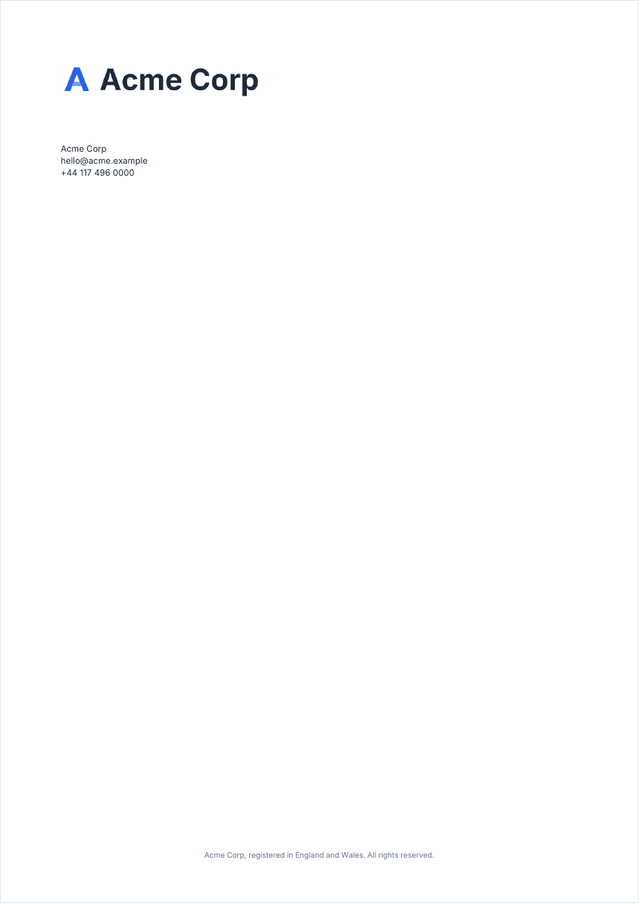

# backCover

A last page without page number or running header and footer: a logo, contact lines, a legal line. It is added on a
page of its own, and closes the document.

<!-- preview: back-cover page=2 -->



```ts
doc.heading('Thank you').paragraph('The back cover is added on a page of its own, after this one.');
doc.backCover({
  logo: { image: 'logo', height: 12 },
  contact: { lines: ['Acme Corp', 'hello@acme.example', '+44 117 496 0000'] },
  legalText: 'Acme Corp, registered in England and Wales. All rights reserved.',
});
```

## Options

`backCover(options?)`. Positions are in millimeters. A back cover takes the options of its own variant only; for the
custom one, see [custom covers](custom-cover.md).

<!-- options: PlainBackCoverOptions -->

| Option      | Type               | Default                                    | Description                                                                                                                                                                                                                          |
| ----------- | ------------------ | ------------------------------------------ | ------------------------------------------------------------------------------------------------------------------------------------------------------------------------------------------------------------------------------------ |
| `variant`   | `'plain'`          | `'plain'`                                  | A back cover drawn by the library from the options below.                                                                                                                                                                            |
| `image`     | `string`           |                                            | Full-page image, anchored to the bottom of the page: a name given to `registerImage`, or image data.                                                                                                                                 |
| `logo`      | `LogoPlacement`    | 20 mm from the top-left corner, 15 mm tall | Logo placed from a page corner.                                                                                                                                                                                                      |
| `contact`   | `BackCoverContact` |                                            | Block of contact lines; nothing is drawn when it has no line.                                                                                                                                                                        |
| `legalText` | `string`           |                                            | Small centered text at the bottom of the page, e.g. legal notices: the `footer` level, in `'secondary'` unless the theme colors that level. Wrapped to the page width less 20 mm on each side, its last line on the bottom baseline. |

<!-- /options -->

`contact` is:

<!-- options: BackCoverContact -->

| Option  | Type         | Default                                                              | Description                                                                                                                                                                                                                 |
| ------- | ------------ | -------------------------------------------------------------------- | --------------------------------------------------------------------------------------------------------------------------------------------------------------------------------------------------------------------------- |
| `lines` | `string[]`   | required                                                             | One text per line, set in the `small` level, wrapped to the page width right of `x` less a 20 mm inset. Required: a contact without `lines` throws `InvalidOptionError`, and so does an `x` that leaves the lines no width. |
| `x`     | `number`     | 20                                                                   | Left edge (mm) of the lines, from the left of the page.                                                                                                                                                                     |
| `y`     | `number`     | 50                                                                   | Top (mm) of the first line, from the top of the page.                                                                                                                                                                       |
| `color` | `ColorInput` | the color of the `small` level, `'text'` unless the theme changes it | Color of the lines.                                                                                                                                                                                                         |

<!-- /options -->

## Rules

- **Throws** an `InvalidOptionError` for an option of the other variant (`draw` on a plain back cover, `legalText` on a
  custom one), a `contact` without a `lines` array, and a contact `x` that leaves the lines no width, besides the checks
  every block makes (see [errors](errors.md#what-a-block-checks)).
- **Warns** when the `image` or the `logo` is neither a registered name nor readable image data.
- **Image**: it spans the page width, keeps its ratio and stands on the bottom edge, as on an [image cover](cover.md).
- **Text**: the contact lines wrap to the page right of `x`, 20 mm from the right edge; the legal text wraps to the page
  less 20 mm on each side and grows upward from the bottom.
- **Last page**: call `backCover` after the content. It closes its page: a block added after it starts a new, numbered
  page, and a warning says the back cover is no longer the last page.
- **Page**: it takes no page number and is not counted. It gets the theme color and the watermarks marked `allPages`,
  but no `background` image and no `onNewPage` callback.
- **In a column**: `backCover` is a page method: it draws on the whole page.
