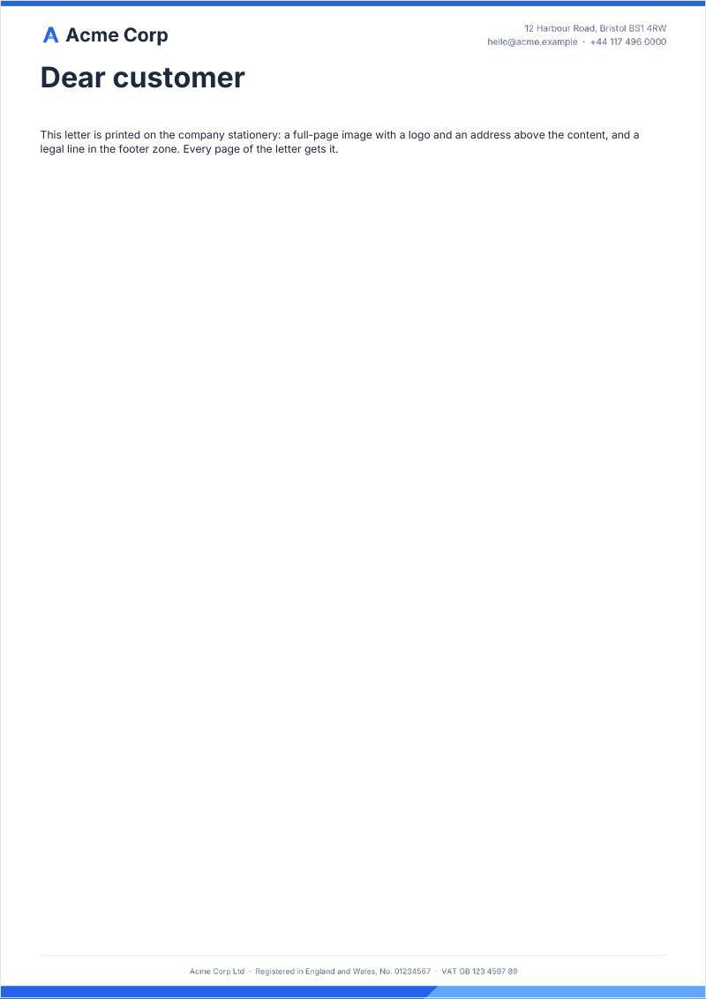

# background

A full-width image behind the content of the page, anchored to its bottom: a letterhead, a decorative band.

<!-- preview: background page=1 -->



```ts
import { loadImageFromPath } from '@mlt-a/jspdf-toolkit/node';

doc.registerImage('letterhead', loadImageFromPath('./letterhead.png'));
doc.background('letterhead', { allPages: true }).pageFooter(false); // the stationery carries its own footer
doc
  .heading('Dear customer')
  .paragraph(
    'This letter is printed on the company stationery: a full-page image with a logo and an address above the ' +
      'content, and a legal line in the footer zone. Every page of the letter gets it.',
  );
```

The image is a name given to `registerImage`, or image data. It keeps its ratio: it spans the page width and stands on
the bottom edge, so an image in the proportions of the page covers it whole and a wide, short one makes a band at the
bottom; `theme.assets.backgroundOffsetY` moves it down, or up when negative. The color of the page itself is the
`background` token of the theme. Keep what the image draws out of the content area: here, above the top margin and in
the footer zone.

## Options

`background(image, options?)`:

<!-- options: BackgroundOptions -->

| Option     | Type      | Default                        | Description                                                                                                                                                                                                 |
| ---------- | --------- | ------------------------------ | ----------------------------------------------------------------------------------------------------------------------------------------------------------------------------------------------------------- |
| `allPages` | `boolean` | `false`, the current page only | The current page and every page added after it, blank pages excepted (`addPage({ blank: true })`, back cover). Pages before the current one keep no background: drawn over their content, it would hide it. |

<!-- /options -->

## Rules

- **Throws** only for the checks every block makes (see [errors](errors.md#what-a-block-checks)): an `image` that is
  not a string, an `allPages` that is not a boolean.
- **Warns** when the image is neither a registered name nor readable image data, and when the page already has content:
  the image is drawn over it. Call `background` before the content of the page.
- **Running header and footer**: they are drawn over the image. Leave room for them, or remove the footer with
  `pageFooter(false)`.
- **Pages**: with `allPages`, the current page and every later one, blank pages excepted (a back cover gets no image).
  A later `background` call with `allPages` replaces the image.
- **In a column**: `background` is a page method: it covers the whole page.
