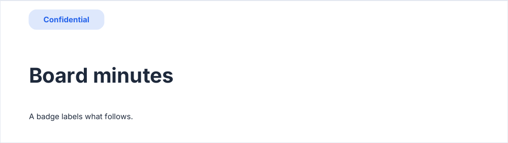
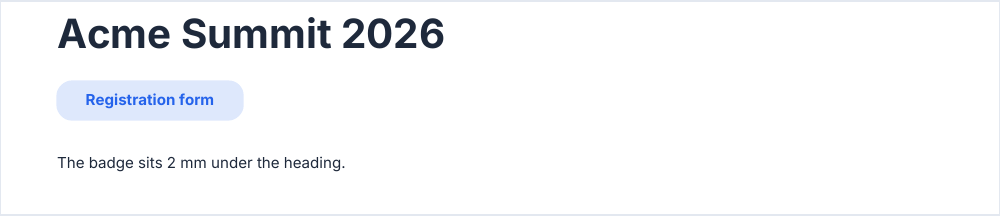

# badge

A pill-shaped label: a status, a document type.

<!-- preview: badge -->



```ts
doc.badge('Confidential').heading('Board minutes').paragraph('A badge labels what follows.');
```

## Under a heading

Called right after a heading, a badge attaches to it: see [spacing](spacing.md#a-badge-under-a-heading).

<!-- preview: badge-heading -->



```ts
doc.heading('Acme Summit 2026').badge('Registration form').paragraph('The badge sits 2 mm under the heading.');
```

## Options

`badge(text, options?)`:

<!-- options: BadgeOptions -->

| Option       | Type        | Default                                                                                   | Description                                                                  |
| ------------ | ----------- | ----------------------------------------------------------------------------------------- | ---------------------------------------------------------------------------- |
| `level`      | `TextLevel` | `'bodyBold'`                                                                              | Text level of the label; the primary color overrides the color of the level. |
| `spaceAfter` | `number`    | under a heading it attaches to, the space that heading leaves; else `theme.spacing.block` | Space (mm) under the badge.                                                  |

<!-- /options -->

## Rules

- **Throws** an `InvalidOptionError` for a reading column too narrow for the padding of the pill, besides the checks
  every block makes (see [errors](errors.md#what-a-block-checks)): a `text` that is not a string, an unknown `level`, a
  `spaceAfter` that is not a finite number.
- **Width**: a label wider than the reading column wraps to it, the pill taking the width of its longest line.
- **Color**: the label is drawn in the primary color on the tint of the pill, whatever color its level has.
- **Across pages**: a badge is never split.
- **In a column**: the badge sits in the column, and its label wraps to the reading column of the column.
- To highlight a value among others, use the `highlight` of a [field](fields.md).
