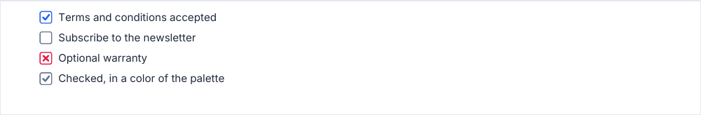

# checkbox

A box and its label: empty, checked or crossed.

<!-- preview: checkbox -->



```ts
doc
  .checkbox('Terms and conditions accepted', { variant: 'checked' })
  .checkbox('Subscribe to the newsletter')
  .checkbox('Optional warranty', { variant: 'cross' })
  .checkbox('Checked, in a color of the palette', { variant: 'checked', color: 'secondary' });
```

## Options

`checkbox(label, options?)`:

<!-- options: CheckboxOptions -->

| Option       | Type              | Default               | Description                                                           |
| ------------ | ----------------- | --------------------- | --------------------------------------------------------------------- |
| `variant`    | `CheckboxVariant` | `'empty'`             | State of the box: `'empty'`, `'checked'` (a tick) or `'cross'`.       |
| `level`      | `TextLevel`       | `'body'`              | Text level of the label.                                              |
| `spaceAfter` | `number`          | `theme.spacing.block` | Space (mm) under the checkbox. Consecutive checkboxes sit 2 mm apart. |
| `color`      | `ColorInput`      |                       | Color of the box and its mark, instead of the one the variant picks.  |

<!-- /options -->

## Rules

- **Throws** an `InvalidOptionError` for a reading column too narrow for the box and some text, besides the checks every
  block makes (see [errors](errors.md#what-a-block-checks)).
- **Colors**: the box of `checked` is drawn in the primary color, the one of `cross` in the error color and the one of
  `empty` in the secondary color; `color` replaces them. The box of an [inline question](inline-question.md) is
  checked in the success color instead.
- **Spacing**: a checkbox called right after another sits `SPACING.small` (2 mm) under it, so a group reads as one
  list, and leaves the block space (`theme.spacing.block`) under it: the last checkbox of a group is followed as any
  block is. A `spaceAfter` is the space under that checkbox, and nothing attaches to it. See
  [spacing](spacing.md#attaching-to-the-block-above).
- **Across pages**: a checkbox is never split. One [taller than a page](flow-control.md#taller-than-a-page) overflows
  it, with a warning.
- **In a column**: a long label wraps to the reading column of the column, the box staying on its first line.
- For a question with its answer on the same line, see [inlineQuestion](inline-question.md).
