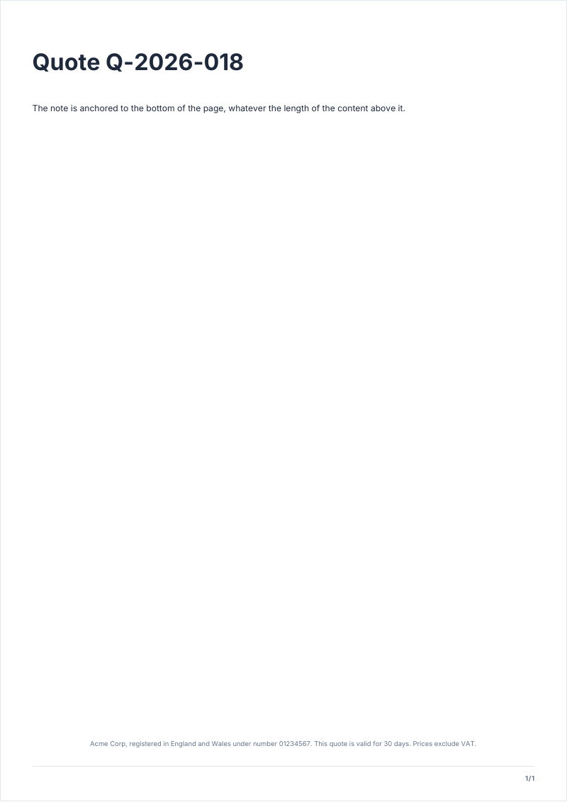

# closingNote

Small muted text, centered at the bottom of the content area: legal mentions, a disclaimer.

<!-- preview: closing-note page=1 -->



```ts
doc
  .heading('Quote Q-2026-018')
  .paragraph('The note is anchored to the bottom of the page, whatever the length of the content above it.')
  .closingNote(
    'Acme Corp, registered in England and Wales under number 01234567. This quote is valid for 30 days. ' +
      'Prices exclude VAT.',
  );
```

## Options

`closingNote(text, options?)`:

<!-- options: ClosingNoteOptions -->

| Option      | Type         | Default                                                 | Description                                                                |
| ----------- | ------------ | ------------------------------------------------------- | -------------------------------------------------------------------------- |
| `level`     | `TextLevel`  | `'footer'`                                              | Text level of the note.                                                    |
| `color`     | `ColorInput` | the color the theme gives the level, else `'secondary'` | Color of the note.                                                         |
| `bottomGap` | `number`     | `theme.spacing.block`                                   | Space (mm) between the note and the bottom of the content area: 0 or more. |

<!-- /options -->

## Rules

- **Throws** an `InvalidOptionError` for a `bottomGap` below 0, besides the checks every block makes (see
  [errors](errors.md#what-a-block-checks)). An empty text draws nothing and closes nothing.
- **Across pages**: it closes the page: what follows starts on a new one. A note that does not fit under the content
  goes to the next page.
- **In a column**: the text is centered on the column and sits at the bottom of the content area.
- For a line repeated on every page, use [pageFooter](page-header-footer.md).
