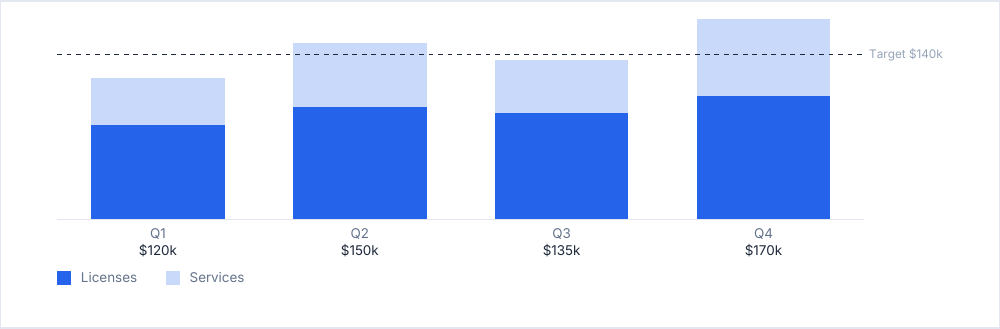

# columnChart

Vertical columns on one scale, stacked by series, against an optional reference line: revenue per quarter against a
target.

<!-- preview: column-chart -->



```ts
doc.columnChart(
  [
    { label: 'Q1', valueLabel: '$120k', values: [80, 40] },
    { label: 'Q2', valueLabel: '$150k', values: [95, 55] },
    { label: 'Q3', valueLabel: '$135k', values: [90, 45] },
    { label: 'Q4', valueLabel: '$170k', values: [105, 65] },
  ],
  {
    series: [{ label: 'Licenses' }, { label: 'Services' }],
    reference: { value: 140, label: 'Target $140k' },
  },
);
```

`values` is an array: one value per series, stacked from the bottom up. An array of one value (`[90]`) draws a plain
column. The reference line crosses the plot; its label sits right of it, in a room of its own.

## A column

<!-- options: ChartColumn -->

| Option       | Type       | Default  | Description                                                                                                                                                                                      |
| ------------ | ---------- | -------- | ------------------------------------------------------------------------------------------------------------------------------------------------------------------------------------------------ |
| `label`      | `string`   | required | Under the column, on 2 lines at most: a longer one is cut with an ellipsis.                                                                                                                      |
| `valueLabel` | `string`   |          | Formatted value under the label, e.g. `'$90,000'`.                                                                                                                                               |
| `values`     | `number[]` | required | One value per series, stacked from the bottom up: an array, even for a plain column (`[90]`). A value that is not a finite number above 0 draws no layer, where it throws in `ChartLine.values`. |

<!-- /options -->

A series names a layer in the legend and may set its color:

<!-- options: ChartSeries -->

| Option  | Type         | Default                                                                                | Description                           |
| ------- | ------------ | -------------------------------------------------------------------------------------- | ------------------------------------- |
| `label` | `string`     | required                                                                               | Name in the legend.                   |
| `color` | `ColorInput` | a shade of the primary color, one per slice, layer or line in order, the primary first | Color in the chart and in the legend. |

<!-- /options -->

## Options

`columnChart(columns, options?)`:

<!-- options: ColumnChartOptions -->

| Option       | Type                               | Default                                                | Description                                                                                                                                                                                                                                                                |
| ------------ | ---------------------------------- | ------------------------------------------------------ | -------------------------------------------------------------------------------------------------------------------------------------------------------------------------------------------------------------------------------------------------------------------------- |
| `series`     | `ChartSeries[]`                    |                                                        | The layers of the columns, in the order of each column's `values`: names the legend and sets the colors. Given, a column with more values than series throws an `InvalidOptionError`.                                                                                      |
| `max`        | `number`                           | the tallest column, or the reference when it is higher | Top of the scale, above 0. The scale reaches `max` as long as no column and not the reference is higher: it then extends to show them.                                                                                                                                     |
| `reference`  | `{ value: number; label: string }` |                                                        | Dashed horizontal line across the plot, e.g. a target, with its label right of the plot, centered on the line. The label has its own room there: the columns share what it leaves, so none runs under it. A label wider than a third of the chart is cut with an ellipsis. |
| `legend`     | `boolean`                          | `true`                                                 | Legend under the chart, when `series` is given.                                                                                                                                                                                                                            |
| `height`     | `number`                           | 42                                                     | Height (mm) of the scale, above 0.                                                                                                                                                                                                                                         |
| `emptyText`  | `string`                           | none, the chart draws nothing                          | Line drawn when no column has a value.                                                                                                                                                                                                                                     |
| `spaceAfter` | `number`                           | `theme.spacing.block`                                  | Space (mm) under the chart.                                                                                                                                                                                                                                                |

<!-- /options -->

## Rules

- **Draws what it can**: a value of zero or less, or that is not a finite number, leaves a layer out; with no value
  above 0 the chart draws nothing, or the `emptyText` line.
- **Throws** an `InvalidOptionError` for a column with more values than named `series`, a `reference` whose `value` is
  not above 0, a `max` or a `height` that is not above 0, besides the checks every block makes (see
  [errors](errors.md#what-a-block-checks)).
- **Scale**: `max` is the top of the scale as long as no column and not the reference is higher; the scale then extends
  to show them.
- **Reference**: its label stands right of the plot, in a room of its own, so no column runs under it; the columns share
  the rest of the width. A label wider than a third of the chart is cut with an ellipsis.
- **Labels**: the label of a column takes two lines at most, then ends with an ellipsis; a label or a value with no room
  at all is left out, with one warning for the chart.
- **Across pages**: the chart is never split. One [taller than a page](flow-control.md#taller-than-a-page) overflows it,
  with a warning.
- **In a column**: the chart spans the column.
- `computeColumnChartHeight(ctx, columns, options)` returns the height of the chart, without `spaceAfter`.
