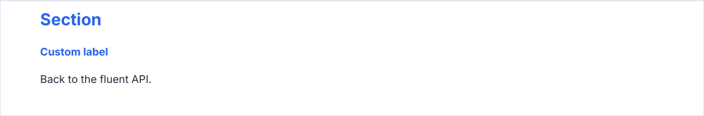
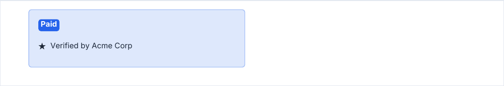

# Custom components

Every block is a function that takes the document as a `DrawingContext` (the `PDFDocument` itself), then the content,
then options: `drawX(ctx, content, options)`. A component of your own follows the same contract as the built-in ones, so
it paginates and spaces like them.

<!-- preview: custom-note -->



```ts
import {
  measureTextLevel,
  resolveColor,
  setTextStyle,
  type ColorInput,
  type DrawingContext,
} from '@mlt-a/jspdf-toolkit';

export interface NoteOptions {
  /** Default: `'primary'`. */
  color?: ColorInput;
  spaceAfter?: number;
}

export function computeNoteHeight(ctx: DrawingContext): number {
  return measureTextLevel(ctx, 'label').lineHeight;
}

export function drawNote(ctx: DrawingContext, text: string, options: NoteOptions = {}): number {
  const { color = 'primary' } = options;
  // Reserved with the note, so it reads the space `endBlock` will leave.
  const spaceAfter = ctx.resolveSpaceAfter(options.spaceAfter);
  const { ascent } = measureTextLevel(ctx, 'label');
  ctx.ensureSpace(computeNoteHeight(ctx) + spaceAfter);

  const y = ctx.getYPos();
  setTextStyle(ctx, 'label');
  ctx.doc.setTextColor(resolveColor(ctx.theme, color));
  ctx.doc.text(text, ctx.margins.left, y + ascent);

  return ctx.endBlock(y + computeNoteHeight(ctx), spaceAfter);
}

doc.heading('Section', { level: 'h2' });
drawNote(doc, 'Custom label');
doc.paragraph('Back to the fluent API.');
```

## The contract

- **Flow primitives** draw at the current position, call `ensureSpace(height)` before reading the position (it breaks
  the page and places headings that wait for a block), and close with `endBlock(bottom, spaceAfter)`, whose result they
  return; `endBlock` defaults `spaceAfter` to `theme.spacing.block`. A block that asks for space above it calls
  `beginBlock(spaceBefore)` after `ensureSpace`. `endBlock` does not place a waiting heading: call `ensureSpace` (or
  read `getYPos`) before drawing. A block that repeats something at the top of a new page (a title, a head row) passes
  its height as `ensureSpace(height, { lead })`, so a block too tall for a page with it is reported.
- **Primitives placed by coordinates** take `{ x, y, … }` in their options, `y` being the top of what they draw, and
  return the Y under it.
- **Page decorations** (watermark, running header and footer) return nothing.
- `computeXHeight(ctx, content, options)` returns the height a block will take, without `spaceAfter`, to decide a layout
  before drawing. `measureX` returns metrics (`measureTextLevel`, `measureHighlightedText`).
- **Drawing with jsPDF** after a block finds the font, colors, line width, cap and join set before it, in force on the
  page: a `doc.doc.rect(…, 'F')` without `doc.doc.setFillColor` takes the fill set before the block, even though the
  block wrote text (in PDF the text color is also the fill color) or broke the page.
- The reading column (the `measure` document option) applies to the `compute*` functions as it does to the drawing.

## Building blocks

<!-- preview: custom-blocks -->



```ts
import { drawBox, drawHighlightedText, drawIconWithText } from '@mlt-a/jspdf-toolkit';

const height = 24;
const spaceAfter = doc.resolveSpaceAfter();
doc.ensureSpace(height + spaceAfter);
const y = doc.getYPos();
const x = doc.margins.left;

drawBox(doc, { x, y, width: 90, height, boxStyle: 'tint' });
drawHighlightedText(doc, 'Paid', { x: x + 4, y: y + 4, strong: true });
drawIconWithText(doc, 'Verified by Acme Corp', { icon: 'star', x: x + 4, y: y + 14 });
doc.endBlock(y + height, spaceAfter);
```

Exported for custom code:

- **Text**: `setTextStyle(ctx, level)`, `setFont(ctx, role, weight, size, italic?)` (a `'body'`, `'title'` or `'label'`
  family at `'regular'` or `'bold'`, with face fallback), `measureTextLevel(ctx, level, options?)`
  (`{ lineHeight, ascent }`), `computeParagraphHeight`, `computeRichTextHeight`, `computeRichBlocksHeight`.
- **Boxes**: `drawBox(ctx, { x, y, width, height, boxStyle, radius? })`, `computeInfoBoxHeight`,
  `computeDeclarationsBoxHeight`, `computeSignatureZoneHeight`.
- **Charts**: `computeDonutChartHeight`, `computeStackedBarHeight`, `computeColumnChartHeight`,
  `computeLineChartHeight`.
- **Pills, icons and images**: `drawHighlightedText(ctx, text, { x, y, … })`, `measureHighlightedText`,
  `drawIconWithText(ctx, text, { icon, x, y, … })`, `drawImage(ctx, image, { x, y, width?, height? })`. A pill wraps its
  glyphs, `padding` around them: with `y` at `padding` above the top of a text line, its text sits on that line.
- **Scales**: `SPACING`, `LINE_WIDTH`, `RADIUS`, `PT_TO_MM`; the document rhythm is `theme.spacing`, complete on every
  theme.

## Options of the building blocks

`drawBox(ctx, options)`:

<!-- options: BoxOptions -->

| Option     | Type             | Default  | Description                                |
| ---------- | ---------------- | -------- | ------------------------------------------ |
| `x`        | `number`         | required | Left edge (mm), from the left of the page. |
| `y`        | `number`         | required | Top edge (mm), from the top of the page.   |
| `width`    | `number`         | required | Width (mm).                                |
| `height`   | `number`         | required | Height (mm).                               |
| `boxStyle` | `BoxStylePreset` | required | Fill and border preset.                    |
| `radius`   | `number`         | 1        | Corner radius (mm).                        |

<!-- /options -->

`drawHighlightedText(ctx, text, options)`:

<!-- options: HighlightedTextOptions -->

| Option     | Type               | Default                | Description                                                                             |
| ---------- | ------------------ | ---------------------- | --------------------------------------------------------------------------------------- |
| `x`        | `number`           | required               | Left edge (mm) of the pill.                                                             |
| `y`        | `number`           | required               | Top of the pill: the top of its first text line is `padding` lower.                     |
| `padding`  | `number`           | 1                      | Padding (mm) between the pill edge and its text, on every side.                         |
| `maxWidth` | `number`           | the document `measure` | Width (mm) the pill wraps within, padding included.                                     |
| `strong`   | `boolean`          | `false`                | Primary fill with `onPrimary` text, instead of the light tint with `text`.              |
| `metrics`  | `HighlightMetrics` |                        | Already measured with the same `text`, `padding` and `maxWidth`: skips measuring again. |

<!-- /options -->

`drawIconWithText(ctx, text, options)`:

<!-- options: IconWithTextOptions -->

| Option     | Type         | Default                | Description                                                                            |
| ---------- | ------------ | ---------------------- | -------------------------------------------------------------------------------------- |
| `x`        | `number`     | required               | Left edge (mm), from the left of the page.                                             |
| `y`        | `number`     | required               | Top edge (mm) of the first text line, from the top of the page.                        |
| `icon`     | `string`     | required               | A name given to `doc.registerImage`, or image data.                                    |
| `iconSize` | `number`     | 3                      | Side (mm) of the square icon.                                                          |
| `gap`      | `number`     | 2                      | Space (mm) between the icon and the text.                                              |
| `level`    | `TextLevel`  | `'body'`               | Text level of the text.                                                                |
| `color`    | `ColorInput` | the level's            | Text color.                                                                            |
| `maxWidth` | `number`     | the document `measure` | Width (mm) of the icon, the gap and the text together: the text wraps in what is left. |

<!-- /options -->

`drawImage(ctx, image, options)`:

<!-- options: ImageOptions -->

| Option   | Type     | Default  | Description                                                                                           |
| -------- | -------- | -------- | ----------------------------------------------------------------------------------------------------- |
| `x`      | `number` | required | Left edge (mm), from the left of the page.                                                            |
| `y`      | `number` | required | Top edge (mm), from the top of the page.                                                              |
| `width`  | `number` |          | Width (mm). Give `width`, `height` or both; one left out follows from the other and the image ratio.  |
| `height` | `number` |          | Height (mm). Give `width`, `height` or both; one left out follows from the other and the image ratio. |

<!-- /options -->

`measureTextLevel(ctx, level, options?)`:

<!-- options: MeasureTextLevelOptions -->

| Option            | Type     | Default | Description                                          |
| ----------------- | -------- | ------- | ---------------------------------------------------- |
| `lineHeightScale` | `number` | 1       | Multiplies the line height: a finite number above 0. |

<!-- /options -->

## Rules

- **Throws** like the blocks, from `compute*Height` too (see [errors](errors.md#what-a-block-checks)). `drawImage`
  throws when it has neither a `width` nor a `height`.
- **Warns** when an image or an icon is neither a registered name nor readable data.
- **In a column**: `ctx` is the document laid out in the column, so `ctx.margins`, `ctx.contentWidth` and `ctx.measure`
  are the column's.
