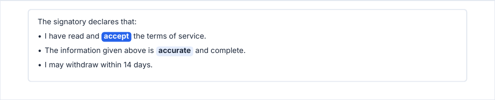
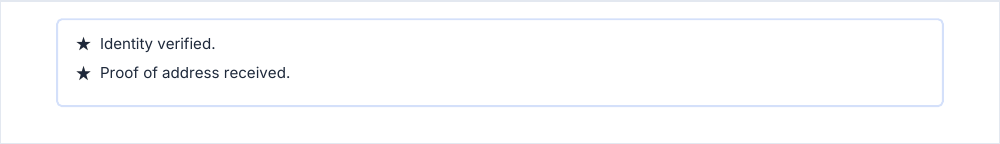

# declarationsBox

A box of statements, for what a signatory declares or accepts. Words to stress become pills.

<!-- preview: declarations-box -->



```ts
doc.declarationsBox(
  [
    { text: 'I have read and accept the terms of service.', highlights: [{ text: 'accept', strong: true }] },
    { text: 'The information given above is accurate and complete.', highlights: [{ text: 'accurate' }] },
    { text: 'I may withdraw within 14 days.' },
  ],
  { intro: 'The signatory declares that:', bullet: true },
);
```

## With an icon, in another style

`icon` is placed before each item and replaces the bullet. `boxStyle` is a `BoxStylePreset`: `'tint'`, `'tintSolid'`,
`'border'`, `'background'`, `'surface'` or `'surfaceBorder'`.

<!-- preview: declarations-box-icon -->



```ts
doc.declarationsBox([{ text: 'Identity verified.' }, { text: 'Proof of address received.' }], {
  icon: 'star',
  boxStyle: 'surfaceBorder',
});
```

## An item

<!-- options: DeclarationItem -->

| Option       | Type                                        | Default  | Description                                                                         |
| ------------ | ------------------------------------------- | -------- | ----------------------------------------------------------------------------------- |
| `text`       | `string`                                    | required | The declaration as drawn; wraps within the box.                                     |
| `highlights` | `Array<{ text: string; strong?: boolean }>` |          | Fragments of `text` set in a pill. Each one marks the first place its words appear. |

<!-- /options -->

## Options

`declarationsBox(items, options?)`:

<!-- options: DeclarationsBoxOptions -->

| Option       | Type             | Default               | Description                                                                  |
| ------------ | ---------------- | --------------------- | ---------------------------------------------------------------------------- |
| `intro`      | `string`         |                       | Intro line(s) above the items.                                               |
| `bullet`     | `boolean`        |                       | Prefixes each item with a bullet. Ignored when `icon` is set.                |
| `icon`       | `string`         |                       | Icon before each item: a name given to `doc.registerImage`, or image data.   |
| `boxStyle`   | `BoxStylePreset` | `'background'`        | Fill and border preset.                                                      |
| `level`      | `TextLevel`      | `'body'`              | Text level of the intro and the items. Highlights keep their own pill style. |
| `spaceAfter` | `number`         | `theme.spacing.block` | Space (mm) under the box.                                                    |

<!-- /options -->

## Rules

- **Throws** an `InvalidOptionError` for a frame that leaves no room for the text, besides the checks every block
  makes (see [errors](errors.md#what-a-block-checks)). Every item is checked before anything is drawn.
- **Warns** when the `icon` is neither a registered name nor readable image data.
- **Highlights**: a highlight marks the first place its words appear, and matches whole words split on spaces:
  `'accept'` does not match `accept.` with its full stop. One that matches nothing is ignored without a word.
- **Across pages**: the box is never split; it moves to the next page when it does not fit. One
  [taller than a page](flow-control.md#taller-than-a-page) overflows it, with a warning.
- **In a column or an inset**: the box takes the measure of that frame, from its left edge.
- `computeDeclarationsBoxHeight(ctx, items, options)` returns the height the box will take, without `spaceAfter`.
