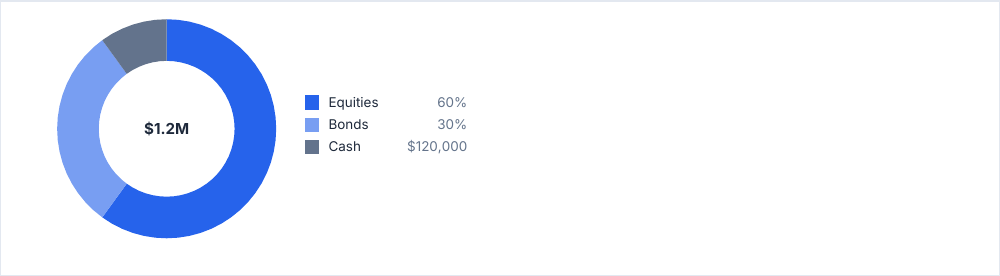
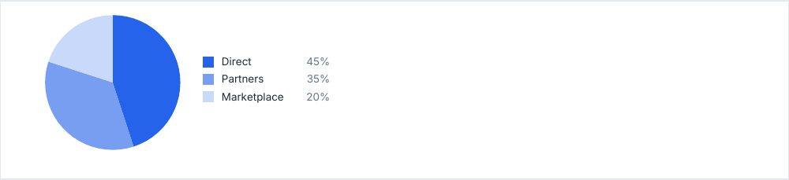

# donutChart

Parts of a whole, as a ring or a pie, with a legend on its right showing each percentage.

<!-- preview: donut-chart -->



```ts
doc.donutChart(
  [
    { label: 'Equities', value: 60 },
    { label: 'Bonds', value: 30 },
    { label: 'Cash', value: 10, color: 'secondary', legendValue: '$120,000' },
  ],
  { centerLabel: '$1.2M' },
);
```

A slice without `color` takes a shade of the primary color, the first being the primary itself: the chart follows the
theme. `legendValue` replaces the percentage in the legend.

## A pie

`innerRatio: 0` closes the ring.

<!-- preview: donut-chart-pie -->



```ts
doc.donutChart(
  [
    { label: 'Direct', value: 45 },
    { label: 'Partners', value: 35 },
    { label: 'Marketplace', value: 20 },
  ],
  { innerRatio: 0, diameter: 36 },
);
```

## A slice

<!-- options: ChartSlice -->

| Option        | Type         | Default                                                                                | Description                                                      |
| ------------- | ------------ | -------------------------------------------------------------------------------------- | ---------------------------------------------------------------- |
| `value`       | `number`     | required                                                                               | A value that is not a finite number above 0 leaves the part out. |
| `legendValue` | `string`     |                                                                                        | Text of the legend in place of the percentage, e.g. `'$1,200'`.  |
| `label`       | `string`     | required                                                                               | Name in the legend.                                              |
| `color`       | `ColorInput` | a shade of the primary color, one per slice, layer or line in order, the primary first | Color in the chart and in the legend.                            |

<!-- /options -->

## Options

`donutChart(slices, options?)`:

<!-- options: DonutChartOptions -->

| Option        | Type      | Default                                                                                           | Description                                                                                                                                                                                                                                                |
| ------------- | --------- | ------------------------------------------------------------------------------------------------- | ---------------------------------------------------------------------------------------------------------------------------------------------------------------------------------------------------------------------------------------------------------- |
| `diameter`    | `number`  | 46, shrinking without a warning to leave the legend 36 mm, down to 20, and to the available width | Diameter (mm), above 0. Wider than the available width: brought down to it, with a warning. Within that width but leaving the legend less than 36 mm beside it (the room is then at least 20 mm): brought down to what is left, with a warning of its own. |
| `innerRatio`  | `number`  | 0.62                                                                                              | Radius of the hole, as a share of the radius, from 0 up to but excluding 1: 0 draws a pie.                                                                                                                                                                 |
| `centerLabel` | `string`  |                                                                                                   | Text in the middle of the hole, e.g. the total. Cut short when it is wider than the hole.                                                                                                                                                                  |
| `legend`      | `boolean` | `true`                                                                                            | Legend on the right.                                                                                                                                                                                                                                       |
| `emptyText`   | `string`  | none, the chart draws nothing                                                                     | Line drawn when no slice has a value.                                                                                                                                                                                                                      |
| `spaceAfter`  | `number`  | `theme.spacing.block`                                                                             | Space (mm) under the chart.                                                                                                                                                                                                                                |

<!-- /options -->

## Rules

- **Draws what it can**: a slice whose `value` is not a finite number above 0 is left out. With no slice left the chart
  draws nothing and leaves the position as it was, or the `emptyText` line when given.
- **Throws** an `InvalidOptionError` for a `diameter` that is not above 0 and an `innerRatio` outside 0 to 1 (1
  excluded), besides the checks every block makes (see [errors](errors.md#what-a-block-checks)). A slice left out is
  checked too: its `label` must be a string, its `color` valid.
- **Warns** when a `diameter` wider than the available width is brought down to it, and when one that leaves the legend
  no room is brought down to what is left. A label cut short ends with an ellipsis; a label with no room at all is left
  out, with one warning for the chart.
- **Across pages**: the chart is never split; it moves to the next page whole. One
  [taller than a page](flow-control.md#taller-than-a-page) overflows it, with a warning.
- **In a column**: the available width is the column's.
- The library draws the numbers you give it: format the values yourself (`legendValue`, `centerLabel`).
- `computeDonutChartHeight(ctx, slices, options)` returns the height of the chart, without `spaceAfter`.
