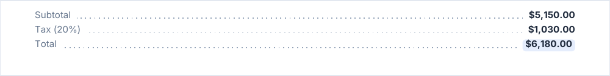

# fields, fieldRows

Label / value pairs: the facts of an invoice, a contract, a form. `fields` draws one row, `fieldRows` several.

<!-- preview: fields -->


```ts
doc.fields([
  { label: 'Client', value: 'TechStart Inc.' },
  { label: 'Date', value: 'April 9, 2026', complement: 'Due in 30 days' },
  { label: 'Status', value: 'Paid', highlight: true },
]);
```

`highlight` draws the value in a pill, `complement` adds a muted note under it. A highlighted value sits on the baseline
of a plain one.

## Layouts

`layout` picks how a field is drawn.

| `layout`              | Result                                                                                                               |
| --------------------- | -------------------------------------------------------------------------------------------------------------------- |
| `'stacked'` (default) | Label above value; the fields of a row sit side by side in columns.                                                  |
| `'inline'`            | One field per line, `Label: value`. A long value wraps under itself.                                                 |
| `'leader'`            | One field per line, label left, value right, dotted leader between. A long value goes right-aligned under the label. |

<!-- preview: fields-inline -->


```ts
doc.fields(
  [
    { label: 'Reference', value: 'INV-042' },
    { label: 'Payment', value: 'Bank transfer, 30 days net' },
  ],
  { layout: 'inline' },
);
```

<!-- preview: fields-leader -->



```ts
doc.fields(
  [
    { label: 'Subtotal', value: '$5,150.00' },
    { label: 'Tax (20%)', value: '$1,030.00' },
    { label: 'Total', value: '$6,180.00', highlight: true },
  ],
  { layout: 'leader' },
);
```

`'stacked'` and `'inline'` set the label in the `fieldLabel` level and the value in `fieldValue`; `'leader'` sets them
in `body` and `bodyBold`, so a theme restyles a leader row through those (see [text levels](text-levels.md)).

## Several rows

`fieldRows(rows, options?)` takes one array of fields per row. `rowGap` is the space between two rows.

<!-- preview: field-rows -->


```ts
doc.fieldRows([
  [
    { label: 'Name', value: 'Jane Smith' },
    { label: 'Role', value: 'Chief executive' },
  ],
  [
    { label: 'Email', value: 'jane@techstart.example' },
    { label: 'Phone', value: '+1 555 0100' },
  ],
]);
```

## A field

<!-- options: Field -->

| Option       | Type      | Default  | Description                                                                        |
| ------------ | --------- | -------- | ---------------------------------------------------------------------------------- |
| `label`      | `string`  | required | Name of the field, in the label level of the layout (see `FieldsOptions.layout`).  |
| `value`      | `string`  | required | Value of the field, in the value level of the layout (see `FieldsOptions.layout`). |
| `highlight`  | `boolean` | `false`  | Draws the value in a pill.                                                         |
| `complement` | `string`  |          | Note under the value, in muted small text.                                         |

<!-- /options -->

## Options

`fields(list, options?)` and `fieldRows(rows, options?)`:

<!-- options: FieldsOptions -->

| Option       | Type          | Default                                                                                                                                   | Description                                                                                                                                                                                                                                                                                                                                                                                                                                                                                                                                                                                                                                                                                                                                                                                                                                                                                                                                                                                                                |
| ------------ | ------------- | ----------------------------------------------------------------------------------------------------------------------------------------- | -------------------------------------------------------------------------------------------------------------------------------------------------------------------------------------------------------------------------------------------------------------------------------------------------------------------------------------------------------------------------------------------------------------------------------------------------------------------------------------------------------------------------------------------------------------------------------------------------------------------------------------------------------------------------------------------------------------------------------------------------------------------------------------------------------------------------------------------------------------------------------------------------------------------------------------------------------------------------------------------------------------------------- |
| `spaceAfter` | `number`      | `theme.spacing.block`                                                                                                                     | Space (mm) under the block: under the last row for `fieldRows`.                                                                                                                                                                                                                                                                                                                                                                                                                                                                                                                                                                                                                                                                                                                                                                                                                                                                                                                                                            |
| `rowGap`     | `number`      | `SPACING.small` for `'stacked'`, `SPACING.medium` for `'inline'` and `'leader'`, whose fields of a row are already `SPACING.xsmall` apart | Space (mm) between two rows of `fieldRows`: 0 or more.                                                                                                                                                                                                                                                                                                                                                                                                                                                                                                                                                                                                                                                                                                                                                                                                                                                                                                                                                                     |
| `layout`     | `FieldLayout` |                                                                                                                                           | - `'stacked'` (default): the label above the value, the fields of a row side by side in columns. - `'inline'`: one field per line, `Label: value`. A long value wraps under itself, after the label. A highlighted value keeps its pill. A label wider than half the line falls back to `'stacked'` for that field. - `'leader'`: one field per line, the label on the left, the value on the right in bold or as a pill, dotted leader between them. A value wider than half the line goes on its own right-aligned lines under the label, with no leader. `'inline'` and `'leader'` give every field its own full-width line, so a row of `fieldRows` is a group of lines. The text levels a theme restyles (`typography.levels`) for each layout: `'stacked'` and `'inline'` set the label in `fieldLabel` and the value in `fieldValue`; `'leader'` sets the label in `body` (in the color of `fieldLabel`) and the value in `bodyBold`, so a leader row reads as a line of text. A complement is set in `smallMuted`. |

<!-- /options -->

## Rules

- **Throws** an `InvalidOptionError` for a `label` or a `value` that is not a string (a number throws: format it first),
  a `rowGap` below 0, and stacked fields too many for the reading column to share, besides the checks every block makes
  (see [errors](errors.md#what-a-block-checks)). Every row is checked before the first one is drawn. An empty list draws
  nothing.
- **Across pages**: a row is never split; the next one starts on the next page when it does not fit. A row
  [taller than a page](flow-control.md#taller-than-a-page) overflows it, with a warning.
- **In a column**: the fields share the reading column of the column.
