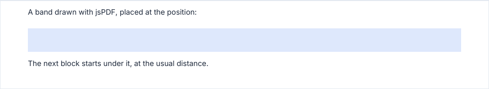

# Flow control

Blocks flow from top to bottom and break the page on their own. These methods are for the few times you decide:
`keepTogether`, `inset`, `addPage`, `addSpace`, `onNewPage`, and the position (`getYPos`, `setYPos`, `ensureSpace`).

## keepTogether

Keeps a group of blocks on one page: when it does not fit under the current position but fits on a page of its own, the
page breaks first.

```ts
doc.keepTogether(() => {
  doc
    .heading('Terms', { level: 'h3' })
    .paragraph('Payment within 30 days.')
    .signatureZone([{ label: 'The client' }]);
});
```

- A group taller than a page breaks across pages as it would without `keepTogether`.
- The callback runs up to three times (two measuring passes, then the real one): keep it free of side effects.
- A heading already stays with the block that follows it: `keepTogether` is for longer groups.
- Wrap [columns](columns.md) in it when they may reach the bottom of the page.

## inset

Lays out a group of blocks in a narrower frame: `left` and `right` are in mm from the edges of the current frame (the
page, a column or another inset), `width` is the width of the inset. Two of the three fix the third.

<!-- preview: inset -->


```ts
doc.inset({ left: 20 }, () => {
  doc.paragraph('Indented 20 mm, wrapped to the narrower frame.');
});
doc.inset({ right: 0, width: 80 }, () => {
  doc.infoBox('Bank transfer, 30 days net.', { title: 'Payment' });
});
```

- `margins`, `contentWidth` and `measure` read the inset while the callback runs; the current frame comes back after it,
  even when it throws.
- The flow runs on: the position and the space left above carry in and out, and a page break inside goes on in the
  inset, without a warning.
- A heading called just before the inset spans the frame around it and stays with the first block inside.
- A `width` wider than the room the frame leaves is brought down to fit, with a warning.
- A `width` given is also the `measure` of the inset, wider or narrower than the `measure` of the document; without it,
  the measure is the room left, or the measure of the frame around when that is narrower.
- **Throws** an `InvalidOptionError` for an option out of its bounds, for `left`, `right` and `width` together, or for
  `left` and `right` that leave no width; the error names the option at fault.
- Blocks that take the measure of their frame (`infoBox`, `declarationsBox`, `addressBlock`) are narrowed by an inset,
  not by an option of their own.

<!-- options: InsetOptions -->

| Option  | Type     | Default                       | Description                                                                                                                                                                                                                                                                                                                                               |
| ------- | -------- | ----------------------------- | --------------------------------------------------------------------------------------------------------------------------------------------------------------------------------------------------------------------------------------------------------------------------------------------------------------------------------------------------------- |
| `left`  | `number` | 0                             | Space (mm) between the left edge of the current frame and the inset: 0 or more.                                                                                                                                                                                                                                                                           |
| `right` | `number` | 0                             | Space (mm) between the inset and the right edge of the current frame: 0 or more.                                                                                                                                                                                                                                                                          |
| `width` | `number` | what `left` and `right` leave | Width (mm) of the inset: a finite number above 0. Given alone, the inset starts at the left edge of the frame; with `right`, it ends that far from the right edge. Wider than the room the frame leaves, it is brought down to fit, with a warning. A given width is also the measure of the inset, wider or narrower than the `measure` of the document. |

<!-- /options -->

## addSpace

Adds vertical space, on top of what the previous block left. Pick the amount from `SPACING`. It is ignored at the top of
a page.

<!-- preview: add-space -->


```ts
import { SPACING } from '@mlt-a/jspdf-toolkit';

doc.paragraph('Before.').addSpace(SPACING.xlarge).paragraph('After, 8 mm lower than usual.');
```

The steps of `SPACING` are listed in [spacing](spacing.md).

## addPage

Starts a new page. `blank: true` adds a page that paints itself, like the back cover does: it gets the theme color and
the watermarks marked `allPages`, but no `background` image and no `onNewPage` callback.

```ts
doc.paragraph('End of the first part.').addPage().heading('Second part');
```

<!-- options: AddPageOptions -->

| Option  | Type      | Default | Description                                                                                                                                                                                              |
| ------- | --------- | ------- | -------------------------------------------------------------------------------------------------------------------------------------------------------------------------------------------------------- |
| `blank` | `boolean` | `false` | A page that paints itself: it gets the theme background color, and `finalize()` draws the `allPages` watermarks on it, but it gets neither the `onNewPage` callback nor the `allPages` background image. |

<!-- /options -->

## onNewPage

Runs a callback on every page created after the call, pages of a long table included: a letterhead, a side band.

```ts
doc.onNewPage(() => {
  doc.doc.setFillColor(doc.theme.colors.primary);
  doc.doc.rect(0, 0, 4, doc.pageHeight, 'F');
});
```

One callback is kept: a new call replaces the previous one. It starts from the `body` text style; the fill and draw
colors, line width, cap and join it finds are the ones jsPDF reports, in force on the page. The font, colors and line
width it sets are put back after it.

## Position

| Method                          | Does                                                                                |
| ------------------------------- | ----------------------------------------------------------------------------------- |
| `getYPos()`                     | Returns the current position (mm from the top of the page).                         |
| `setYPos(y)`                    | Moves the position: the next block starts there, with no space collapsed above it.  |
| `ensureSpace(height, options?)` | Breaks the page when less than `height` mm is left. Returns whether the page broke. |

`ensureSpace` takes a `lead` (mm) for what a block repeats at the top of a new page, and warns when `height` is taller
than a page.

<!-- options: EnsureSpaceOptions -->

| Option | Type     | Default | Description                                                                                                                                                                                                                      |
| ------ | -------- | ------- | -------------------------------------------------------------------------------------------------------------------------------------------------------------------------------------------------------------------------------- |
| `lead` | `number` | 0       | Height (mm) the caller draws at the top of the new page before the block when the page breaks (a continuation title, a repeated header). It does not decide the break; it counts in the warning for a block too tall for a page. |

<!-- /options -->

They are for drawing with `doc.doc`, the jsPDF instance, yourself:

<!-- preview: flow-position -->



```ts
doc.paragraph('A band drawn with jsPDF, placed at the position:');
const height = 10;
doc.ensureSpace(height);
const y = doc.getYPos();
doc.doc.setFillColor(doc.theme.colors.tint);
doc.doc.rect(doc.margins.left, y, doc.contentWidth, height, 'F');
doc.endBlock(y + height);
doc.paragraph('The next block starts under it, at the usual distance.');
```

## Taller than a page

Most blocks are never split: a box, a chart, a row of fields, a table row, a signature zone. One that does not fit under
the position moves to the next page. One taller than a whole page cannot fit anywhere: it is not cut, it starts at the
top of a page and runs past its bottom, and `doc.warnings` reads `Block of … mm is taller than the usable page height
(… mm) and may be clipped`. Shorten it, or split its content into several blocks.

## Rules

- **Throws** an `InvalidOptionError` for a `keepTogether` or `onNewPage` argument that is not a function, an `addSpace`
  or a `setYPos` that is not a finite number, an `addPage` option that is not a boolean.
- **Warns** when `ensureSpace` is asked for a block taller than the usable page height.
- **At the top of a page**: `addSpace` does nothing, like the space a block asks above it.
- **In a column**: wrap the whole `columns` call in `keepTogether`, not a block inside a column.
- Every block takes `spaceAfter`; before reaching for `addSpace`, see whether the rhythm of the theme
  (`theme.spacing`) is what should change. To write a block of your own, see [custom components](custom-components.md).
