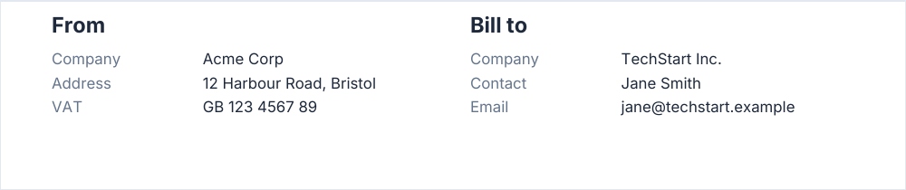

# headerColumns

Titled columns of `label` / `value` lines: the two parties at the top of an invoice, a quote or a letter. The title is
set in `h2` and the text color; a label in the font of the `fieldValue` level and the color of the `fieldLabel` level;
a value in `fieldValue`.

<!-- preview: header-columns -->



```ts
doc.headerColumns([
  {
    title: 'From',
    fields: [
      { label: 'Company', value: 'Acme Corp' },
      { label: 'Address', value: '12 Harbour Road, Bristol' },
      { label: 'VAT', value: 'GB 123 4567 89' },
    ],
  },
  {
    title: 'Bill to',
    fields: [
      { label: 'Company', value: 'TechStart Inc.' },
      { label: 'Contact', value: 'Jane Smith' },
      { label: 'Email', value: 'jane@techstart.example' },
    ],
  },
]);
```

## A column

<!-- options: HeaderColumn -->

| Option       | Type            | Default  | Description                                                                                                                                                                                                                                           |
| ------------ | --------------- | -------- | ----------------------------------------------------------------------------------------------------------------------------------------------------------------------------------------------------------------------------------------------------- |
| `title`      | `string`        | required | Heading of the column, in `h2` and the text color, unless the theme colors `h2`.                                                                                                                                                                      |
| `fields`     | `HeaderField[]` | required | Lines under the title, one per field.                                                                                                                                                                                                                 |
| `labelWidth` | `number`        | 35       | Width (mm) of the label part, from the column edge to the values. Must exceed the 2 mm kept between a label and its value, else an `InvalidOptionError` is thrown. At most half the column: the value keeps the rest. A longer label wraps inside it. |

<!-- /options -->

and a line:

<!-- options: HeaderField -->

| Option  | Type     | Default  | Description                                                                                                                                                                |
| ------- | -------- | -------- | -------------------------------------------------------------------------------------------------------------------------------------------------------------------------- |
| `label` | `string` | required | Left part, in the font of the `fieldValue` level and the color of the `fieldLabel` level (`secondary` unless the theme restyles it); wraps within the column `labelWidth`. |
| `value` | `string` | required | Right part, in the `fieldValue` level; wraps in what the label leaves of the column.                                                                                       |

<!-- /options -->

## Options

`headerColumns(columns, options?)`:

<!-- options: HeaderColumnsOptions -->

| Option       | Type     | Default           | Description                                |
| ------------ | -------- | ----------------- | ------------------------------------------ |
| `gap`        | `number` | `SPACING.xlarge`  | Space (mm) between the columns: 0 or more. |
| `spaceAfter` | `number` | `SPACING.xxlarge` | Space (mm) under the tallest column.       |

<!-- /options -->

## Rules

- **Throws** an `InvalidOptionError` for a `labelWidth` that does not exceed 2 mm and a `gap` below 0, besides the
  checks every block makes (see [errors](errors.md#what-a-block-checks)). An empty list of columns draws nothing.
- **Width**: the columns are equal and span the content width. A label takes `labelWidth`, at most half its column; the
  value takes the rest.
- **Across pages**: the block reserves its height and is never split: one that does not fit under the position starts on
  the next page. One [taller than a page](flow-control.md#taller-than-a-page) overflows it, with a warning.
- **Wrapping**: long labels and values wrap inside their part of the column.
- For free content side by side, use [columns](columns.md); for label / value pairs in the body, [fields](fields.md).
