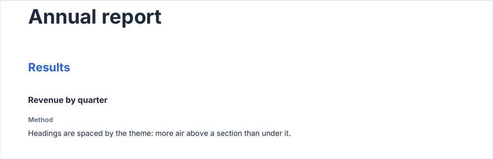
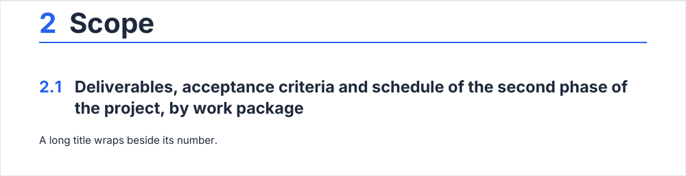

# heading

A section title, `h1` to `h4`, wrapped to the reading column. A heading never ends a page alone: it waits for the block
that follows and moves to the next page with it.

<!-- preview: heading -->



```ts
doc
  .heading('Annual report')
  .heading('Results', { level: 'h2' })
  .heading('Revenue by quarter', { level: 'h3' })
  .heading('Method', { level: 'h4' })
  .paragraph('Headings are spaced by the theme: more air above a section than under it.');
```

## Numbered sections and rules

`number` is drawn before the title in the primary color, on its first line; the lines of a long title align after it.
`rule` underlines the last line across the reading column. With either, the title itself turns to the text color, unless
the theme colors its level: the accent moves to the number or the rule.

<!-- preview: heading-number -->



```ts
doc
  .heading('Scope', { number: '2', rule: true })
  .heading('Deliverables, acceptance criteria and schedule of the second phase of the project, by work package', {
    level: 'h2',
    number: '2.1',
  })
  .paragraph('A long title wraps beside its number.');
```

## Options

`heading(text, options?)`:

<!-- options: HeadingOptions -->

| Option         | Type           | Default                                           | Description                                                                                                                                                                                                                                                                         |
| -------------- | -------------- | ------------------------------------------------- | ----------------------------------------------------------------------------------------------------------------------------------------------------------------------------------------------------------------------------------------------------------------------------------- |
| `level`        | `HeadingLevel` | `'h1'`                                            | Heading level: `'h1'` (a page title) to `'h4'` (the smallest).                                                                                                                                                                                                                      |
| `spaceBefore`  | `number`       | `theme.spacing.heading[level].before`             | Space (mm) above the heading. It collapses with the space the previous block left under it: the larger of the two separates them. None at the top of a page.                                                                                                                        |
| `spaceAfter`   | `number`       | `theme.spacing.heading[level].after`              | Space (mm) under the heading.                                                                                                                                                                                                                                                       |
| `number`       | `string`       |                                                   | Section number drawn before the title in the primary color, e.g. `'2.1'`, on its first line: the lines of a long title align after it. Listed in the table of contents. A number that leaves the title no width throws an `InvalidOptionError`.                                     |
| `rule`         | `boolean`      |                                                   | Rule under the heading, across the reading column, in the primary color.                                                                                                                                                                                                            |
| `keepWithNext` | `boolean`      | `true`                                            | Keeps the heading with the block that follows it, so a heading never ends a page alone: `doc.heading()` waits for the next block and moves to the next page with its first line or row when both do not fit. Consecutive headings wait together. `false` draws the heading at once. |
| `toc`          | `boolean`      | listed when its level is within the table `depth` | Lists the heading in the table of contents (`true`) or leaves it out (`false`), whatever the table `depth`.                                                                                                                                                                         |

<!-- /options -->

## Rules

- **Throws** an `InvalidOptionError` for a `number` that leaves the title no width in the reading column, besides the
  checks every block makes (see [errors](errors.md#what-a-block-checks)). An empty `text` draws nothing and leaves no
  space.
- **Across pages**: with `keepWithNext` (the default) the heading waits for the next block and moves to the next page
  with its first line or row; consecutive headings wait together. `keepWithNext: false` draws it at once.
- **Spacing**: the heading sits at the larger of its `spaceBefore` and the space the block above left, never their sum,
  and nothing above the first block of a page. The defaults come from `theme.spacing.heading`: see
  [spacing](spacing.md). A [badge](badge.md) right after a heading attaches to it, unless the heading has a
  `spaceAfter`: see [spacing](spacing.md#a-badge-under-a-heading).
- **Table of contents**: a heading whose level is within the `depth` of the [table](table-of-contents.md) is listed,
  its `number` before its title; `toc: true` lists it whatever its level, `toc: false` leaves it out.
- **Fonts**: `h1` and `h2` use `typography.titleFontFamily` when the theme sets one; their color and weight follow the
  [text levels](text-levels.md).
- **In a column**: the heading wraps to the reading column of the column.
