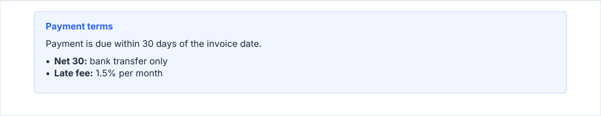
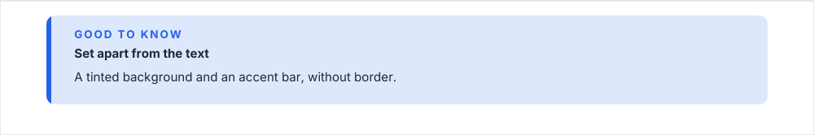
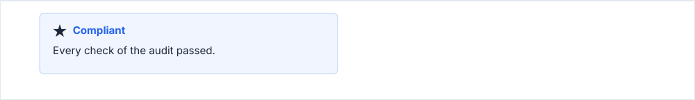

# infoBox

A box that sets content apart from the text. Two variants, told apart by `variant`: a bordered `surface` box with a
title (the default) and a tinted `callout`.

<!-- preview: info-box -->



```ts
doc.infoBox('Payment is due within 30 days of the invoice date.', {
  title: 'Payment terms',
  bulletPoints: ['Net 30: bank transfer only', 'Late fee: 1.5% per month'],
  boldPrefixes: ['Net 30:', 'Late fee:'],
});
```

`boldPrefixes` bolds the leading part of each bullet that starts with one of the listed strings, and its bullet.

## Callout

A tinted background and an accent bar, without border: it reads as a note in the margin of the text.

<!-- preview: info-box-callout -->



```ts
doc.infoBox('A tinted background and an accent bar, without border.', {
  variant: 'callout',
  eyebrow: 'Good to know',
  title: 'Set apart from the text',
});
```

## With an icon, in an inset

<!-- preview: info-box-icon -->



```ts
doc.inset({ width: 90 }, () => {
  doc.infoBox('Every check of the audit passed.', { title: 'Compliant', icon: 'star' });
});
```

The library ships no icon: `icon` is an image of yours, registered with `doc.registerImage` or passed as data.

## Options

`infoBox(content, options)`. The box takes the measure of its frame: narrow it with [`inset`](flow-control.md#inset). The two variants share
`bulletPoints`, `boldPrefixes` and `spaceAfter`; the compiler rejects the options of the other variant.

`variant: 'surface'` (default):

<!-- options: SurfaceInfoBoxOptions -->

| Option         | Type        | Default               | Description                                                                                                                                      |
| -------------- | ----------- | --------------------- | ------------------------------------------------------------------------------------------------------------------------------------------------ |
| `variant`      | `'surface'` |                       | The default variant: a bordered box on the `surface` color, drawn when `variant` is left out.                                                    |
| `title`        | `string`    | required              | Title line, in the `label` style. Required by the types; at run time, only a box with an `icon` must have one (the icon sits on the title line). |
| `icon`         | `string`    |                       | Icon before the title: a name given to `doc.registerImage`, or image data. The library ships no icon.                                            |
| `bulletPoints` | `string[]`  |                       | Bullet items listed under the content, each in `body` behind a bullet.                                                                           |
| `boldPrefixes` | `string[]`  |                       | A bullet that starts with one of these strings shows that prefix, and the bullet glyph, in bold.                                                 |
| `spaceAfter`   | `number`    | `theme.spacing.block` | Space (mm) under the box.                                                                                                                        |

<!-- /options -->

`variant: 'callout'`:

<!-- options: CalloutInfoBoxOptions -->

| Option         | Type        | Default               | Description                                                                                      |
| -------------- | ----------- | --------------------- | ------------------------------------------------------------------------------------------------ |
| `variant`      | `'callout'` | required              | A tinted note with no border, set apart from the text by an accent bar on its left.              |
| `eyebrow`      | `string`    |                       | Short text in capitals above the title.                                                          |
| `title`        | `string`    |                       | Title line, in bold body text.                                                                   |
| `accentBar`    | `boolean`   | `true`                | Accent bar on the left edge.                                                                     |
| `bulletPoints` | `string[]`  |                       | Bullet items listed under the content, each in `body` behind a bullet.                           |
| `boldPrefixes` | `string[]`  |                       | A bullet that starts with one of these strings shows that prefix, and the bullet glyph, in bold. |
| `spaceAfter`   | `number`    | `theme.spacing.block` | Space (mm) under the box.                                                                        |

<!-- /options -->

## Rules

- **Throws** an `InvalidOptionError` for an option of the other variant, even from JavaScript (an `icon` on a callout,
  an `eyebrow` or an `accentBar` on a surface box), a frame that leaves no room for the text, and an `icon` without a
  `title` (the icon sits on the title line), besides the checks every block makes (see
  [errors](errors.md#what-a-block-checks)). A surface box without an icon may leave `title` out at run time.
- **Warns** when the `icon` is neither a registered name nor readable image data: the box is drawn without it.
- **Across pages**: a box is never split; it moves to the next page when it does not fit. One
  [taller than a page](flow-control.md#taller-than-a-page) overflows it, with a warning.
- **In a column or an inset**: the box takes the measure of that frame.
- `computeInfoBoxHeight(ctx, content, options)` returns the height a box will take, without `spaceAfter`.
