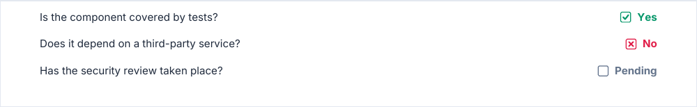

# inlineQuestion

A question on the left of the line, its answer on the right: a box (empty, checked or crossed) and the answer text,
ending on the right edge of the reading column. A long question wraps before the answer instead of running under it.

<!-- preview: inline-question -->



```ts
doc
  .inlineQuestion('Is the component covered by tests?', { variant: 'checked', answer: 'Yes' })
  .inlineQuestion('Does it depend on a third-party service?', { variant: 'cross', answer: 'No' })
  .inlineQuestion('Has the security review taken place?', { answer: 'Pending' });
```

## Options

`inlineQuestion(question, options?)`:

<!-- options: InlineQuestionOptions -->

| Option       | Type              | Default               | Description                                                                  |
| ------------ | ----------------- | --------------------- | ---------------------------------------------------------------------------- |
| `variant`    | `CheckboxVariant` | `'empty'`             | State of the answer box: `'empty'` (not answered), `'checked'` or `'cross'`. |
| `answer`     | `string`          |                       | Text after the box, in bold.                                                 |
| `spaceAfter` | `number`          | `theme.spacing.block` | Space (mm) under the question.                                               |
| `color`      | `ColorInput`      |                       | Color of the box and the answer, instead of the one the variant picks.       |

<!-- /options -->

## Rules

- **Throws** an `InvalidOptionError` for an `answer` that leaves the question no width, besides the checks every block
  makes (see [errors](errors.md#what-a-block-checks)).
- **Colors**: the box and the answer of `checked` are drawn in the success color (green by default), those of `cross`
  in the error color and those of `empty` in the secondary color; `color` replaces them. A [checkbox](checkbox.md) is
  checked in the primary color instead.
- **Across pages**: the line is never split. One [taller than a page](flow-control.md#taller-than-a-page) overflows it,
  with a warning.
- **In a column**: the answer ends on the right edge of the reading column of the column.
- For a box and its label alone, see [checkbox](checkbox.md).
