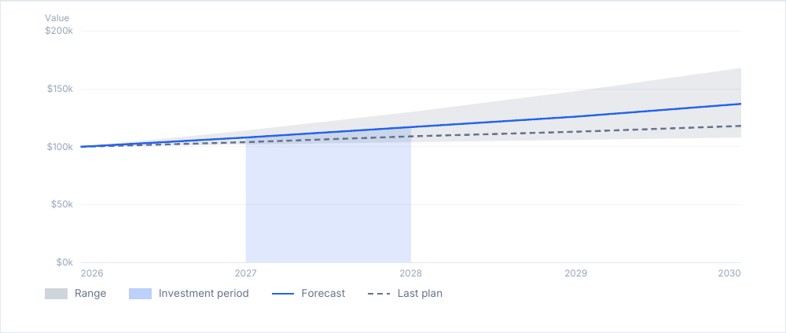
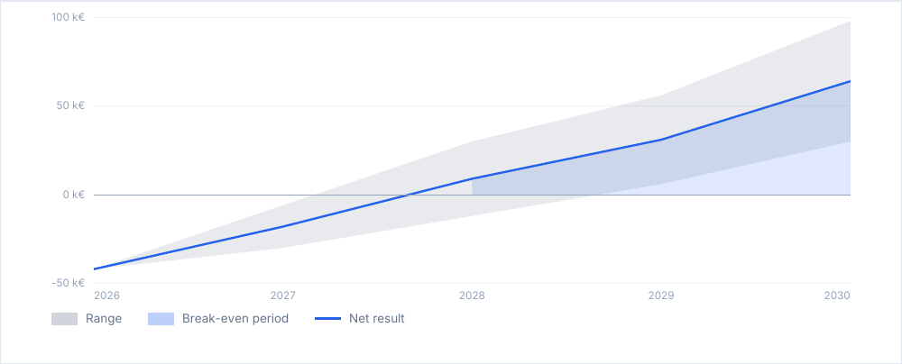

# lineChart

One or several lines over a numeric X axis, with an optional range around them and a highlighted period.

<!-- preview: line-chart -->



```ts
doc.lineChart(
  {
    xs: [2026, 2027, 2028, 2029, 2030],
    lines: [
      { label: 'Forecast', values: [100, 108, 117, 126, 137], emphasis: true },
      { label: 'Last plan', values: [100, 104, 109, 113, 118], dash: [1.5, 1], color: 'secondary' },
    ],
    band: { label: 'Range', lower: [100, 102, 104, 106, 108], upper: [100, 114, 130, 148, 168] },
  },
  {
    yTitle: 'Value',
    highlight: { from: 2027, to: 2028, label: 'Investment period' },
    formatValue: (value) => `$${value}k`,
  },
);
```

The Y axis runs from zero to a round maximum. `highlight` shades the area under the emphasized line between two X
values.

A value may be below zero: a gain that turns into a loss, a balance, a gap. The scale then extends under zero, and the
axis stays at zero:

<!-- preview: line-chart-signed -->



```ts
doc.lineChart(
  {
    xs: [2026, 2027, 2028, 2029, 2030],
    lines: [{ label: 'Net result', values: [-42, -18, 9, 31, 64], emphasis: true }],
    band: { label: 'Range', lower: [-42, -30, -12, 6, 30], upper: [-42, -6, 30, 56, 98] },
  },
  {
    highlight: { from: 2028, to: 2030, label: 'Break-even period' },
    formatValue: (value) => `${value} k€`,
  },
);
```

## Data

<!-- options: LineChartData -->

| Option  | Type          | Default  | Description                                                                                                                                                              |
| ------- | ------------- | -------- | ------------------------------------------------------------------------------------------------------------------------------------------------------------------------ |
| `xs`    | `number[]`    | required | X value of each point, e.g. years: finite numbers, each equal to or greater than the one before it. A value lower than the one before it throws an `InvalidOptionError`. |
| `lines` | `ChartLine[]` | required | The lines, each with one value per point of `xs`.                                                                                                                        |
| `band`  | `ChartBand`   |          | A shaded range, drawn under the lines.                                                                                                                                   |

<!-- /options -->

A line is:

<!-- options: ChartLine -->

| Option      | Type               | Default                                                                                | Description                                                                                                                                                          |
| ----------- | ------------------ | -------------------------------------------------------------------------------------- | -------------------------------------------------------------------------------------------------------------------------------------------------------------------- |
| `values`    | `number[]`         | required                                                                               | One value per point of `xs`, each a finite number, negative or not, else an `InvalidOptionError`, where `ChartColumn.values` leaves a value that is not above 0 out. |
| `lineWidth` | `number`           | 0.5                                                                                    | Stroke width (mm), above 0.                                                                                                                                          |
| `dash`      | `[number, number]` | a solid line                                                                           | Dash and gap lengths (mm) of a dashed line, 0 or more, not both 0.                                                                                                   |
| `emphasis`  | `boolean`          |                                                                                        | Draws the line last, over the others. The highlighted area follows the first line with emphasis.                                                                     |
| `label`     | `string`           | required                                                                               | Name in the legend.                                                                                                                                                  |
| `color`     | `ColorInput`       | a shade of the primary color, one per slice, layer or line in order, the primary first | Color in the chart and in the legend.                                                                                                                                |

<!-- /options -->

and the band:

<!-- options: ChartBand -->

| Option  | Type         | Default                                     | Description                                                                                             |
| ------- | ------------ | ------------------------------------------- | ------------------------------------------------------------------------------------------------------- |
| `color` | `ColorInput` | `'secondary'`, whatever the number of lines | Color in the chart and in the legend, drawn translucent.                                                |
| `lower` | `number[]`   | required                                    | One value per point of `xs`, like `ChartLine.values`, each at most the `upper` value of the same point. |
| `upper` | `number[]`   | required                                    | One value per point of `xs`, like `ChartLine.values`.                                                   |
| `label` | `string`     | required                                    | Name in the legend.                                                                                     |

<!-- /options -->

## Options

`lineChart(data, options?)`:

<!-- options: LineChartOptions -->

| Option        | Type                                                               | Default                                                                | Description                                                                                                                                                                                                              |
| ------------- | ------------------------------------------------------------------ | ---------------------------------------------------------------------- | ------------------------------------------------------------------------------------------------------------------------------------------------------------------------------------------------------------------------ |
| `highlight`   | `{ from: number; to: number; color?: ColorInput; label?: string }` |                                                                        | Colors the area between the emphasized line (or the first one) and the zero line, between two X values, e.g. a target period. Under a scale that goes below 0, the area follows the line on both sides of the zero line. |
| `xTitle`      | `string`                                                           |                                                                        | Title of the X axis, centered under its labels.                                                                                                                                                                          |
| `yTitle`      | `string`                                                           |                                                                        | Title of the Y axis, above the plot.                                                                                                                                                                                     |
| `formatValue` | `(value: number) => string`                                        | the number, rounded to the decimals that print the grid values exactly | Formats a Y value, e.g. `(value) => `$${value / 1000}k``. May run more than once per chart (`keepTogether` measures first): no side effects.                                                                             |
| `formatX`     | `(x: number) => string`                                            | the number                                                             | Formats an X value. Runs like `formatValue`.                                                                                                                                                                             |
| `height`      | `number`                                                           | 62                                                                     | Height (mm) of the plot, above 0.                                                                                                                                                                                        |
| `width`       | `number`                                                           | the available width                                                    | Width (mm) of the chart, Y labels included, above 0. Wider than the available width: brought down to it, with a warning.                                                                                                 |
| `yTicks`      | `number`                                                           | 4                                                                      | Horizontal grid lines above the axis, a whole number of 1 or more. A scale that goes below 0 has grid lines at the multiples of a round step that fit this number, so it may have one more.                              |
| `xTicks`      | `number`                                                           | 6                                                                      | Most labels under the X axis, a whole number of 2 or more.                                                                                                                                                               |
| `emptyText`   | `string`                                                           | none, the chart draws nothing                                          | Line drawn when there are fewer than two points or every value is 0.                                                                                                                                                     |
| `spaceAfter`  | `number`                                                           | `theme.spacing.block`                                                  | Space (mm) under the chart.                                                                                                                                                                                              |

<!-- /options -->

## Rules

- **Draws what it can**: with fewer than two points, or every value at 0, the chart draws nothing, or the `emptyText`
  line.
- **Throws** an `InvalidOptionError` for an `xs` value lower than the one before it (equal values are accepted), a line
  or a band with another number of values than points of `xs`, a line or band value that is not a finite number
  (negative values are accepted), a band whose `lower` value is above its `upper` one, a `dash` of two lengths that are
  both 0, a `highlight.to` below `highlight.from`, a `yTicks` that is not a whole number of 1 or more, an `xTicks` that
  is not one of 2 or more, besides the checks every block makes (see
  [errors](errors.md#what-a-block-checks)).
- **Scale**: it always includes zero. With no value below 0 it runs from 0 to a round maximum (1, 2, 2.5, 5 or 10
  times a power of ten), with `yTicks` equal intervals: nothing changes for such data. With a value below 0 (a line or
  the `lower` edge of the band) the step between two grid lines is the round number at or above the range of the data
  over `yTicks`, and the ends are the multiples of that step that enclose the data: at most `yTicks` + 1 intervals, zero
  always on the grid. A chart of negative values only has zero as the top of the scale. The scale is automatic: no
  option sets its ends.
- **Zero line**: the axis is drawn at zero, solid, over the lines: in the `border` color at the bottom of the plot, in
  the darker `subtle` color when the scale goes below zero. The grid lines are faint, and the bottom of a scale that
  goes below zero is one of them. The X labels and the X title stay under the plot. `formatValue` receives the
  negative values as they are; the default label prints them with a minus sign.
- **Colors**: lines without a `color` take the shades of the primary color, with or without a band or a highlight. A
  band without one is `'secondary'`, a highlight `'primary'`, both drawn translucent: their legend swatches differ.
- **Highlight**: the area runs from `from` to `to`, kept within the first and the last value of `xs`: a period that
  starts before the data starts with it. It is filled between the line and the zero line, above or below it, so a line
  that crosses zero shades both sides. The band is filled between its `lower` and `upper` edges wherever they stand.
- **Warns** when a plot narrower than 10 mm (a small `width`, wide Y labels) is not drawn: the chart takes no room and
  `doc.warnings` reads `Failed to draw lineChart: …`; and when a `width` wider than the available width is brought down.
- **Across pages**: the chart is never split. One [taller than a page](flow-control.md#taller-than-a-page) overflows it,
  with a warning.
- **In a column**: the available width is the column's.
- `computeLineChartHeight(ctx, data, options)` returns the height of the chart, without `spaceAfter`.
