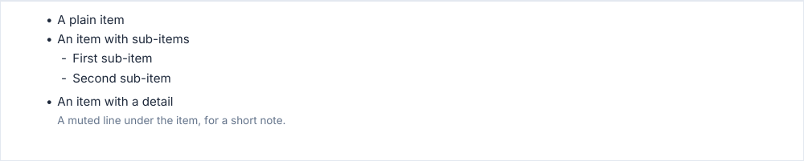
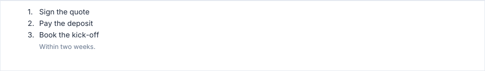

# bulletList, numberedList

Lists with sub-items and detail lines: `bulletList` marks each item with a bullet, `numberedList` with its number.

<!-- preview: bullet-list -->



```ts
doc.bulletList([
  'A plain item',
  { text: 'An item with sub-items', subItems: ['First sub-item', 'Second sub-item'] },
  { text: 'An item with a detail', detail: 'A muted line under the item, for a short note.' },
]);
```

## Numbered

<!-- preview: numbered-list -->



```ts
doc.numberedList(['Sign the quote', 'Pay the deposit', { text: 'Book the kick-off', detail: 'Within two weeks.' }]);
```

## An item

An item is a string, or an object:

<!-- options: ListItem -->

| Option     | Type                    | Default  | Description                                                                                                                                                                                                                                                              |
| ---------- | ----------------------- | -------- | ------------------------------------------------------------------------------------------------------------------------------------------------------------------------------------------------------------------------------------------------------------------------ |
| `text`     | `string`                | required | The item text, behind the bullet or number.                                                                                                                                                                                                                              |
| `subItems` | `string[]`              |          | Items nested under it, one dash each, indented 4 mm. Plain text: no sub-items of their own.                                                                                                                                                                              |
| `detail`   | `string \| RichBlock[]` |          | Text under the item, aligned with its text and set in `smallMuted`. A string is plain text, like `text`; emphasis and links come as blocks (`parseRichText('Some **detail**')`). Only its first line is kept with the item; a long detail may continue on the next page. |

<!-- /options -->

## Options

`bulletList(items, options?)` and `numberedList(items, options?)`:

<!-- options: ListOptions -->

| Option            | Type        | Default                               | Description                                                                                                                                                 |
| ----------------- | ----------- | ------------------------------------- | ----------------------------------------------------------------------------------------------------------------------------------------------------------- |
| `level`           | `TextLevel` | `'body'`                              | Text level of the items.                                                                                                                                    |
| `indent`          | `number`    | 0                                     | Indent (mm) of the whole list from the left margin, taken off its width.                                                                                    |
| `maxWidth`        | `number`    | the document `measure` minus `indent` | Width (mm) of the list, bullets included, above 0. Wider than the available width (the content width less `indent`): brought down to it, with a warning.    |
| `itemSpacing`     | `number`    | 1                                     | Space (mm) between two items: 0 or more.                                                                                                                    |
| `bulletChar`      | `string`    | `'•'`                                 | Bullet glyph of `bulletList`, a string. `numberedList` checks it and draws its numbers instead; `iconList` has no glyph, so it throws `InvalidOptionError`. |
| `lineHeightScale` | `number`    | 1                                     | Multiplies the line height.                                                                                                                                 |
| `spaceAfter`      | `number`    | `theme.spacing.block`                 | Space (mm) under the list.                                                                                                                                  |

<!-- /options -->

## Rules

- **Throws** an `InvalidOptionError` for an object item without a `text` string, an `itemSpacing` below 0, a `maxWidth`
  that is not above 0, and an `indent` or a `maxWidth` that leaves the items no width beside their bullets, besides the
  checks every block makes (see [errors](errors.md#what-a-block-checks)). The whole list is checked before its first
  item is drawn. An empty list draws nothing.
- **Warns** when `maxWidth` is wider than the available width: the list is brought down to it.
- **Across pages**: a list breaks between two items. Only the first line of a `detail` is kept with its item: a long
  detail may continue on the next page.
- **In a column**: the items wrap to the reading column of the column.
- For a list whose bullet is an image, see [iconList](icon-list.md).
