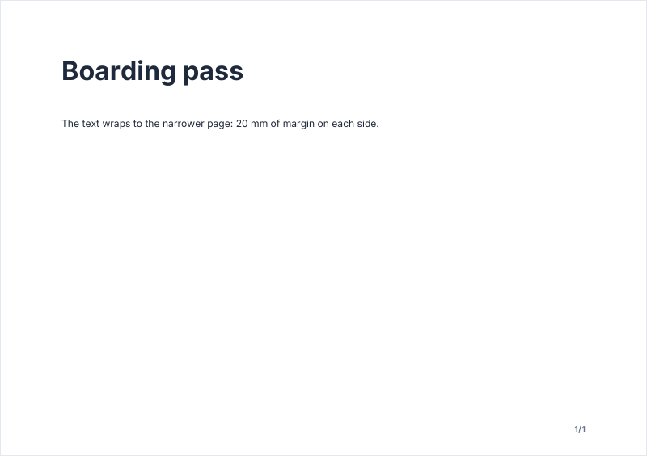

# Page formats

The page is the first thing a document decides: its format, its orientation, its margins and the width of its reading
column. Everything else follows: covers, watermarks, backgrounds, the running header and footer, columns, charts.

<!-- preview: page-format page=1 -->



```ts
import { PDFDocument } from '@mlt-a/jspdf-toolkit';
import { interFonts } from '@mlt-a/jspdf-toolkit/fonts/inter';

const doc = new PDFDocument({
  format: 'A5',
  orientation: 'landscape',
  margins: { left: 20, right: 20 },
  fonts: interFonts,
});

doc.heading('Boarding pass').paragraph('The text wraps to the narrower page: 20 mm of margin on each side.');
```

`format` is `'A3'`, `'A4'` (the default), `'A5'`, `'letter'`, `'legal'`, or `[width, height]` in mm for a custom size. A
custom size is taken as given: `[297, 210]` is a landscape page, and an `orientation` turns the page to match.

```ts
import { PDFDocument } from '@mlt-a/jspdf-toolkit';

const label = new PDFDocument({ format: [100, 60] }); // width, height in mm
label.paragraph('A label.');
```

## Margins and the reading column

- Margin defaults: `top` 20, `left` 12, `right` = `left`, `bottom` 15 (the footer zone, at least 11 mm to fit a footer).
  Omit a side to keep its default.
- A `pageHeader` needs 16 mm of top margin for its line and rule: it raises `top` to 16 when it is lower, and leaves
  the default 20 as it is.
- `firstPageTop` lowers or raises the top of the content on the first page only: room for a letterhead, or a first page
  that starts higher.
- `measure` is the width of the reading column: the default width of headings, paragraphs, lists, fields, boxes,
  declarations and signatures. Tables, charts, columns, separators, the running header and footer and the covers span
  the content width.

<!-- options: DocumentOptions -->

| Option         | Type                        | Default                                                                                     | Description                                                                                                                                                                                                                                                                                                                                                                                                                                                                                                                                                                                                |
| -------------- | --------------------------- | ------------------------------------------------------------------------------------------- | ---------------------------------------------------------------------------------------------------------------------------------------------------------------------------------------------------------------------------------------------------------------------------------------------------------------------------------------------------------------------------------------------------------------------------------------------------------------------------------------------------------------------------------------------------------------------------------------------------------- |
| `theme`        | `Theme`                     | `createTheme()`                                                                             | Colors, typography and spacing of every block: `createTheme(…)` or `presetTheme(…)`.                                                                                                                                                                                                                                                                                                                                                                                                                                                                                                                       |
| `format`       | `PageFormat`                | `'A4'`                                                                                      | Page format: `'A3'`, `'A4'`, `'A5'`, `'letter'`, `'legal'`, or `[width, height]` in mm. Margins, content area, covers, watermarks, backgrounds, header and footer follow it. Throws `InvalidOptionError` for an unknown name or a size that is not two finite numbers above 0.                                                                                                                                                                                                                                                                                                                             |
| `orientation`  | `'portrait' \| 'landscape'` | `'portrait'`, or the shape of a custom `[width, height]` format (`[297, 210]` is landscape) | Given with a custom format, it turns the page to match.                                                                                                                                                                                                                                                                                                                                                                                                                                                                                                                                                    |
| `margins`      | `Partial<Margins>`          |                                                                                             | Page margins (mm); omitted sides keep their default.                                                                                                                                                                                                                                                                                                                                                                                                                                                                                                                                                       |
| `fonts`        | `FontSource[]`              |                                                                                             | Font files to embed. When `theme.typography.fontFamily` is not set, the first family listed here becomes the default family; without fonts, Helvetica.                                                                                                                                                                                                                                                                                                                                                                                                                                                     |
| `firstPageTop` | `number`                    | `margins.top`                                                                               | Top of the content (mm) on the first page only, e.g. lower to leave room for a letterhead, higher to start right away.                                                                                                                                                                                                                                                                                                                                                                                                                                                                                     |
| `measure`      | `number`                    | the content width                                                                           | Width (mm) of the reading column: the default width of text blocks (headings, paragraphs and rich text, lists, fields, checkboxes, inline questions, whose answer ends on its right edge, badges, info boxes, declarations, signatures, and address blocks), so lines stay short on a wide page. A reading column narrower than the content width leaves air on the right. Tables, charts, columns, header columns, separators, the running header and footer, covers and watermarks span the content width. Inside a `columns` callback, the reading column is the narrower of the column and this width. |
| `compress`     | `boolean`                   | `true`                                                                                      | Compresses the PDF streams.                                                                                                                                                                                                                                                                                                                                                                                                                                                                                                                                                                                |
| `title`        | `string`                    |                                                                                             | PDF metadata title.                                                                                                                                                                                                                                                                                                                                                                                                                                                                                                                                                                                        |
| `author`       | `string`                    |                                                                                             | PDF metadata author.                                                                                                                                                                                                                                                                                                                                                                                                                                                                                                                                                                                       |
| `subject`      | `string`                    |                                                                                             | PDF metadata subject.                                                                                                                                                                                                                                                                                                                                                                                                                                                                                                                                                                                      |
| `keywords`     | `string[]`                  |                                                                                             | PDF metadata keywords.                                                                                                                                                                                                                                                                                                                                                                                                                                                                                                                                                                                     |
| `creator`      | `string`                    |                                                                                             | PDF metadata creator.                                                                                                                                                                                                                                                                                                                                                                                                                                                                                                                                                                                      |
| `debug`        | `boolean`                   | `false`                                                                                     | Prints each warning to the console as it is raised, besides listing it in `warnings`.                                                                                                                                                                                                                                                                                                                                                                                                                                                                                                                      |

<!-- /options -->

and the margins:

<!-- options: Margins -->

| Option   | Type     | Default | Description                                                                                            |
| -------- | -------- | ------- | ------------------------------------------------------------------------------------------------------ |
| `top`    | `number` | 20      | Top of the content on every page after the first. A declared `pageHeader` widens it to clear its rule. |
| `right`  | `number` | `left`  | Space between the content and the right edge of the page.                                              |
| `bottom` | `number` | 15      | Height of the zone under the content, which holds the page footer.                                     |
| `left`   | `number` | 12      | Space between the content and the left edge of the page.                                               |

<!-- /options -->

## Rules

- **Throws** an `InvalidOptionError` at construction for a `format` that is not one of the five names written exactly
  (`'a4'` throws) or a size that is not two finite numbers above 0; an `orientation` that is neither `'portrait'` nor
  `'landscape'`; a negative margin; margins that leave no width or no height; a `measure` wider than the content width;
  a `firstPageTop` below 0; and the checks every option of the constructor makes (see
  [errors](errors.md#what-a-block-checks)).
- **Counts** `margins.top` and `margins.bottom` for the height: the room a `pageHeader` takes is declared later and is
  not part of the check.
- **Read-only state**: `doc.pageWidth`, `doc.pageHeight`, `doc.margins`, `doc.contentWidth`, `doc.measure` and
  `doc.firstPageTop` describe the page, or the column inside a `columns` callback. `doc.margins` is one frozen object
  per page or column, the same on every read: its `top` follows a `pageHeader` declared after you read it; spread it
  (`{ ...doc.margins }`) for a copy that stays.
