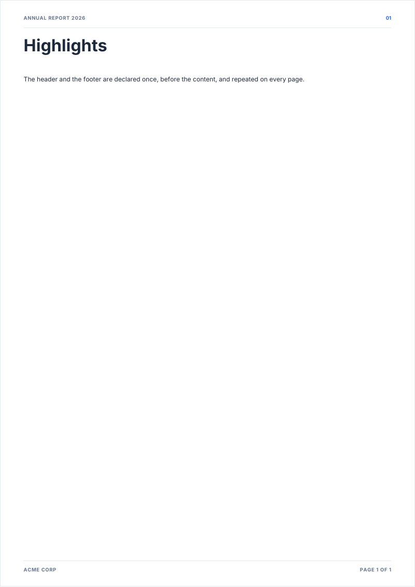

# pageHeader, pageFooter

The running header and footer, drawn on every numbered page when the document is finalized.

<!-- preview: page-header-footer page=1 -->



```ts
doc
  .pageHeader({ title: 'Annual report 2026', folio: true })
  .pageFooter({ left: 'Acme Corp', right: 'Page {page} of {pages}' });
doc
  .heading('Highlights')
  .paragraph('The header and the footer are declared once, before the content, and repeated on every page.');
```

`{page}` and `{pages}` stand for the page number and the page count, written as they are (`3`, `12`). `folio: true`
prints the page number of the header on two digits at least (`03`). The texts are set in capitals with a light letter
spacing, as the rendering shows: `theme.chrome` changes that (see the rules).

## The default footer, and none

Without `pageFooter`, a document prints `{page}/{pages}` on the right. Declaring a footer replaces it: put `{page}` in
`left` or `right` to keep the number. `pageFooter(false)` removes the footer altogether.

```ts
doc.pageFooter(false);
```

## A header and footer of your own

`variant: 'custom'` takes a `draw` function in place of the options: `finalize()` runs it on every numbered page, with
the number of that page and the page count. `reserve` is the top margin the custom header needs, in mm.

<!-- preview: page-header-footer-custom page=1 -->


```ts
import { setFont } from '@mlt-a/jspdf-toolkit';

doc
  .pageHeader({
    variant: 'custom',
    reserve: 30,
    draw: (ctx, { page }) => {
      ctx.doc.setFillColor(ctx.theme.colors.primary);
      ctx.doc.rect(0, 0, 8, 24, 'F');
      setFont(ctx, 'title', 'bold', 9);
      ctx.doc.setTextColor(ctx.theme.colors.secondary);
      ctx.doc.text('Annual report 2026', ctx.margins.left, 16);
      ctx.doc.setTextColor(ctx.theme.colors.primary);
      ctx.doc.text(String(page).padStart(2, '0'), ctx.pageWidth - ctx.margins.right, 16, { align: 'right' });
    },
  })
  .pageFooter({
    variant: 'custom',
    draw: (ctx, { page, pages }) => {
      ctx.doc.setTextColor(ctx.theme.colors.secondary);
      ctx.doc.text(`${page} of ${pages}`, ctx.pageWidth / 2, ctx.pageHeight - 7, { align: 'center' });
    },
  });
doc.heading('Highlights').paragraph('The content starts under the 30 mm the header reserves.');
```

## Options

`pageHeader(options)`:

<!-- options: PlainPageHeaderOptions -->

| Option    | Type      | Default   | Description                                                                                                        |
| --------- | --------- | --------- | ------------------------------------------------------------------------------------------------------------------ |
| `variant` | `'plain'` | `'plain'` | A header drawn by the library from the options below.                                                              |
| `title`   | `string`  |           | Running title, left-aligned. Cut short with "…" when it would run into the page number or past the margin.         |
| `folio`   | `boolean` | `false`   | Page number, right-aligned, in the primary color: the number printed in the footer, on two digits at least (`01`). |

<!-- /options -->

`pageFooter(options | false)`:

<!-- options: PlainPageFooterOptions -->

| Option    | Type      | Default                   | Description                                                                                                                                                                                                                              |
| --------- | --------- | ------------------------- | ---------------------------------------------------------------------------------------------------------------------------------------------------------------------------------------------------------------------------------------- |
| `variant` | `'plain'` | `'plain'`                 | A footer drawn by the library from the options below.                                                                                                                                                                                    |
| `left`    | `string`  |                           | Left label. `{page}` and `{pages}` stand for the printed page number and the page count, e.g. `'{page}/{pages}'`. Declaring a footer replaces the default one (`{ right: '{page}/{pages}' }`): print the page numbers with these tokens. |
| `right`   | `string`  |                           | Right label, same tokens as `left`.                                                                                                                                                                                                      |
| `logo`    | `string`  | `theme.assets.footerLogo` | Logo centered between the labels: a name given to `registerImage`, or image data.                                                                                                                                                        |
| `rule`    | `boolean` | `true`                    | Rule over the footer.                                                                                                                                                                                                                    |

<!-- /options -->

`pageHeader({ variant: 'custom', … })`:

<!-- options: CustomPageHeaderOptions -->

| Option    | Type                                                  | Default  | Description                                                                                                                                                                                                                       |
| --------- | ----------------------------------------------------- | -------- | --------------------------------------------------------------------------------------------------------------------------------------------------------------------------------------------------------------------------------- |
| `variant` | `'custom'`                                            | required | A header drawn by `draw` on every numbered page.                                                                                                                                                                                  |
| `reserve` | `number`                                              | 0        | Top margin (mm) the header needs, below which the content starts: a lower `margins.top` is raised to it, as the plain header does with 16 mm; 0 leaves the margins as they are. Less than the page height minus `margins.bottom`. |
| `draw`    | `(ctx: DrawingContext, numbers: PageNumbers) => void` | required | Draws the header of one page: `ctx` is the document, on that page; `numbers` its number and the page count.                                                                                                                       |

<!-- /options -->

`pageFooter({ variant: 'custom', … })`:

<!-- options: CustomPageFooterOptions -->

| Option    | Type                                                  | Default  | Description                                                                                                 |
| --------- | ----------------------------------------------------- | -------- | ----------------------------------------------------------------------------------------------------------- |
| `variant` | `'custom'`                                            | required | A footer drawn by `draw` on every numbered page.                                                            |
| `draw`    | `(ctx: DrawingContext, numbers: PageNumbers) => void` | required | Draws the footer of one page: `ctx` is the document, on that page; `numbers` its number and the page count. |

<!-- /options -->

`draw` receives a `PageNumbers`:

<!-- options: PageNumbers -->

| Option  | Type     | Default  | Description                                                                        |
| ------- | -------- | -------- | ---------------------------------------------------------------------------------- |
| `page`  | `number` | required | Number of the page, from 1, the covers not counted: its entry in `doc.pageLabels`. |
| `pages` | `number` | required | Number of numbered pages: the size of `doc.pageLabels`.                            |

<!-- /options -->

## Rules

- **Throws** an `InvalidOptionError` for a `pageFooter` argument that is neither an object nor `false`, besides the
  checks every block makes (see [errors](errors.md#what-a-block-checks)). A custom variant throws without a `draw`
  function, and each variant throws on an option of the other (`title` on a custom header, `draw` or `reserve` on a
  plain one), at the call.
- **Warns** when the footer `logo` is neither a registered name nor readable image data, and when a footer does not fit.
- **Declare the header before the content**: the header needs 16 mm of top margin for its line and rule. It raises
  `margins.top` to 16 when it is lower, and warns if content already sits above the new top; the default 20 mm is
  enough, so nothing moves. A custom header does the same with its `reserve`, 0 by default: the margins stay.
- **The custom callbacks**: `draw` runs once per numbered page, the footer on every page first, then the header. `ctx`
  is the document on that page, laid out on the whole page (`margins`, `contentWidth`), from the `body` text style; the
  font, colors and line width it sets do not reach the next page. A custom footer draws in the bottom margin as it is:
  it takes no `theme.assets.footerLogo` and needs no minimum height.
- **Draw with jsPDF**: use `ctx.doc` and the low-level primitives. A block (`ctx.paragraph`…) is drawn after
  `finalize()` and warns as such.
- **When a callback throws**, `finalize()` stops and the error propagates: the pages drawn so far keep what was drawn,
  the watermarks are not drawn, and the document stays finalized.
- **Numbering**: page numbers count from 1 and skip the [cover](cover.md) and the [back cover](back-cover.md), which
  take neither header nor footer; `doc.pageLabels` maps the pages to their numbers.
- **Look**: the texts take the font of the `label` level at the size of `footer`, in `secondary`; the page number of
  the header is in `primary`. Capitals and letter spacing come from `theme.chrome`:
  `createTheme({ chrome: { uppercase: false } })` keeps the case of the text.
- **In a column**: both are page methods: they act on every numbered page, whatever column declares them.
