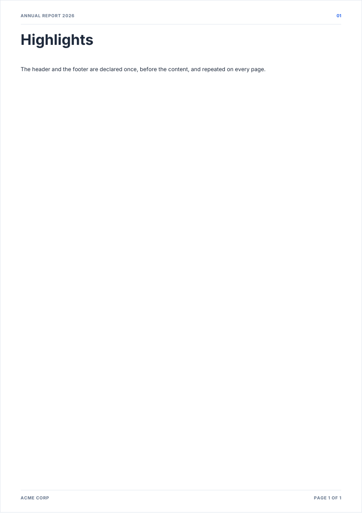

# pageHeader, pageFooter

The running header and footer, drawn on every numbered page when the document is finalized.

<!-- preview: page-header-footer page=1 -->



```ts
doc
  .pageHeader({ title: 'Annual report 2026', folio: true })
  .pageFooter({ left: 'Acme Corp', right: 'Page {page} of {pages}' });
doc
  .heading('Highlights')
  .paragraph('The header and the footer are declared once, before the content, and repeated on every page.');
```

`{page}` and `{pages}` stand for the page number and the page count, written as they are (`3`, `12`). `folio: true`
prints the page number of the header on two digits at least (`03`). The texts are set in capitals with a light letter
spacing, as the rendering shows: `theme.chrome` changes that (see the rules).

## The default footer, and none

Without `pageFooter`, a document prints `{page}/{pages}` on the right. Declaring a footer replaces it: put `{page}` in
`left` or `right` to keep the number. `pageFooter(false)` removes the footer altogether.

```ts
doc.pageFooter(false);
```

## Options

`pageHeader(options)`:

<!-- options: PageHeaderOptions -->

| Option  | Type      | Default | Description                                                                                                        |
| ------- | --------- | ------- | ------------------------------------------------------------------------------------------------------------------ |
| `title` | `string`  |         | Running title, left-aligned. Cut short with "…" when it would run into the page number or past the margin.         |
| `folio` | `boolean` | `false` | Page number, right-aligned, in the primary color: the number printed in the footer, on two digits at least (`01`). |

<!-- /options -->

`pageFooter(options | false)`:

<!-- options: PageFooterOptions -->

| Option  | Type      | Default                   | Description                                                                                                                                                                                                                              |
| ------- | --------- | ------------------------- | ---------------------------------------------------------------------------------------------------------------------------------------------------------------------------------------------------------------------------------------- |
| `left`  | `string`  |                           | Left label. `{page}` and `{pages}` stand for the printed page number and the page count, e.g. `'{page}/{pages}'`. Declaring a footer replaces the default one (`{ right: '{page}/{pages}' }`): print the page numbers with these tokens. |
| `right` | `string`  |                           | Right label, same tokens as `left`.                                                                                                                                                                                                      |
| `logo`  | `string`  | `theme.assets.footerLogo` | Logo centered between the labels: a name given to `registerImage`, or image data.                                                                                                                                                        |
| `rule`  | `boolean` | `true`                    | Rule over the footer.                                                                                                                                                                                                                    |

<!-- /options -->

## Rules

- **Throws** an `InvalidOptionError` for a `pageFooter` argument that is neither an object nor `false`, besides the
  checks every block makes (see [errors](errors.md#what-a-block-checks)).
- **Warns** when the footer `logo` is neither a registered name nor readable image data, and when a footer does not fit.
- **Declare the header before the content**: the header needs 16 mm of top margin for its line and rule. It raises
  `margins.top` to 16 when it is lower, and warns if content already sits above the new top; the default 20 mm is
  enough, so nothing moves.
- **Numbering**: page numbers count from 1 and skip the [cover](cover.md) and the [back cover](back-cover.md), which
  take neither header nor footer; `doc.pageLabels` maps the pages to their numbers.
- **Look**: the texts take the font of the `label` level at the size of `footer`, in `secondary`; the page number of
  the header is in `primary`. Capitals and letter spacing come from `theme.chrome`:
  `createTheme({ chrome: { uppercase: false } })` keeps the case of the text.
- **In a column**: both are page methods: they act on every numbered page, whatever column declares them.
