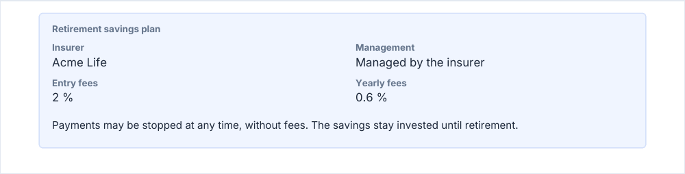
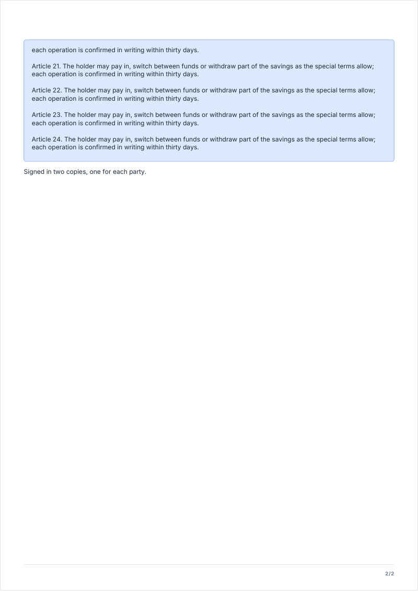

# panel

A frame around any blocks: a heading, fields, paragraphs, rich text, a table. The blocks are drawn by a callback, inside
a fill and border with padding on every side.

<!-- preview: panel -->



```ts
doc.panel(() => {
  doc.heading('Retirement savings plan', { level: 'h4' });
  doc.fieldRows([
    [
      { label: 'Insurer', value: 'Acme Life' },
      { label: 'Management', value: 'Managed by the insurer' },
    ],
    [
      { label: 'Entry fees', value: '2 %' },
      { label: 'Yearly fees', value: '0.6 %' },
    ],
  ]);
  doc.paragraph('Payments may be stopped at any time, without fees. The savings stay invested until retirement.');
});
```

The first block sits at the top of the content, without the space it asks above it. A heading called just before the
panel stands above the frame and moves with it.

## Across pages

A panel that fits on one page is kept on one page: on the current one when it fits under the position, else on the
next. A taller one is split, and every page holds a frame of its own, closed on its four sides, with the padding kept
at the top and the bottom of the page. The rendering shows the second page.

<!-- preview: panel-split page=2 -->



```ts
const clauses = Array.from(
  { length: 24 },
  (_, index) =>
    `Article ${index + 1}. The holder may pay in, switch between funds or withdraw part of the savings as the ` +
    'special terms allow; each operation is confirmed in writing within thirty days.',
);
doc.heading('Savings contract', { level: 'h2' });
doc.panel(
  () => {
    doc.heading('General terms', { level: 'h4' });
    doc.paragraphs(clauses);
  },
  { boxStyle: 'tint' },
);
doc.paragraph('Signed in two copies, one for each party.');
```

## Options

`panel(draw, options?)`:

<!-- options: PanelOptions -->

| Option       | Type             | Default               | Description                                                                                                  |
| ------------ | ---------------- | --------------------- | ------------------------------------------------------------------------------------------------------------ |
| `boxStyle`   | `BoxStylePreset` | `'surface'`           | Fill and border of the frame, a `BoxStylePreset`.                                                            |
| `padding`    | `number`         | 4                     | Space (mm) between the frame and its content, on its four sides, on every page the panel runs on: 0 or more. |
| `radius`     | `number`         | 1                     | Corner radius (mm) of the frame: 0 or more.                                                                  |
| `spaceAfter` | `number`         | `theme.spacing.block` | Space (mm) under the panel.                                                                                  |

<!-- /options -->

## Rules

- **Throws** an `InvalidOptionError` for a `draw` that is no function, and for a padding that leaves the content no
  width, besides the checks every block makes (see [errors](errors.md#what-a-block-checks)).
- **Measured first**: the callback runs up to three times (measuring passes, then the real one), as with
  [`keepTogether`](flow-control.md#keeptogether). Keep it free of side effects: a callback that draws more on its last
  run gets a frame that runs to the bottom of the page.
- **Across pages**: kept on one page when it fits on one; split otherwise, one closed frame per page. A first frame
  that would hold nothing moves the panel to the next page.
- **In a column or an inset**: the frame takes the measure of that frame, and the blocks inside wrap to it less the
  padding. Panels nest.
