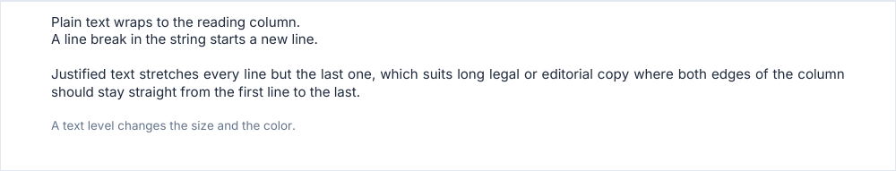

# paragraph, paragraphs

Plain text wrapped to the reading column. `paragraphs` draws several at once.

<!-- preview: paragraph -->



```ts
doc
  .paragraph('Plain text wraps to the reading column.\nA line break in the string starts a new line.')
  .paragraph(
    'Justified text stretches every line but the last one, which suits long legal or editorial copy where both ' +
      'edges of the column should stay straight from the first line to the last.',
    { align: 'justify' },
  )
  .paragraph('A text level changes the size and the color.', { level: 'smallMuted' });
```

## Several paragraphs

`paragraphs(texts, options?)` takes the same options, plus `itemSpacing` between two paragraphs. `spaceAfter` is the
space under the last one.

<!-- preview: paragraphs -->


```ts
import { SPACING } from '@mlt-a/jspdf-toolkit';

doc.paragraphs(['First point.', 'Second point.', 'Third point, indented like the others.'], {
  itemSpacing: SPACING.small,
  indent: SPACING.xlarge,
});
```

## Options

`paragraph(text, options?)`:

<!-- options: ParagraphOptions -->

| Option            | Type                  | Default                               | Description                                                                                                                     |
| ----------------- | --------------------- | ------------------------------------- | ------------------------------------------------------------------------------------------------------------------------------- |
| `level`           | `TextLevel`           | `'body'`                              | Text level of the paragraph.                                                                                                    |
| `indent`          | `number`              | 0                                     | Indent (mm) from the left margin.                                                                                               |
| `maxWidth`        | `number`              | the document `measure` minus `indent` | Line width (mm), above 0. Wider than the available width (the content width less `indent`): brought down to it, with a warning. |
| `align`           | `'justify' \| 'left'` | `left`                                | `justify` stretches every line but the last one of each source line.                                                            |
| `lineHeightScale` | `number`              | 1                                     | Multiplies the line height.                                                                                                     |
| `spaceAfter`      | `number`              | `theme.spacing.block`                 | Space (mm) after the paragraph.                                                                                                 |

<!-- /options -->

`paragraphs(texts, options?)`:

<!-- options: ParagraphsOptions -->

| Option            | Type                  | Default                               | Description                                                                                                                     |
| ----------------- | --------------------- | ------------------------------------- | ------------------------------------------------------------------------------------------------------------------------------- |
| `itemSpacing`     | `number`              | `theme.spacing.block`                 | Space (mm) between two paragraphs: 0 or more.                                                                                   |
| `level`           | `TextLevel`           | `'body'`                              | Text level of the paragraph.                                                                                                    |
| `indent`          | `number`              | 0                                     | Indent (mm) from the left margin.                                                                                               |
| `maxWidth`        | `number`              | the document `measure` minus `indent` | Line width (mm), above 0. Wider than the available width (the content width less `indent`): brought down to it, with a warning. |
| `align`           | `'justify' \| 'left'` | `left`                                | `justify` stretches every line but the last one of each source line.                                                            |
| `lineHeightScale` | `number`              | 1                                     | Multiplies the line height.                                                                                                     |
| `spaceAfter`      | `number`              | `theme.spacing.block`                 | Space (mm) after the paragraph.                                                                                                 |

<!-- /options -->

## Rules

- **Throws** an `InvalidOptionError` for an `indent` that leaves the text no width, an `itemSpacing` below 0, and a
  `maxWidth` or `lineHeightScale` that is not above 0, besides the checks every block makes (see
  [errors](errors.md#what-a-block-checks)). An empty text draws nothing.
- **Warns** when `maxWidth` is wider than the available width: the lines are brought down to it.
- **Line breaks**: a `\n` in the text starts a new line; `justify` leaves the line before it ragged, like the last line.
- **Across pages**: a paragraph breaks line by line.
- **In a column**: the text wraps to the reading column of the column.
- For bold, italic or links inside the text, use [richText](rich-text.md); `level` is described in
  [text levels](text-levels.md).
- `computeParagraphHeight(ctx, text, options)` returns the height a paragraph will take, without `spaceAfter`.
