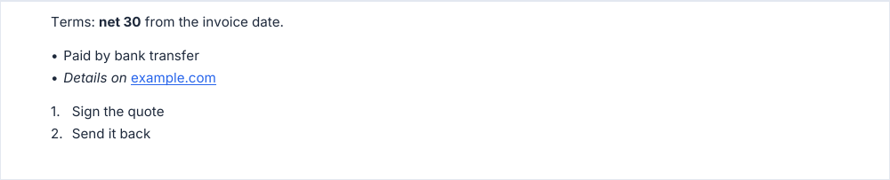

# richText, richBlocks

Text with bold, italic and links. `richText` reads a light markup, `richBlocks` takes the same content as data.

<!-- preview: rich-text -->


```ts
doc.richText(
  'Revenue grew **15%**, driven by *new markets* and a **stronger customer base**.\n\n' +
    'A blank line starts a new paragraph. Escape a star with \\*.',
);
```

| Markup              | Result                                                                                   |
| ------------------- | ---------------------------------------------------------------------------------------- |
| `**bold**`          | Bold.                                                                                    |
| `*italic*`          | Italic.                                                                                  |
| `**bold *nested***` | Bold, then bold italic, when the font family has a bold italic face (see the rules).     |
| `\*`                | A literal star.                                                                          |
| A line break        | A space: the text flows on, unlike in `paragraph`, where a line break starts a new line. |
| A blank line        | A new paragraph.                                                                         |

The words outside the markup keep the weight of their [text level](text-levels.md); `**…**` makes them bold.

## From data: richBlocks

`richBlocks(blocks, options?)` draws paragraphs and lists from data. It is how you add a link: a run is
`{ text, bold?, italic?, link? }`, and a block is `{ type: 'paragraph', runs }`, or a list of runs per item:
`{ type: 'bulletList', items }` or `{ type: 'numberedList', items }`, numbered. A `\n` in the text of a run starts a new
line.

<!-- preview: rich-blocks -->



```ts
doc.richBlocks([
  {
    type: 'paragraph',
    runs: [{ text: 'Terms: ' }, { text: 'net 30', bold: true }, { text: ' from the invoice date.' }],
  },
  {
    type: 'bulletList',
    items: [
      [{ text: 'Paid by bank transfer' }],
      [
        { text: 'Details on ', italic: true },
        { text: 'example.com', link: 'https://example.com' },
      ],
    ],
  },
  { type: 'numberedList', items: [[{ text: 'Sign the quote' }], [{ text: 'Send it back' }]] },
]);
```

## Options

`richText(markup, options?)` and `richBlocks(blocks, options?)`:

<!-- options: RichTextOptions -->

| Option       | Type                  | Default                                                  | Description                                                                                                                                     |
| ------------ | --------------------- | -------------------------------------------------------- | ----------------------------------------------------------------------------------------------------------------------------------------------- |
| `level`      | `TextLevel`           | `body`                                                   | Text level of the block (size, color, base weight). Emphasis is set run by run.                                                                 |
| `indent`     | `number`              | 0                                                        | Indent (mm) from the left margin.                                                                                                               |
| `maxWidth`   | `number`              | the document `measure` minus `indent`                    | Line width (mm), above 0. Wider than the available width (the content width less `indent`): brought down to it, with a warning.                 |
| `align`      | `'justify' \| 'left'` | `left`                                                   | `justify` stretches the spaces of every line but the last one of each paragraph and list item, and the line before a `\n` in the text of a run. |
| `spaceAfter` | `number`              | `theme.spacing.block`, also the space between two blocks | Space (mm) after the last block.                                                                                                                |

<!-- /options -->

## Rules

- **Throws** an `InvalidOptionError` for a block of an unknown `type` and the options `paragraph` rejects, besides the
  checks every block makes (see [errors](errors.md#what-a-block-checks)).
- **Bold italic** needs a bold italic face in the font family. Without one, as with Inter, the text is drawn in bold and
  `doc.warnings` says so: `Font family "Inter" has no bolditalic face: drawn as bold`. Italic alone falls back to the
  regular face the same way.
- **Warns** when `maxWidth` is wider than the available width: the lines are brought down to it.
- **Across pages**: the text breaks line by line.
- **In a column**: the text wraps to the reading column of the column.
- `parseRichText(markup)` returns the `RichBlock[]` that `richText` draws, and `parseRichInline(markup)` the runs of one
  line: use them to build blocks from user input, or the `detail` of a [list](lists.md) item.
- `computeRichTextHeight` and `computeRichBlocksHeight` return the height a block will take, without `spaceAfter`.
