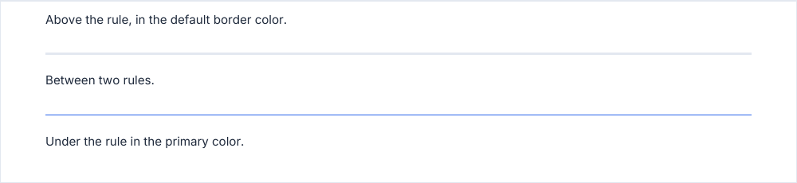

# separator

A horizontal rule across the content width.

<!-- preview: separator -->



```ts
doc
  .paragraph('Above the rule, in the default border color.')
  .separator({ lineWidth: 0.5 })
  .paragraph('Between two rules.')
  .separator({ color: 'primary' })
  .paragraph('Under the rule in the primary color.');
```

## Options

`separator(options?)`:

<!-- options: SeparatorOptions -->

| Option        | Type         | Default                                                                           | Description                                                                                                                                               |
| ------------- | ------------ | --------------------------------------------------------------------------------- | --------------------------------------------------------------------------------------------------------------------------------------------------------- |
| `color`       | `ColorInput` | `'border'`                                                                        | Color of the rule.                                                                                                                                        |
| `lineWidth`   | `number`     | `LINE_WIDTH.normal`                                                               | Stroke width (mm) of the rule: above 0.                                                                                                                   |
| `spaceAfter`  | `number`     | `SPACING.large`                                                                   | Space (mm) under the rule.                                                                                                                                |
| `spaceBefore` | `number`     | `SPACING.large`, wider than the space under a block, so the rule reads as a break | Space (mm) above the rule. It collapses with the space the previous block left under it: the larger of the two separates them. None at the top of a page. |

<!-- /options -->

## Rules

- **Throws** an `InvalidOptionError` for a `lineWidth` that is not above 0, besides the checks every block makes (see
  [errors](errors.md#what-a-block-checks)).
- **Spacing**: the space around the rule is wider than a block's (6 mm each side) and collapses with those of its
  neighbors, like every block. There is none above the first block of a page.
- **Across pages**: the rule and its space stay together.
- **In a column**: the rule spans the column.
