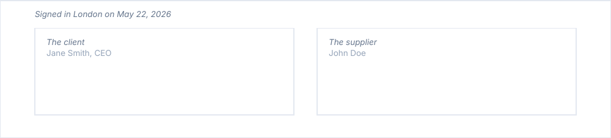
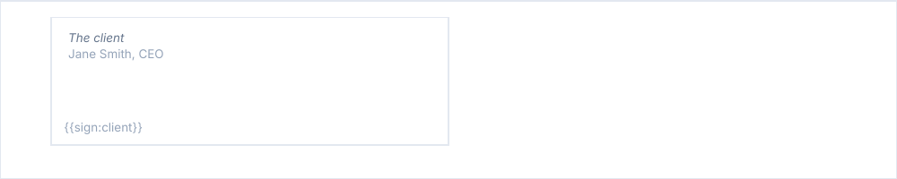

# signatureZone

One or two signature boxes, with an optional line above them.

<!-- preview: signature-zone -->



```ts
doc.signatureZone(
  [
    { label: 'The client', sublabel: 'Jane Smith, CEO' },
    { label: 'The supplier', sublabel: 'John Doe' },
  ],
  { caption: 'Signed in London on May 22, 2026' },
);
```

## An e-signature anchor

`anchorKey` hands the box to `renderAnchor`, where you place the tag your e-signature provider looks for.

<!-- preview: signature-zone-anchor -->



```ts
import { setFont } from '@mlt-a/jspdf-toolkit';

doc.signatureZone([{ label: 'The client', sublabel: 'Jane Smith, CEO', anchorKey: 'client' }], {
  height: 30,
  renderAnchor: (ctx, box, key) => {
    setFont(ctx, 'body', 'regular', 8);
    ctx.doc.setTextColor(ctx.theme.colors.subtle);
    ctx.doc.text(`{{sign:${key}}}`, box.x + 3, box.y + box.height - 3);
  },
});
```

## A signature image

`image` draws a scanned signature in the box: a name given to `registerImage`, or image data.

```ts
import { loadImageFromPath } from '@mlt-a/jspdf-toolkit/node';

doc.registerImage('signature', loadImageFromPath('./signature.png'));
doc.signatureZone([{ label: 'The supplier', sublabel: 'John Doe', image: 'signature' }]);
```

## An item

<!-- options: SignatureItem -->

| Option         | Type     | Default                           | Description                                                                                                                                        |
| -------------- | -------- | --------------------------------- | -------------------------------------------------------------------------------------------------------------------------------------------------- |
| `label`        | `string` | required                          | Line at the top of the box, in italics, e.g. `'Client'`; wrapped to the box.                                                                       |
| `sublabel`     | `string` |                                   | Detail under the label (signer name and role), wrapped to the box and muted.                                                                       |
| `image`        | `string` |                                   | Signature image: a name given to `registerImage`, or image data. Drawn as large as it fits under the text of the box, its ratio kept, on the left. |
| `imageOffsetX` | `number` | 4                                 | Distance (mm) from the box left edge to the image; a negative value moves it left.                                                                 |
| `imageOffsetY` | `number` | just under the label and sublabel | Distance (mm) from the box top to the image; a negative value moves it up.                                                                         |
| `anchorKey`    | `string` |                                   | Marks the box as a signature spot of an e-signature flow: `renderAnchor` is called on it with this key.                                            |

<!-- /options -->

## Options

`signatureZone(items, options?)`:

<!-- options: SignatureZoneOptions -->

| Option         | Type                                                                        | Default               | Description                                                                                                                                                                                  |
| -------------- | --------------------------------------------------------------------------- | --------------------- | -------------------------------------------------------------------------------------------------------------------------------------------------------------------------------------------- |
| `height`       | `number`                                                                    | 30                    | Height (mm) of every box; grows to hold the label, sublabel and image.                                                                                                                       |
| `gap`          | `number`                                                                    | `SPACING.xlarge`      | Space (mm) between the two boxes: 0 or more.                                                                                                                                                 |
| `caption`      | `string`                                                                    |                       | Line above the boxes, in italics, e.g. the place and date of signature. Not drawn without a box.                                                                                             |
| `spaceAfter`   | `number`                                                                    | `theme.spacing.block` | Space (mm) under the boxes.                                                                                                                                                                  |
| `renderAnchor` | `(ctx: DrawingContext, box: SignatureBoxBounds, anchorKey: string) => void` |                       | Called on every box that declares an `anchorKey` and has no `image`, after the box is drawn: place an e-signature anchor there. A box that already carries a signature image gets no anchor. |

<!-- /options -->

`renderAnchor` receives the bounds of the box:

<!-- options: SignatureBoxBounds -->

| Option   | Type     | Default  | Description                                |
| -------- | -------- | -------- | ------------------------------------------ |
| `x`      | `number` | required | Left edge (mm), from the left of the page. |
| `y`      | `number` | required | Top edge (mm), from the top of the page.   |
| `width`  | `number` | required | Width (mm).                                |
| `height` | `number` | required | Height (mm).                               |

<!-- /options -->

## Rules

- **Throws** an `InvalidOptionError` for more than two items, a `height` that is not above 0, and a `gap` that leaves
  the boxes no width, besides the checks every block makes (see [errors](errors.md#what-a-block-checks)). An empty list
  of items draws nothing.
- **Width**: two boxes share the reading column, `gap` between them; a box alone takes half of it, on the left. A
  label and a sublabel longer than their box wrap to it, and the box grows to hold them.
- **Image**: drawn as large as it fits under the label and the sublabel, its ratio kept, on the left of the box; the box
  grows to hold it when `height` is too small. `imageOffsetX` and `imageOffsetY` move it.
- **Warns** when an `image` is neither a registered name nor readable image data: the box is drawn without it.
- **Anchors**: `renderAnchor` is called for every box with an `anchorKey` and no `image`, after the box is drawn.
- **Across pages**: the zone, its caption included, is never split. One
  [taller than a page](flow-control.md#taller-than-a-page) overflows it, with a warning.
- **In a column**: the boxes share the reading column of the column.
- `computeSignatureZoneHeight(ctx, items, options)` returns the height of the zone, without `spaceAfter`.
