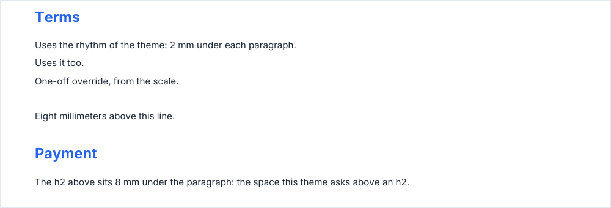

# Spacing

Vertical spacing follows three rules, so a document keeps one rhythm without any number in your code.

1. **One scale.** `SPACING` holds the steps, listed below. Every gap the library leaves is one of them; pick from it for
   a `spaceAfter` or an `addSpace`.
2. **The theme sets the rhythm.** `theme.spacing.block` is the space under every block: paragraph, list, table, box,
   fields, signatures, columns. `theme.spacing.heading` gives each heading level its space `before` and `after`. The few
   blocks with a default of their own say so in their options (`separator`, `logo`, `headerColumns`).
3. **Spaces collapse.** Two blocks are separated by the larger of the space the first leaves under it and the space the
   second asks above it, never by their sum: an h2 sits 12 mm under a paragraph and 12 mm under a table. There is no
   space before the first block of a page, and a block with nothing to draw (empty text, no item) leaves none.
   `addSpace(mm)` and `setYPos` are explicit: they never collapse, but `addSpace` does nothing at the top of a page.

<!-- preview: spacing -->



```ts
import { PDFDocument, SPACING, createTheme } from '@mlt-a/jspdf-toolkit';
import { interFonts } from '@mlt-a/jspdf-toolkit/fonts/inter';

// A denser document: less air under the blocks and above the sections.
const compact = createTheme({ spacing: { block: SPACING.small, heading: { h2: { before: SPACING.xlarge } } } });
const doc = new PDFDocument({ theme: compact, fonts: interFonts });

doc
  .heading('Terms', { level: 'h2' })
  .paragraph('Uses the rhythm of the theme: 2 mm under each paragraph.')
  .paragraph('Uses it too.')
  .paragraph('One-off override, from the scale.', { spaceAfter: SPACING.xlarge })
  .paragraph('Eight millimeters above this line.')
  .heading('Payment', { level: 'h2' })
  .paragraph('The h2 above sits 8 mm under the paragraph: the space this theme asks above an h2.');
```

The first h2 has no space above it: it opens the page.

## The scale

<!-- table: spacing-scale -->

| Step               | mm  |
| ------------------ | --- |
| `SPACING.none`     | 0   |
| `SPACING.xxsmall`  | 0.5 |
| `SPACING.xsmall`   | 1   |
| `SPACING.small`    | 2   |
| `SPACING.medium`   | 4   |
| `SPACING.large`    | 6   |
| `SPACING.xlarge`   | 8   |
| `SPACING.xxlarge`  | 12  |
| `SPACING.xxxlarge` | 16  |

<!-- /table -->

## The theme

`createTheme({ spacing })`:

<!-- options: SpacingOverrides -->

| Option    | Type                                                     | Default              | Description                                                                                                                                                                |
| --------- | -------------------------------------------------------- | -------------------- | -------------------------------------------------------------------------------------------------------------------------------------------------------------------------- |
| `block`   | `number`                                                 | `SPACING.medium` (4) | Space (mm) under a block (paragraph, list, table, box, fields, signatures, columns…) and between two paragraphs: the default `spaceAfter`.                                 |
| `heading` | `Partial<Record<HeadingLevel, Partial<HeadingSpacing>>>` |                      | Space (mm) above and under each heading level, `{ before, after }`: the default `spaceBefore` and `spaceAfter` of `heading`. A level or a side left out keeps its default. |

<!-- /options -->

The default space around each heading level, `DEFAULT_SPACING.heading`:

<!-- table: heading-spacing -->

| Level | `before` (mm) | `after` (mm) |
| ----- | ------------- | ------------ |
| `h1`  | 16            | 8            |
| `h2`  | 12            | 4            |
| `h3`  | 8             | 2            |
| `h4`  | 4             | 2            |

<!-- /table -->

## Attaching to the block above

A few blocks join the one above them instead of leaving the usual gap. In both cases below, the attachment ends at
anything between the two (another block, `addSpace`, `setYPos`, a page break), and at a frame: a block in an `inset` or
a column does not attach to one outside it. A block above that was given a `spaceAfter` is not attached to.

### A badge under a heading

A badge called right after a heading belongs to it: it sits `SPACING.small` (2 mm) under the heading, and leaves under
it the space the heading would have left. `heading('Acme Summit 2026').badge('Registration form')` keeps the title and
its label together, and the paragraph after them starts 8 mm under the badge, as it would under an h1.

- A heading given a `spaceAfter` keeps that space: the badge does not attach, and leaves `theme.spacing.block`.
- A `spaceAfter` given to the badge is the space under it, attached or not.

### Checkboxes in a group

A [checkbox](checkbox.md) called right after another sits `SPACING.small` (2 mm) under it. It keeps its own space
under it: `theme.spacing.block` unless it is given a `spaceAfter`, so the block after the last checkbox of a group
starts 4 mm under it. Checkboxes in a column attach to each other inside that column.

## Rules

- `spaceAfter` (mm) is available on nearly every block and always means the space under the block. A heading and a
  separator also take `spaceBefore`; a heading takes both from `theme.spacing.heading[level]`.
- A `spaceAfter` or `spaceBefore` is any finite number (a negative one pulls the next block up). A gap inside a block
  (`itemSpacing`, `rowGap`, `gap`) is 0 or more.
- **Throws** an `InvalidOptionError` from `createTheme` for a spacing that is not a finite number of 0 or more, and from
  a block for a `spaceAfter` that is not a finite number. A spacing of 0 is valid.
- `DEFAULT_SPACING` holds the defaults. A theme is always complete: a value left out of `spacing` keeps its default,
  level by level and side by side.
- A custom block joins the rhythm with `beginBlock(spaceBefore)` and `endBlock(bottom, spaceAfter?)`: see
  [custom components](custom-components.md).
