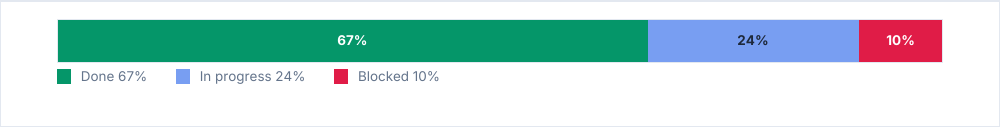

# stackedBar

Parts of a whole as the slices of one horizontal bar: a progress, a split. The percentages sit inside the slices wide
enough for them, the legend under the bar.

<!-- preview: stacked-bar -->



```ts
doc.stackedBar([
  { label: 'Done', value: 14, color: 'success' },
  { label: 'In progress', value: 5 },
  { label: 'Blocked', value: 2, color: 'error' },
]);
```

## Options

`stackedBar(slices, options?)`. A slice is the one of [donutChart](donut-chart.md#a-slice).

<!-- options: StackedBarOptions -->

| Option        | Type      | Default                       | Description                                                                                         |
| ------------- | --------- | ----------------------------- | --------------------------------------------------------------------------------------------------- |
| `width`       | `number`  | the available width           | Width (mm) of the bar, above 0. Wider than the available width: brought down to it, with a warning. |
| `height`      | `number`  | 9                             | Height (mm) of the bar, above 0.                                                                    |
| `legend`      | `boolean` | `true`                        | Legend under the bar: each slice with its percentage or `legendValue`.                              |
| `percentages` | `boolean` | `true`                        | Percentage inside the slices wide enough for it.                                                    |
| `emptyText`   | `string`  | none, the chart draws nothing | Line drawn when no slice has a value.                                                               |
| `spaceAfter`  | `number`  | `theme.spacing.block`         | Space (mm) under the chart.                                                                         |

<!-- /options -->

## Rules

- **Draws what it can**: a slice whose `value` is not a finite number above 0 is left out; with none left the chart
  draws nothing, or the `emptyText` line.
- **Percentages** are bold, in the lighter of the page and text colors over a slice that reaches a 3:1 contrast with
  it, in the other one over the others.
- **Throws** an `InvalidOptionError` for a `width` or a `height` that is not above 0, besides the checks every block
  makes (see [errors](errors.md#what-a-block-checks)). A slice left out is checked too.
- **Warns** when a `width` wider than the available width is brought down to it.
- **Across pages**: the chart is never split. One [taller than a page](flow-control.md#taller-than-a-page) overflows it,
  with a warning.
- **In a column**: the default width is the column's.
- `computeStackedBarHeight(ctx, slices, options)` returns the height of the chart, without `spaceAfter`.
