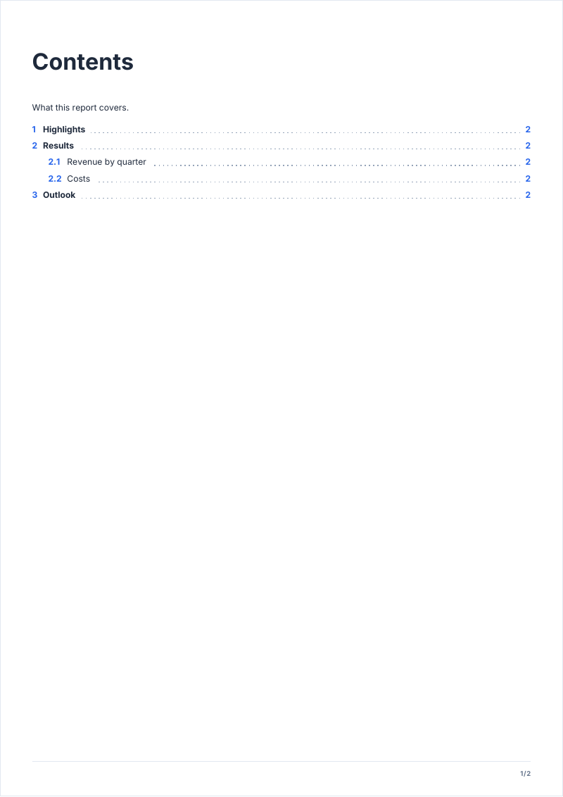

# tableOfContents

A table of contents filled from the headings, with their page numbers and links to them.

<!-- preview: table-of-contents page=1 -->



```ts
doc.tableOfContents({ title: 'Contents', intro: 'What this report covers.' });
doc
  .heading('Highlights', { number: '1' })
  .paragraph('The year in three figures.')
  .heading('Results', { number: '2' })
  .heading('Revenue by quarter', { level: 'h2', number: '2.1' })
  .paragraph('Revenue grew in every quarter.')
  .heading('Costs', { level: 'h2', number: '2.2' })
  .paragraph('Costs stayed flat.')
  .heading('Outlook', { number: '3' })
  .paragraph('What comes next.');
```

Declare it once, at the place it appears: it lists the headings of the whole document, those above it and those below
it. It is filled when the document is finalized, once every page number is known.

A page number is written as it is by default (`2`, `12`). `formatPage` writes it your way, to match a running header
that prints `02`, or to prefix it:

```ts
doc.tableOfContents({ formatPage: (page) => String(page).padStart(2, '0') });
doc.pageHeader({
  variant: 'custom',
  draw: (ctx, { page }) => ctx.doc.text(String(page).padStart(2, '0'), ctx.margins.left, 10),
});
doc.heading('Introduction').paragraph('Listed as 02 in the contents, like its header.');
```

## Options

`tableOfContents(options?)`:

<!-- options: TableOfContentsOptions -->

| Option       | Type                       | Default                       | Description                                                                                                                                                                                                                             |
| ------------ | -------------------------- | ----------------------------- | --------------------------------------------------------------------------------------------------------------------------------------------------------------------------------------------------------------------------------------- |
| `title`      | `string`                   | `'Contents'`                  | Title of the table, drawn as an `h1` that the table does not list.                                                                                                                                                                      |
| `intro`      | `string`                   |                               | A few sentences under the title.                                                                                                                                                                                                        |
| `depth`      | `1 \| 2 \| 3 \| 4`         | 2                             | Deepest heading level listed (`1` = h1 … `4` = h4). A heading's `toc` option overrides it.                                                                                                                                              |
| `formatPage` | `(page: number) => string` | the number itself (`2`, `12`) | Writes the page number of an entry: receives the number printed in the footer (from 1, covers not counted) and returns the text shown, e.g. `String(page).padStart(2, '0')` to match a running header. An empty string shows no number. |

<!-- /options -->

## Rules

- **Throws** an `InvalidOptionError` for a `depth` that is not a whole number from 1 to 4, a `formatPage` that is not
  a function, besides the checks every block makes (see [errors](errors.md#what-a-block-checks)). A `formatPage`
  that returns something other than a string throws the same error, when the document is finalized and before
  anything of the table is drawn.
- **Page number text**: `formatPage` receives the number printed in the footer (from 1, covers not counted, as in
  `doc.pageLabels`), once the entries have their final pages: it is only called with the numbers of pages the document
  has. The column of numbers, the dotted leaders and the wrapping of the labels follow the text it returns, the widest
  of the numbers the entries can reach. An empty string shows no number: the entry keeps its dotted leader and its
  link. The links go to the page whatever the text.
- **Warns** when it is declared twice: only the first table is filled.
- **Nothing to list**: when no heading falls within `depth`, the table is left empty with a warning. Its page is
  removed when it holds nothing but the table; when other content shares it, the page stays.
- **What is listed**: the headings of the numbered pages; a heading on a cover has no page number to point to and is
  not listed. A [heading](heading.md) opts in or out with its own `toc` option, whatever the `depth`. Entries are links:
  a click goes to the heading.
- **Across pages**: the content that follows starts on a new page; a long list gets continuation pages.
- **In a column**: `tableOfContents` is a page method: the table spans the whole page.
