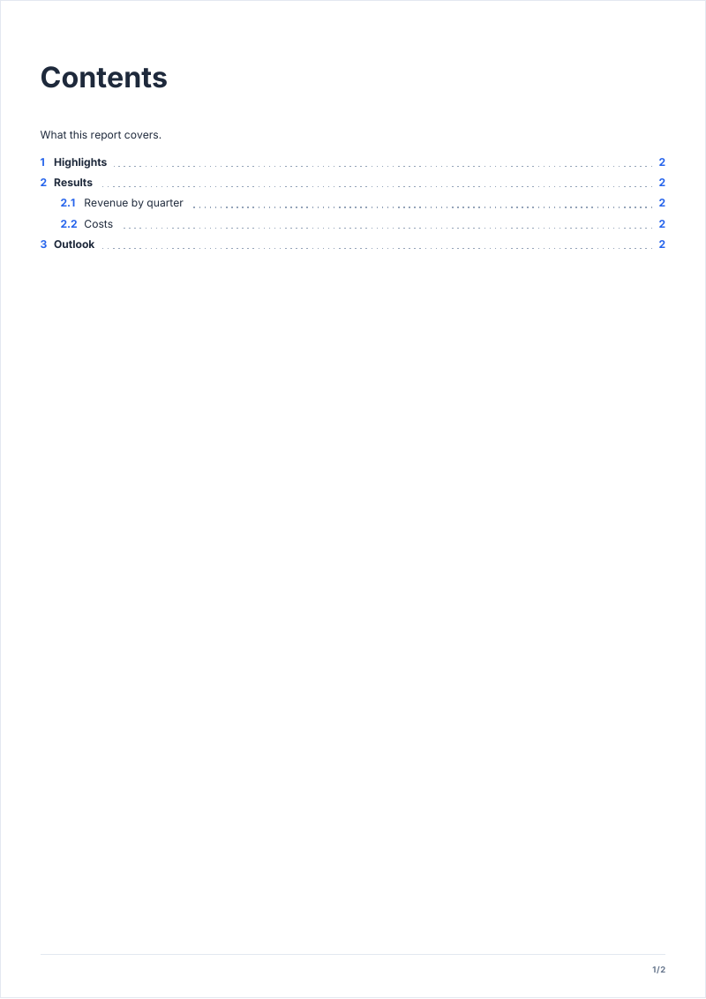

# tableOfContents

A table of contents filled from the headings, with their page numbers and links to them.

<!-- preview: table-of-contents page=1 -->



```ts
doc.tableOfContents({ title: 'Contents', intro: 'What this report covers.' });
doc
  .heading('Highlights', { number: '1' })
  .paragraph('The year in three figures.')
  .heading('Results', { number: '2' })
  .heading('Revenue by quarter', { level: 'h2', number: '2.1' })
  .paragraph('Revenue grew in every quarter.')
  .heading('Costs', { level: 'h2', number: '2.2' })
  .paragraph('Costs stayed flat.')
  .heading('Outlook', { number: '3' })
  .paragraph('What comes next.');
```

Declare it once, at the place it appears: it lists the headings of the whole document, those above it and those below
it. It is filled when the document is finalized, once every page number is known.

## Options

`tableOfContents(options?)`:

<!-- options: TableOfContentsOptions -->

| Option  | Type               | Default      | Description                                                                                |
| ------- | ------------------ | ------------ | ------------------------------------------------------------------------------------------ |
| `title` | `string`           | `'Contents'` | Title of the table, drawn as an `h1` that the table does not list.                         |
| `intro` | `string`           |              | A few sentences under the title.                                                           |
| `depth` | `1 \| 2 \| 3 \| 4` | 2            | Deepest heading level listed (`1` = h1 … `4` = h4). A heading's `toc` option overrides it. |

<!-- /options -->

## Rules

- **Throws** an `InvalidOptionError` for a `depth` that is not a whole number from 1 to 4, besides the checks every
  block makes (see [errors](errors.md#what-a-block-checks)).
- **Warns** when it is declared twice: only the first table is filled.
- **Nothing to list**: when no heading falls within `depth`, the table is left empty with a warning. Its page is
  removed when it holds nothing but the table; when other content shares it, the page stays.
- **What is listed**: the headings of the numbered pages; a heading on a cover has no page number to point to and is
  not listed. A [heading](heading.md) opts in or out with its own `toc` option, whatever the `depth`. Entries are links:
  a click goes to the heading.
- **Across pages**: the content that follows starts on a new page; a long list gets continuation pages.
- **In a column**: `tableOfContents` is a page method: the table spans the whole page.
