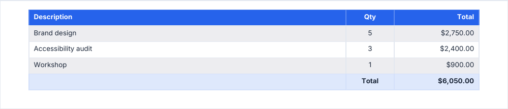
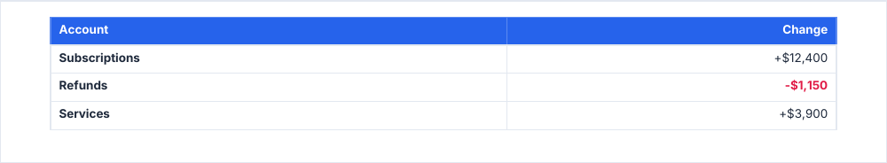

# table

A themed table that sizes its columns from their content and continues across pages.

<!-- preview: table -->



```ts
doc.table(
  [
    { description: 'Brand design', qty: 5, total: '$2,750.00' },
    { description: 'Accessibility audit', qty: 3, total: '$2,400.00' },
    { description: 'Workshop', qty: 1, total: '$900.00' },
  ],
  {
    columns: [
      { header: 'Description', key: 'description' },
      { header: 'Qty', key: 'qty', width: 20, align: 'center' },
      { header: 'Total', key: 'total', width: 35, align: 'right' },
    ],
    footRow: ['', 'Total', '$6,050.00'],
  },
);
```

`data` holds one record per row; each column reads its `key`. A value is a string or a number; `null` and `undefined`
leave the cell empty.

## Styling cells

`cellStyle` is called for every cell and returns the style of that one: here, negative amounts in the error color and a
bold first column. It may run more than once per cell (`keepTogether` measures first): keep it free of side effects.

<!-- preview: table-cell-style -->



```ts
doc.table(
  [
    { account: 'Subscriptions', change: '+$12,400' },
    { account: 'Refunds', change: '-$1,150' },
    { account: 'Services', change: '+$3,900' },
  ],
  {
    columns: [
      { header: 'Account', key: 'account' },
      { header: 'Change', key: 'change', align: 'right' },
    ],
    alternateRowFill: false,
    cellStyle: ({ section, columnIndex, text }) => {
      if (section !== 'body') return undefined;
      if (text.startsWith('-')) return { color: 'error', bold: true };
      return columnIndex === 0 ? { bold: true } : undefined;
    },
  },
);
```

## A column

<!-- options: TableColumn -->

| Option   | Type               | Default  | Description                                                                                                                                                                                                                                                                                                                                  |
| -------- | ------------------ | -------- | -------------------------------------------------------------------------------------------------------------------------------------------------------------------------------------------------------------------------------------------------------------------------------------------------------------------------------------------- |
| `header` | `string`           | required | Text of the head cell.                                                                                                                                                                                                                                                                                                                       |
| `key`    | `string`           | required | Key of the row record whose value fills the cells of this column; a missing key gives an empty cell.                                                                                                                                                                                                                                         |
| `width`  | `number \| 'auto'` | `'auto'` | Width (mm): a finite number above 0, else `InvalidOptionError`. `'auto'` or absent: the column is sized from its content, and the automatic columns share what the fixed ones leave of the content width. A table whose columns are all fixed is as wide as their sum, up to the content width (wider ones are scaled down, with a warning). |
| `align`  | `TextAlign`        | `'left'` | Horizontal alignment of the column, head cell included.                                                                                                                                                                                                                                                                                      |

<!-- /options -->

## Options

`table(data, options)`:

<!-- options: TableOptions -->

| Option              | Type                                                      | Default               | Description                                                                                                                                                                                                                                                                                                                                                                            |
| ------------------- | --------------------------------------------------------- | --------------------- | -------------------------------------------------------------------------------------------------------------------------------------------------------------------------------------------------------------------------------------------------------------------------------------------------------------------------------------------------------------------------------------- |
| `columns`           | `TableColumn[]`                                           | required              | Columns, left to right. At least one, else `InvalidOptionError`.                                                                                                                                                                                                                                                                                                                       |
| `showHead`          | `'everyPage' \| 'firstPage' \| 'never'`                   | `'everyPage'`         | Pages that show the head row: every page of the table, its first page only, or none.                                                                                                                                                                                                                                                                                                   |
| `alternateRowFill`  | `boolean`                                                 | `true`                | Zebra stripes on every other body row, the first included, in `colors.zebraFill`.                                                                                                                                                                                                                                                                                                      |
| `continuationTitle` | `string`                                                  |                       | Bold line drawn above the table on each page it continues on, e.g. `'Orders (continued)'`.                                                                                                                                                                                                                                                                                             |
| `footRow`           | `TableCell[]`                                             |                       | Closing row, one cell per column, in bold on the `tint` fill. It stays with the last body row.                                                                                                                                                                                                                                                                                         |
| `cellStyle`         | `(cell: TableCellContext) => TableCellStyle \| undefined` |                       | Styles cells one by one, e.g. a negative amount in the error color: `({ section, text }) => (section === 'body' && text.startsWith('-') ? { color: 'error' } : undefined)`. Asked about every cell drawn: head (unless `showHead: 'never'`), body and foot. It may be called more than once for the same cell (`keepTogether` measures before it draws): keep it free of side effects. |
| `spaceAfter`        | `number`                                                  | `theme.spacing.block` | Space (mm) under the table.                                                                                                                                                                                                                                                                                                                                                            |

<!-- /options -->

`cellStyle` receives:

<!-- options: TableCellContext -->

| Option        | Type                         | Default  | Description                                                                |
| ------------- | ---------------------------- | -------- | -------------------------------------------------------------------------- |
| `section`     | `'head' \| 'body' \| 'foot'` | required | `head` for the head row, `body` for a row of `data`, `foot` for `footRow`. |
| `rowIndex`    | `number`                     | required | Index of the row in `data` for a body cell; 0 for the head and the foot.   |
| `columnIndex` | `number`                     | required | Index of the column in `columns`.                                          |
| `column`      | `TableColumn`                | required | The column of the cell.                                                    |
| `text`        | `string`                     | required | The cell text: the value as printed, `''` for an empty cell.               |
| `row`         | `TableRow`                   |          | The record of a body row; absent for the head and the foot.                |

<!-- /options -->

and returns:

<!-- options: TableCellStyle -->

| Option   | Type         | Default                                                                    | Description                                 |
| -------- | ------------ | -------------------------------------------------------------------------- | ------------------------------------------- |
| `color`  | `ColorInput` |                                                                            | Text color.                                 |
| `fill`   | `ColorInput` |                                                                            | Cell fill.                                  |
| `bold`   | `boolean`    | bold in the head and the foot, the weight of the `small` level in the body | Bold text; `false` removes the weight too.  |
| `italic` | `boolean`    | the slant of the `small` level                                             | Italic text; `false` removes the slant too. |
| `align`  | `TextAlign`  | the column `align`                                                         | Horizontal alignment of the cell.           |

<!-- /options -->

## Rules

- **Throws** an `InvalidOptionError` for no column and a column `width` that is neither `'auto'` nor above 0, besides
  the checks every block makes (see [errors](errors.md#what-a-block-checks)); an `InvalidColorError` for a color
  `cellStyle` returns that is invalid. A table without a row draws its head row.
- **Warns** when the widths of the columns add up to more than the available width: they are scaled down to fit.
- **Width**: the table spans the available width, unless every column has a fixed `width`: it is then as wide as their
  sum. A column without `width` is sized from its content and shares what the fixed ones leave.
- **Across pages**: rows never split. The head row is repeated on each page (`showHead`), `continuationTitle` is drawn
  above the table on each page it continues on, and the foot row stays with the last body row. A row
  [taller than a page](flow-control.md#taller-than-a-page) overflows it, with a warning.
- **In a column**: the table spans the column.
