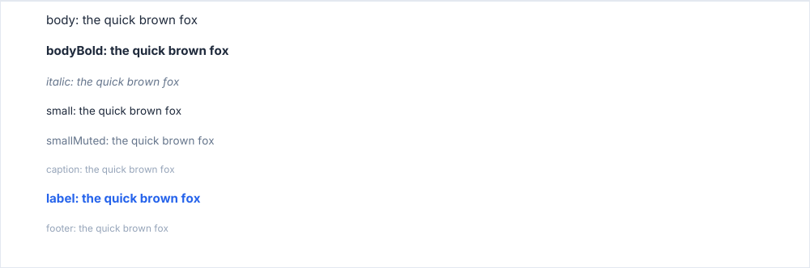
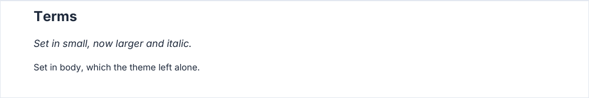

# Text levels

The text of the blocks is set in 14 levels. A level is a size, a weight, a slant, a color and a font family:
`paragraph`, `badge`, `closingNote` and the other text blocks take a `level` option, and the theme restyles a level once
for every block set in it. The running header and footer and the watermark have a style of their own (see the rules).

<!-- preview: text-levels -->



```ts
import type { TextLevel } from '@mlt-a/jspdf-toolkit';

const levels: TextLevel[] = ['body', 'bodyBold', 'italic', 'small', 'smallMuted', 'caption', 'label', 'footer'];
for (const level of levels) doc.paragraph(`${level}: the quick brown fox`, { level });
```

## The levels

<!-- table: text-levels -->

| Level        | Size (`typography.sizes`) | Weight  | Slant   | Color       | Family  |
| ------------ | ------------------------- | ------- | ------- | ----------- | ------- |
| `h1`         | `h1`, 24 pt               | bold    | upright | `text`      | `title` |
| `h2`         | `h2`, 14 pt               | bold    | upright | `primary`   | `title` |
| `h3`         | `h3`, 10 pt               | bold    | upright | `text`      | `body`  |
| `h4`         | `h4`, 8 pt                | bold    | upright | `secondary` | `body`  |
| `body`       | `body`, 9 pt              | regular | upright | `text`      | `body`  |
| `bodyBold`   | `body`, 9 pt              | bold    | upright | `text`      | `body`  |
| `small`      | `small`, 8 pt             | regular | upright | `text`      | `body`  |
| `smallMuted` | `small`, 8 pt             | regular | upright | `secondary` | `body`  |
| `caption`    | `caption`, 7 pt           | regular | upright | `subtle`    | `body`  |
| `label`      | `label`, 9 pt             | bold    | upright | `primary`   | `label` |
| `fieldLabel` | `fieldLabel`, 8 pt        | bold    | upright | `secondary` | `label` |
| `fieldValue` | `fieldValue`, 10 pt       | regular | upright | `text`      | `body`  |
| `footer`     | `footer`, 7 pt            | regular | upright | `subtle`    | `body`  |
| `italic`     | `small`, 8 pt             | regular | italic  | `secondary` | `body`  |

<!-- /table -->

The table is read from the library. The `title` family is `typography.titleFontFamily`, the `label` family
`labelFontFamily`; both fall back to the default family, `body`.

## Restyling a level

`typography.sizes` sets the size of a group of levels, and `typography.levels` restyles a level itself: its `color`,
`bold`, `italic` and `font` (`'body'`, `'title'` or `'label'`). What a level leaves out keeps its built-in style.

<!-- preview: text-levels-theme -->



```ts
import { PDFDocument, createTheme } from '@mlt-a/jspdf-toolkit';
import { interFonts } from '@mlt-a/jspdf-toolkit/fonts/inter';

const doc = new PDFDocument({
  fonts: interFonts,
  theme: createTheme({
    typography: {
      sizes: { small: 10 },
      levels: {
        h2: { color: 'text' }, // section headings in the text color rather than the primary one
        small: { italic: true },
      },
    },
  }),
});

doc
  .heading('Terms', { level: 'h2' })
  .paragraph('Set in small, now larger and italic.', { level: 'small' })
  .paragraph('Set in body, which the theme left alone.');
```

<!-- options: TextLevelStyle -->

| Option   | Type         | Default | Description                                                                                   |
| -------- | ------------ | ------- | --------------------------------------------------------------------------------------------- |
| `color`  | `ColorInput` |         | Text color: a palette token or a hex color.                                                   |
| `bold`   | `boolean`    |         | Bold face, through `typography.weights`.                                                      |
| `italic` | `boolean`    |         | Italic style on top of the weight.                                                            |
| `font`   | `FontRole`   |         | Family the level is set in: the default one (`body`), `titleFontFamily` or `labelFontFamily`. |

<!-- /options -->

## Rules

- **Throws** from `createTheme` an `InvalidOptionError` for a size that is not a finite number above 0, an unknown level
  or `font`, a `bold` or `italic` that is not a boolean, and a weight face other than `'normal'` or `'bold'`; an
  `InvalidColorError` for a `color` that is neither a palette token nor a hex color. A block asked for an unknown
  `level` throws as well.
- **Which blocks follow**: paragraphs, headings, lists, table cells, fields, boxes and `measureTextLevel`. Charts read
  `smallMuted`, `caption`, `small` and `bodyBold`.
- **Outside the levels**: the running header and footer take the family and weight of `label` at the size of
  `footer`, in `secondary`, whatever the theme gives those levels; `theme.chrome` sets their capitals and letter
  spacing. A watermark is set in the bold `body` family at its own `fontSize` and `color`.
- **An emphasis a block asks for wins** over the level: `bold: false` or `italic: false` in a table `cellStyle` removes
  the weight or the slant a level gives, `true` adds it.
- **A block that picks a color of its own** keeps it unless the theme chose a color for that level: the title of a
  numbered heading stays in the text color, the labels of fields take the color of `fieldLabel`, the eyebrow of a
  callout keeps its accent and `closingNote` stays `secondary`. A `color` option given to the block overrides both.
- **Warns** when the family has no face for the weight and slant a level asks for: the closest face is used.
