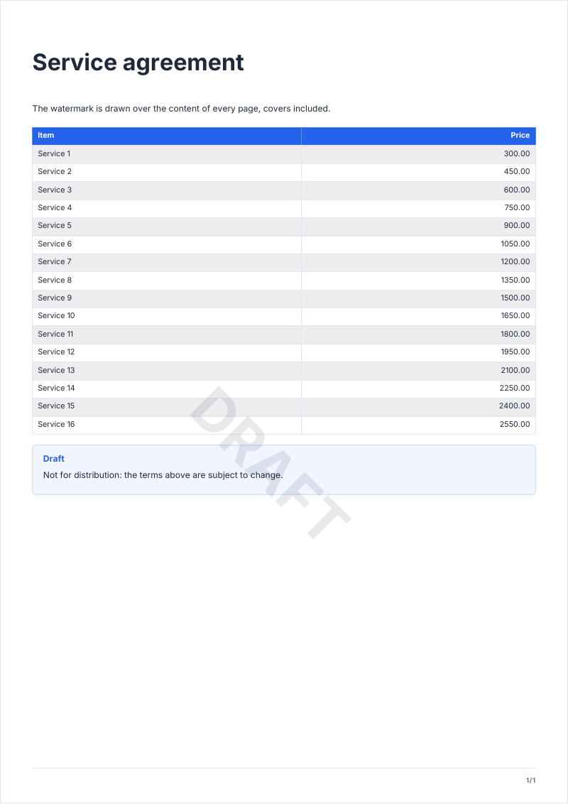

# watermark

A large translucent text across the page: a draft, a copy, a specimen.

<!-- preview: watermark page=1 -->



```ts
doc.watermark('DRAFT', { allPages: true, opacity: 0.1 });
doc
  .heading('Service agreement')
  .paragraph('The watermark is drawn over the content of every page, covers included.')
  .table(
    Array.from({ length: 16 }, (_, index) => ({ item: `Service ${index + 1}`, price: `${(index + 2) * 150}.00` })),
    {
      columns: [
        { header: 'Item', key: 'item' },
        { header: 'Price', key: 'price', align: 'right' },
      ],
    },
  )
  .infoBox('Not for distribution: the terms above are subject to change.', { title: 'Draft' });
```

`finalize()` draws the watermarks last, over everything else on the page: the content, filled boxes and tables, the
running header and footer. The text stays readable through it, as the watermark is translucent. The order of the calls
does not matter: a watermark called before or after the content of its page gives the same page.

## Options

`watermark(text, options?)`:

<!-- options: WatermarkOptions -->

| Option     | Type         | Default                                              | Description                                                                                                                     |
| ---------- | ------------ | ---------------------------------------------------- | ------------------------------------------------------------------------------------------------------------------------------- |
| `allPages` | `boolean`    | `false`, the page where `watermark()` is called only | Every page, added before or after the call: content, table continuation, table of contents, blank pages, covers and back cover. |
| `opacity`  | `number`     | 0.08                                                 | Opacity, from 0 (invisible) to 1 (solid).                                                                                       |
| `angle`    | `number`     | -45                                                  | Rotation (degrees) around the page center; positive turns counter-clockwise.                                                    |
| `fontSize` | `number`     | 60                                                   | Font size (pt), in bold body text.                                                                                              |
| `color`    | `ColorInput` | `'text'`                                             | Color of the text, made translucent by `opacity`.                                                                               |

<!-- /options -->

## Rules

- **Throws** an `InvalidOptionError` for an `opacity` outside 0 to 1 and a `fontSize` that is not above 0, besides the
  checks every block makes (see [errors](errors.md#what-a-block-checks)). An empty text draws nothing.
- **Pages**: without `allPages`, only the page where it is called is marked, the one a `keepTogether` block lands on
  included; it stays on that page when the table of contents inserts pages before it. With `allPages`, every page,
  added before or after the call: covers, blank pages, back cover and the pages of the table of contents included.
- **Order**: on each page, the `allPages` watermarks come first, then those of the page, in call order.
- **After `finalize()`**: a watermark is drawn at once, with the warning of any drawing after `finalize()`. A page
  added after `finalize()` carries the `allPages` watermarks under its content: nothing is drawn after it.
- **In a column**: `watermark` is a page method: it marks the whole page.
